# Assignment 02 — Provision Linux VMs with Terraform and Run Ansible Ad-Hoc Commands

Part of the DevOps Micro Internship (DMI) Cohort 3 with Agentic AI

---

## Purpose

In this assignment, you will use Terraform to provision three or four Ubuntu Linux Virtual Machines on either Microsoft Azure or Amazon Web Services.

You will configure SSH key-based authentication, organize the servers using a custom Ansible inventory, and run Ansible ad-hoc commands across individual hosts and inventory groups.

---

# Task 1 — Create the Multi-Host Lab Structure

## Goal

Create a separate project directory for the multi-host lab and prepare the Terraform, Ansible, and documentation files.

This project will use the Git repository and Ansible controller prepared in Assignment 01.

### Evidence

#### Screenshot 1 — Terminal showing the complete `ansible-adhoc-lab` project structure

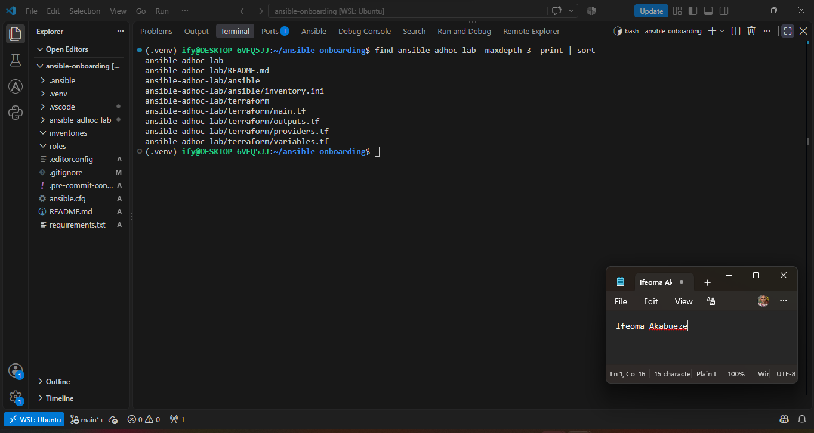

---

#### Screenshot 2 — Terminal showing `git status --short` with the new project files and updated `.gitignore`

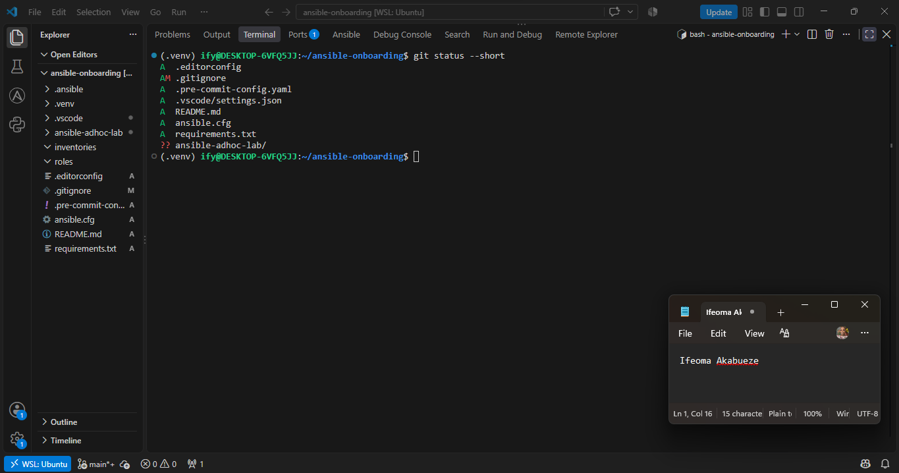

---

### Notes

I created the ansible-adhoc-lab project inside my existing ansible-onboarding repository, with separate terraform/ and ansible/ folders so the infrastructure code and the Ansible inventory stay organized. I did not run git init inside the lab folder, because the Assignment 01 repository already tracks it.

I updated the existing .gitignore by appending Terraform rules for .terraform/, *.tfstate, *.tfstate.*, *.tfplan, and crash logs, while keeping the original Assignment 01 rules. I also added *.tfvars, because my terraform.tfvars file contains my controller’s public IP. I deliberately did not ignore .terraform.lock.hcl, because it pins provider versions so everyone uses the same ones.

Running git status --short confirmed that .gitignore was modified and ansible-adhoc-lab/ appeared as new, with no state files listed. My AWS credentials are stored in ~/.aws/ and my SSH keys in ~/.ssh/, both outside the project directory.

---

# Task 2 — Create the Terraform Configuration

## Goal

Create the Terraform configuration required to provision three or four Ubuntu Linux VMs on your selected cloud platform.

Complete only one option:

- Option A — Microsoft Azure
- Option B — Amazon Web Services

Do not configure both providers for this assignment.

### Evidence

#### Screenshot 3 — Terraform configuration showing the three or four server roles and the `for_each` or `count` implementation

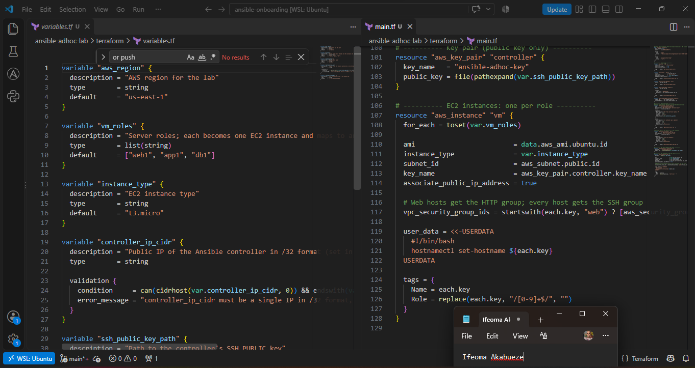

---

#### Screenshot 4 — Terraform configuration showing SSH restricted to the controller IP and HTTP allowed only for web hosts

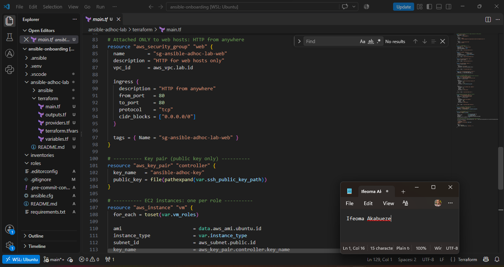

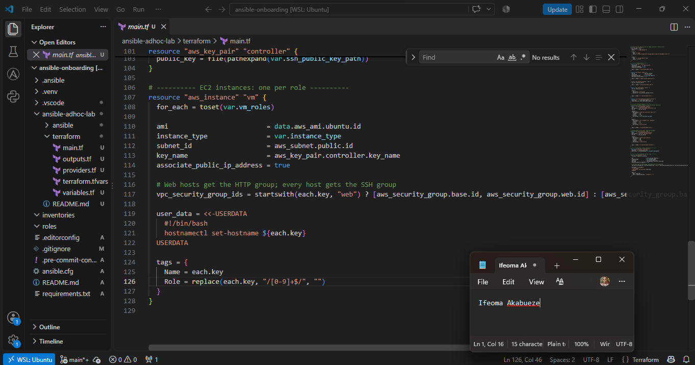

---

#### Screenshot 5 — Terraform output configuration showing how public IP addresses are associated with the server roles

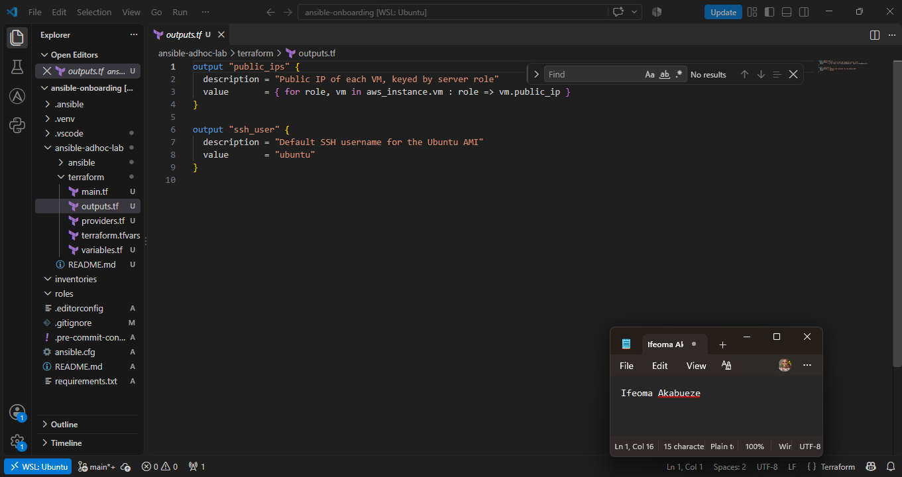

---

### Notes

I chose AWS (us-east-1) and the three-VM option (web1, app1, db1) to stay within quota and keep costs low. I split the configuration into providers.tf, variables.tf, main.tf, and outputs.tf. The AWS provider uses the credentials saved by aws configure, so no credentials are stored in the Terraform files.

The server roles are defined once in the vm_roles variable. A single aws_instance block uses for_each = toset(var.vm_roles) to create all three instances, so there are no repeated resource blocks. Each instance is tagged with its role, and the hostname is set to match it. Instead of hard-coding an AMI ID, which differs between regions, I used a data "aws_ami" lookup that finds the latest official Ubuntu 24.04 LTS image from Canonical.

For networking, I created the VPC, a public subnet, an internet gateway, and a route table. Security is split into two groups: sg-ansible-adhoc-lab allows SSH only from my controller’s public IP (/32) and is attached to every instance, while sg-ansible-adhoc-lab-web allows HTTP from anywhere and is attached only to web hosts, using a startswith(each.key, "web") condition. A validation rule on controller_ip_cidr rejects anything that is not a single /32 address, so SSH can never be opened to 0.0.0.0/0. My IP is stored in terraform.tfvars, which is excluded from Git.

The ansible-adhoc-key key pair uploads only my public key (~/.ssh/id_ed25519.pub) using file(pathexpand(...)). The private key is never referenced. The public_ips output uses a for expression to build a map from each role to its public IP, which makes it easy to build the Ansible inventory. I ran terraform fmt to format the files and did not run terraform apply in this task.

---

# Task 3 — Provision the Infrastructure with Terraform

## Goal

Initialize and validate the Terraform configuration, review the execution plan, provision the selected three or four VMs, and retrieve their public IP addresses.

### Evidence

#### Screenshot 6 — Final `terraform apply` output showing `Apply complete`

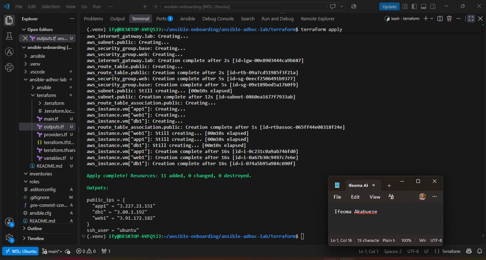

---

#### Screenshot 7 — `terraform output public_ips` showing the role-to-IP mapping for all three or four VMs

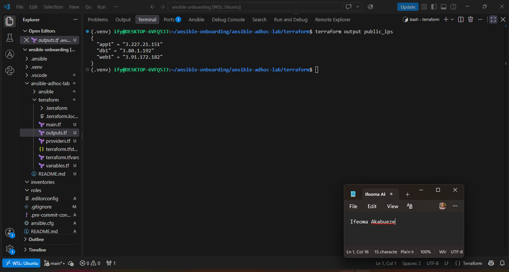

---

#### Screenshot 8 — Azure Portal or AWS Management Console showing all three or four VMs in the `Running` state, with their role-based names visible

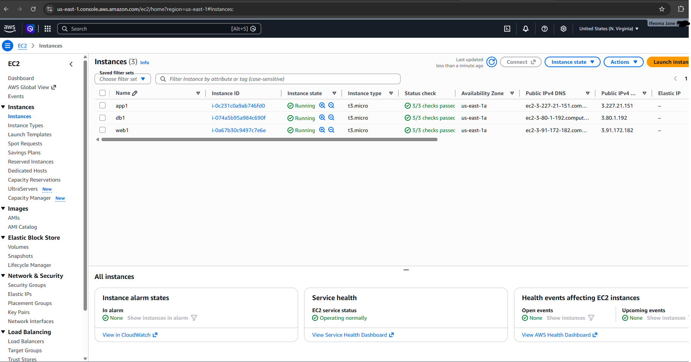

---

### Notes

From the terraform directory, I ran terraform fmt and terraform fmt -check to confirm consistent formatting. terraform init downloaded the AWS provider (v6.69.1) and created .terraform.lock.hcl, which pins the provider version. Running terraform validate exposed an error: AWS does not allow security group names to begin with sg-, because that prefix is reserved for security group IDs. I fixed it by removing sg- from the name values (ansible-adhoc-lab and ansible-adhoc-lab-web) while keeping the Name tags as sg-ansible-adhoc-lab and sg-ansible-adhoc-lab-web, so the required names still appear in the EC2 console. Validation then passed.

Before applying, I reviewed the terraform plan output and confirmed that it would create exactly three t3.micro instances (web1, app1, db1) in us-east-1, with SSH allowed only from my controller’s public IP (/32), HTTP allowed only through the web security group, the ansible-adhoc-key key pair using my public key, and no resources being changed or destroyed (Plan: 11 to add, 0 to change, 0 to destroy).

terraform apply completed successfully with 11 resources added. Terraform created them in dependency order: the VPC and internet gateway first, then the subnet, route table, and security groups, and finally the three instances. The public_ips output mapped each role to its public IP, and I confirmed in the EC2 console that all three instances were running with their role-based names. I also confirmed with git status --short that .terraform/, terraform.tfstate, and terraform.tfvars are excluded from Git.

---

# Task 4 — Verify SSH Key-Based Access

## Goal

Verify that each managed VM can be accessed from the Ansible controller using SSH key-based authentication.

### Evidence

#### Screenshot 9 — Terminal showing successful SSH hostname output from all VMs

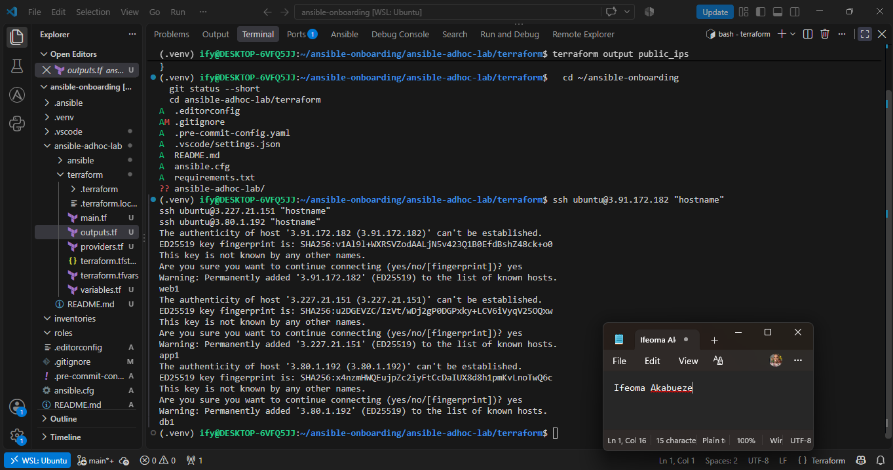

---

### Notes

The SSH public key was attached to all three instances through Terraform: the aws_key_pair resource uploaded ~/.ssh/id_ed25519.pub to AWS as ansible-adhoc-key, and each aws_instance references it with key_name. I got each VM’s public IP from terraform output public_ips and tested access from the Ansible controller with ssh ubuntu@<ip> "hostname", using ubuntu, the default user for official Ubuntu AMIs.

On the first connection to each VM, SSH displayed the server’s ED25519 fingerprint and asked me to confirm it, because my SSH config uses StrictHostKeyChecking ask. After I typed yes, each fingerprint was saved to ~/.ssh/known_hosts, so later connections did not prompt again.

All three VMs returned their hostnames (web1, app1, and db1) without asking for a remote password, which confirms that key-based authentication is working and that SSH is reachable from my controller’s IP through the security group. The hostnames match the server roles because the Terraform user_data script ran hostnamectl set-hostname on first boot.

---

# Task 5 — Create the Custom Ansible Inventory

## Goal

Create an Ansible inventory file that groups the managed VMs by role.

The inventory allows Ansible to run commands against all servers, or only specific groups such as `web`, `app`, or `db`.

### Evidence

#### Screenshot 10 — `inventory.ini` showing the `web`, `app`, and `db` groups

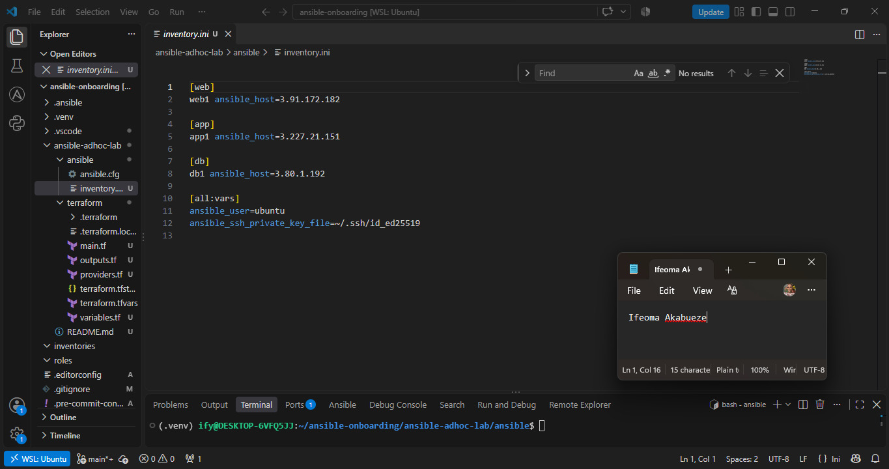

---

#### Screenshot 11 — Output of `ansible-inventory -i inventory.ini --graph`

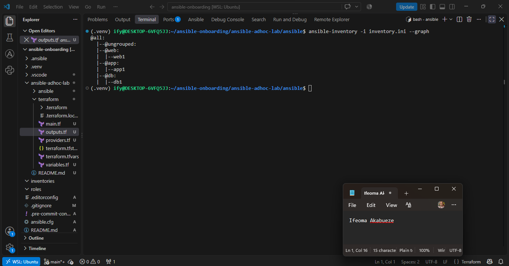

---

### Notes

I created inventory.ini in the ansible-adhoc-lab/ansible directory and grouped the VMs by role: web1 in [web], app1 in [app], and db1 in [db]. Each host uses a friendly alias with ansible_host set to its public IP from the Terraform public_ips output, so Ansible output shows role names instead of bare IP addresses. Under [all:vars], I set ansible_user=ubuntu and ansible_ssh_private_key_file=~/.ssh/id_ed25519, so every host uses the same login and key. The inventory only stores the path to the private key; the key itself stays in ~/.ssh, outside the project.

I also created a local ansible.cfg with host_key_checking = False to avoid fingerprint prompts when Ansible connects to several new VMs at once. This setting is only for this temporary lab; in production, host key checking should stay enabled. Because Ansible uses the ansible.cfg in the current directory first, this file takes priority over my Assignment 01 configuration when I run commands from this folder, so I pass -i inventory.ini explicitly in each command.

Running ansible-inventory -i inventory.ini --graph confirmed that Ansible reads the inventory correctly and shows the web, app, and db groups with their hosts under @all

---

# Task 6 — Run Ansible Ad-Hoc Commands

## Goal

Run Ansible ad-hoc commands from the controller to verify connectivity, check server information, and manage packages and services across inventory groups.

This task proves that the inventory is working and that Ansible can control multiple managed VMs without writing a playbook.

### Evidence

#### Screenshot 12 — Output of `ansible all -i inventory.ini -m ping`

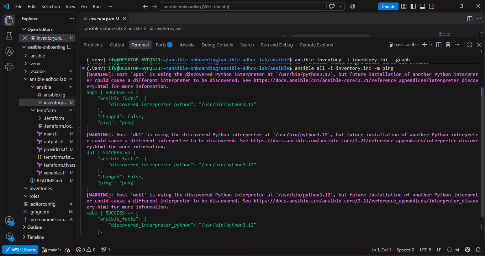

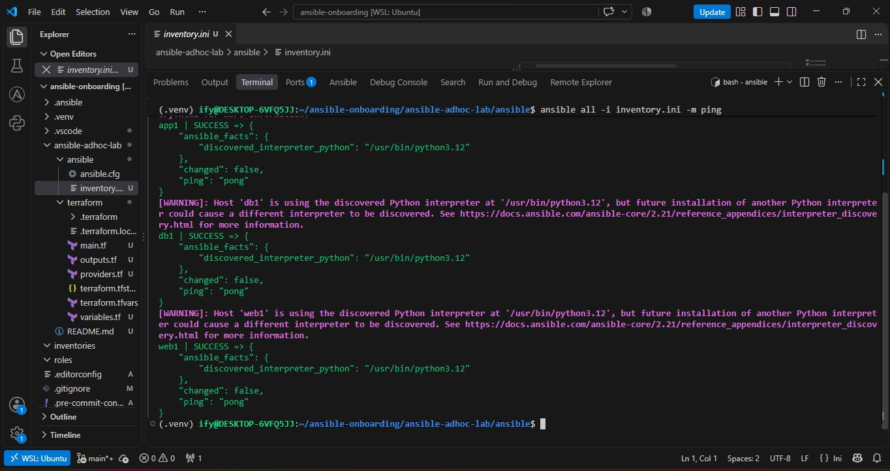

---

#### Screenshot 13 — Output of `ansible all -i inventory.ini -m command -a "uptime"`

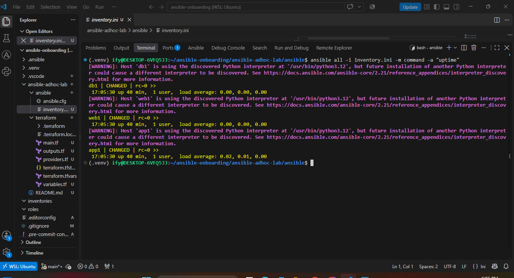

---

#### Screenshot 14 — Output of `ansible web -i inventory.ini -m apt -a "name=nginx state=present update_cache=yes" --become`

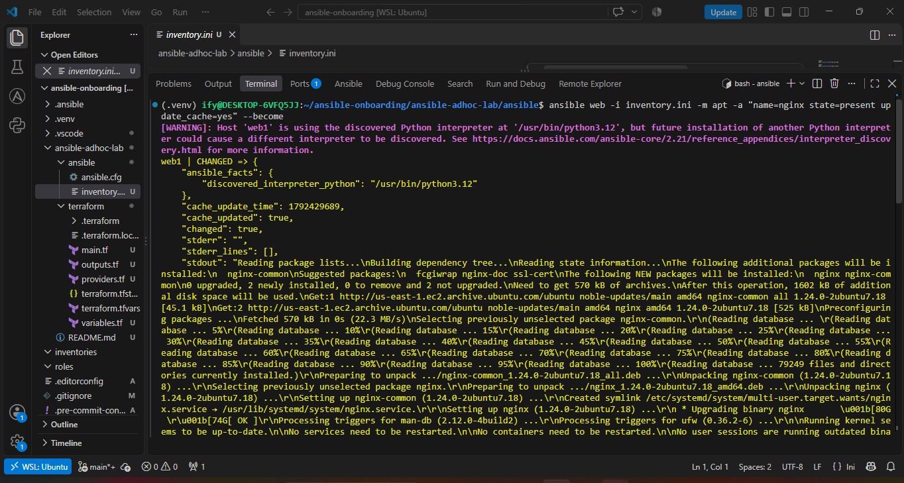

---

#### Screenshot 15 — Output of `ansible web -i inventory.ini -m service -a "name=nginx state=started enabled=yes" --become`

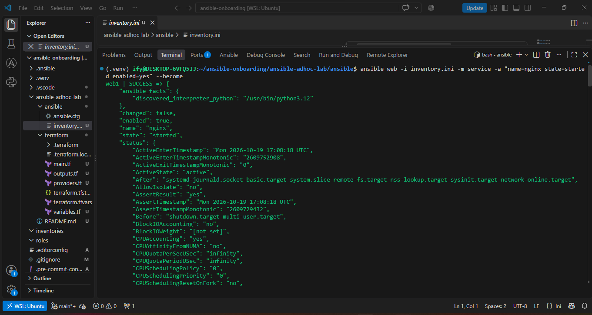

---

#### Screenshot 16 — Output of `ansible all -i inventory.ini -m apt -a "name=htop state=present update_cache=yes" --become`

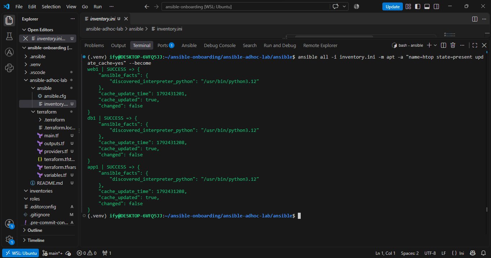

---

#### Screenshot 17 — Output of `ansible web -i inventory.ini -m command -a "systemctl is-active nginx"`

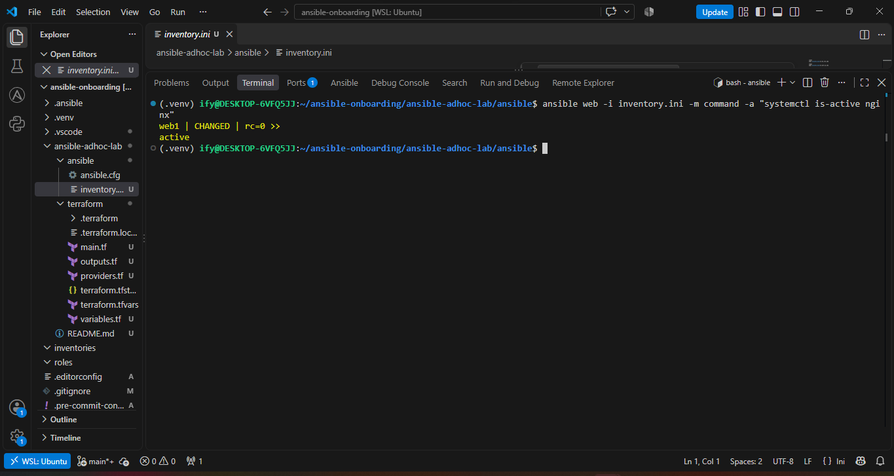

---

### Notes

From the ansible-adhoc-lab/ansible directory, I ran ad-hoc commands against the inventory using the pattern ansible <target> -i inventory.ini -m <module> -a "<arguments>", adding --become for tasks that need sudo. The ping module returned SUCCESS with "pong" for web1, app1, and db1. This is not an ICMP ping; it confirms that Ansible can connect over SSH and run Python on each host. On the first run, Ansible showed a warning about the discovered Python interpreter (/usr/bin/python3.12). This happened because the lab’s local ansible.cfg takes priority over my Assignment 01 configuration, so I added interpreter_python = auto_silent to the lab config to silence it.

Using the command module, whoami returned ubuntu on all hosts, uptime showed how long each VM had been running, df -h reported disk usage on the db group only, and free -m showed memory usage across all hosts. These demonstrate targeting all hosts as well as a single group.

I installed Nginx on the web group only with the apt module and --become, which returned CHANGED because the package was newly installed. The service module with state=started enabled=yes returned SUCCESS with "changed": false, because Ubuntu had already started and enabled Nginx during installation. This shows Ansible’s idempotency: it only makes changes when the current state differs from the desired state. Installing htop on all hosts also returned SUCCESS with no changes, since it is preinstalled on Ubuntu cloud images. Finally, systemctl is-active nginx returned active with rc=0 on web1, confirming the web server was running.

---

# LinkedIn Post Required

## Evidence

#### LinkedIn Post URL

Paste your LinkedIn post URL here:

https://lnkd.in/p/ev49kSXq

---

#### Screenshot — Published LinkedIn post

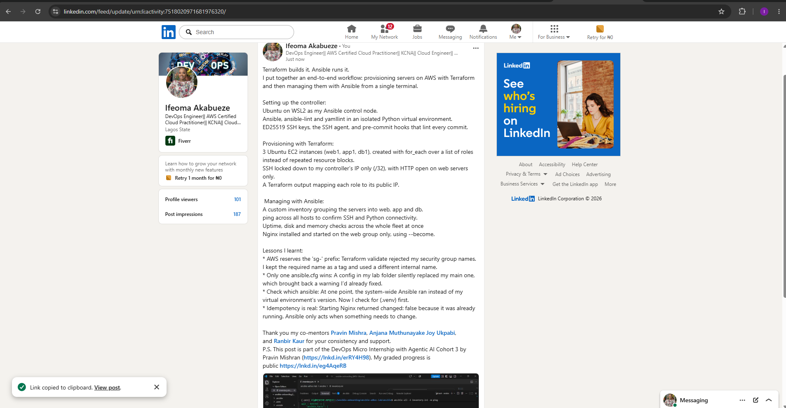

---

# Assignment Questions

Answer the following in your own words:

**1. What is the purpose of an Ansible inventory file?**

An Ansible inventory file tells Ansible which servers to manage and how to connect to them. It lists the managed hosts, organizes them into groups so commands can target only the servers that need them, and stores connection variables such as the SSH user and private key path. In my lab, inventory.ini grouped web1, app1, and db1 into web, app, and db groups, used ansible_host to map each friendly alias to its public IP, and set ansible_user=ubuntu for all hosts under [all:vars]. This let me install Nginx on the web group only, while running checks like uptime across all hosts.

---

**2. What is the difference between the `web`, `app`, and `db` groups in your inventory?**

The web, app, and db groups organize the servers by their role in the environment, so Ansible commands can target only the servers that need a specific action. The web group contains web1, the web server that handles HTTP traffic. It is the only group where I installed and started Nginx, and in Terraform it is the only one attached to the security group that allows port 80. The app group contains app1, intended for application or backend services. The db group contains db1, intended for database services, which I targeted alone to check disk usage with df -h. All three groups belong to the built-in all group, so commands like ping, uptime, and installing htop can still run across every server at once.

---

**3. What does the Ansible `ping` module verify?**

The Ansible ping module verifies that Ansible can connect to a managed host and run Python on it. It is not an ICMP network ping like the Linux ping command. Instead, it checks the full path Ansible needs for real work: the host is reachable over SSH, the username and private key are accepted, and a usable Python interpreter exists on the remote server to execute modules. If everything works, the host returns SUCCESS with "ping": "pong". In my lab, all three VMs (web1, app1, and db1) returned pong, and Ansible also reported the discovered interpreter, /usr/bin/python3.12, confirming they were ready to be managed.

---

**4. Why do package installation commands require `--become`?**

Package installation commands require --become because installing software changes system-wide files and settings, which only the root user is allowed to modify. Ansible connects to each VM as a regular user (ubuntu in my lab), and that user cannot install packages on its own. The apt module needs to update the package cache, write to directories such as /usr/bin and /etc, and register services with systemd, all of which require administrator privileges. --become tells Ansible to escalate privileges, using sudo by default, so those tasks run as root. Without it, the command fails with a permission error. Managing services, such as starting and enabling Nginx with the service module, needs --become for the same reason

---

**5. When would you use an ad-hoc command instead of a playbook?**

I would use an ad-hoc command for quick, one-time tasks that do not need to be saved or repeated, such as checking whether servers are reachable, viewing system information, or making a small urgent change. For example, in my lab I used ad-hoc commands to run ping across all hosts, check uptime, df -h, and free -m, confirm whether Nginx was active, and quickly install packages on specific groups. They are fast because they run directly from the command line without creating a file.

I would use a playbook when the work involves multiple steps, needs to be repeated, or should be documented and shared with a team. A playbook stores the tasks in a YAML file that can be version-controlled in Git, reviewed by teammates, checked by tools like ansible-lint, and rerun consistently on new servers. For example, installing Nginx, deploying its configuration, opening the firewall, and restarting the service belongs in a playbook, not in four separate ad-hoc commands typed by hand.

---

**6. What is one challenge you faced while setting up SSH or inventory, and how did you fix it?**

One challenge I faced was a warning that appeared on every host when I first ran ansible all -i inventory.ini -m ping. Ansible reported that each VM was using a discovered Python interpreter (/usr/bin/python3.12) and warned that future Python installations could change it. The connection itself worked, since all hosts returned pong, but I had already silenced this warning in my main project ansible.cfg with interpreter_python = auto_silent, so I didn’t expect to see it.

I found that Ansible uses only one configuration file: the first it finds, starting with the current directory. Because I ran commands from the lab’s ansible folder, the small local ansible.cfg I had created there (containing only host_key_checking = False) completely replaced my main configuration, so my earlier settings no longer applied. I fixed it by adding interpreter_python = auto_silent to the local lab config, and the warning disappeared on the next run. This taught me to check which config file Ansible is actually using with ansible --version, which shows the active config file path.

---

# Required Files

Confirm that the following files are included in your assignment workspace:

- [ ] `ansible-adhoc-lab/README.md`
- [ ] `ansible-adhoc-lab/terraform/providers.tf`
- [ ] `ansible-adhoc-lab/terraform/main.tf`
- [ ] `ansible-adhoc-lab/terraform/variables.tf`
- [ ] `ansible-adhoc-lab/terraform/outputs.tf`
- [ ] `ansible-adhoc-lab/ansible/inventory.ini`
- [ ] Updated `.gitignore`

---

# Submission Instructions

- Add all required screenshots from the tasks.
- Full Name must be visible in required screenshots.
- Mention whether you used Azure or AWS.
- Mention whether you used the three-VM option or four-VM option.
- Add the public IP addresses of the VMs, redacted if preferred.
- Add your `inventory.ini` proof.
- Add a short explanation of what you learned.
- Answer all assignment questions clearly in your own words.
- Add your LinkedIn post URL.
- Do not expose SSH private keys, Terraform state files, cloud credentials, passwords, access keys, secret keys, account IDs, or subscription IDs.
- Submit only one Google Doc link.

---

# Completion Checklist

- [ ] Task 1: `ansible-adhoc-lab` project structure created
- [ ] Task 1: `.gitignore` updated for Terraform files
- [ ] Task 2: Terraform configuration created
- [ ] Task 2: Server roles defined for either three or four VMs
- [ ] Task 2: `count` or `for_each` used
- [ ] Task 2: SSH restricted to the controller public IP
- [ ] Task 2: HTTP allowed only for web hosts
- [ ] Task 2: Terraform output maps roles to public IPs
- [ ] Task 3: Terraform initialized successfully
- [ ] Task 3: Terraform configuration validated
- [ ] Task 3: Terraform apply completed successfully
- [ ] Task 3: All selected VMs are running
- [ ] Task 4: SSH key-based access works for every VM
- [ ] Task 5: `inventory.ini` contains `web`, `app`, and `db` groups
- [ ] Task 5: `ansible-inventory -i inventory.ini --graph` shows the correct groups
- [ ] Task 6: `ansible all -i inventory.ini -m ping` returns `SUCCESS`
- [ ] Task 6: Ad-hoc commands run successfully
- [ ] Task 6: `--become` was used for package and service tasks
- [ ] Task 6: Nginx is active on the `web` group
- [ ] Screenshots 1–17 are included
- [ ] Assignment questions are answered
- [ ] LinkedIn post published
- [ ] LinkedIn post URL added
- [ ] No sensitive information is exposed
- [ ] Google Doc is accessible

---

## About DMI & CloudAdvisory

DevOps Micro Internship (DMI) is a project-based DevOps program run by Pravin Mishra and The CloudAdvisory, focused on real-world execution, systems thinking, and career readiness.

It helps learners build strong DevOps foundations with hands-on experience.

---

## Resources

- DMI Official Website: [https://dmi.pravinmishra.com?utm_source=github&utm_medium=readme](https://dmi.pravinmishra.com?utm_source=github&utm_medium=readme)
- University: [https://university.pravinmishra.com?utm_source=github&utm_medium=readme](https://university.pravinmishra.com?utm_source=github&utm_medium=readme)
- Discord Community: [https://discord.pravinmishra.com?utm_source=github&utm_medium=readme](https://discord.pravinmishra.com?utm_source=github&utm_medium=readme)
- Blog: [https://dmi.pravinmishra.com/blog?utm_source=github&utm_medium=readme](https://dmi.pravinmishra.com/blog?utm_source=github&utm_medium=readme)
- YouTube Playlist: [https://www.youtube.com/playlist?list=PLFeSNDtI4Cho](https://www.youtube.com/playlist?list=PLFeSNDtI4Cho)
- Pravin Mishra LinkedIn: [https://www.linkedin.com/in/pravin-mishra-aws-trainer/](https://www.linkedin.com/in/pravin-mishra-aws-trainer/)
- CloudAdvisory LinkedIn: [https://www.linkedin.com/company/thecloudadvisory/](https://www.linkedin.com/company/thecloudadvisory/)

---

*This submission is part of DevOps Micro Internship (DMI) Cohort 3 — Agentic AI Track.*