# Assignment 03 — Deploy a Static Website to Multiple Servers Using a Multi-Play Ansible Playbook

Part of the DevOps Micro Internship (DMI) with Agentic AI

---

## Student Details

**Full Name:** Ifeoma Akabueze 
**Cloud Platform Used:** AWS 
**Server 1 URL:**   http://3.91.172.182
**Server 2 URL:** http://44.202.214.233

---

## Purpose

In this assignment, you will create a multi-play Ansible playbook to install Nginx, deploy a static website to two Ubuntu servers, and verify that the website is accessible from both servers.

You may use either AWS EC2 instances or Azure Virtual Machines as your managed servers.

---

# Task 1 — Create the Project Structure

## Goal

Create the required folders and files for the Ansible project.

## Evidence

### Screenshot 1 — Terminal or VS Code showing the complete `static-web` project structure

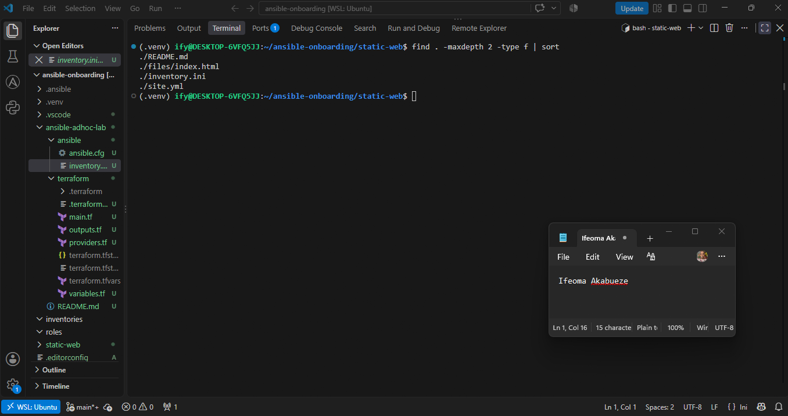

---

# Task 2 — Configure the Ansible Inventory

## Goal

Add both Ubuntu servers to the Ansible inventory.

## Evidence

### Screenshot 2 — Output of `ansible-inventory -i inventory.ini --graph` showing `web1` and `web2`

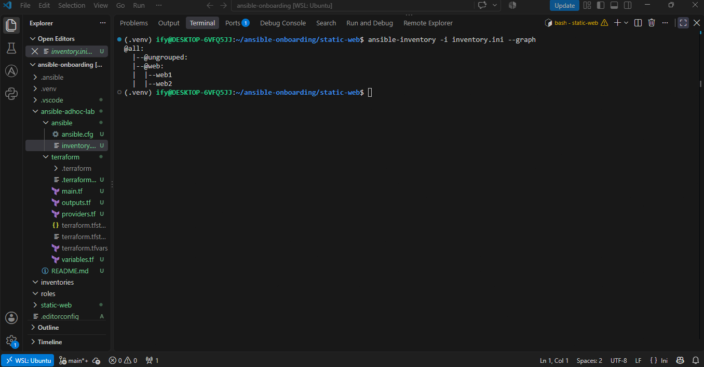

---

## Configuration File

Copy and paste the complete contents of your `inventory.ini` file below:

```ini
[web]
web1 ansible_host=3.91.172.182
web2 ansible_host=44.202.214.233

[web:vars]
ansible_user=ubuntu
ansible_ssh_private_key_file=/home/ify/.ssh/id_ed25519
```

---

# Task 3 — Verify Ansible Connectivity

## Goal

Confirm that the Ansible controller can connect to both servers.

## Evidence

### Screenshot 3 — Ansible ping output showing `SUCCESS` and `pong` for both servers

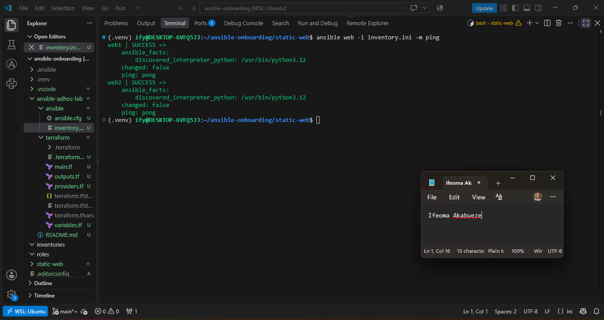

---

# Task 4 — Download and Personalize the Static Website

## Goal

Download `index.html` to the Ansible controller and personalize the website with your full name.

## Evidence

### Screenshot 4 — Edited `files/index.html` showing the footer line with your full name

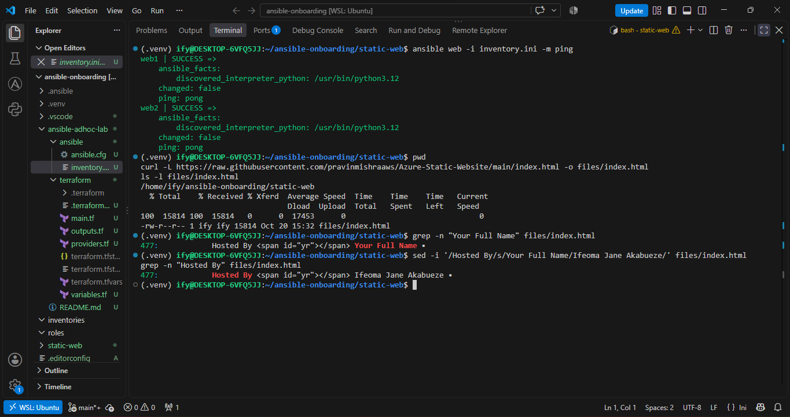

---

# Task 5 — Create the Multi-Play Ansible Playbook

## Goal

Create a single Ansible playbook containing separate plays for installation, deployment, and verification.

## Configuration File

Copy and paste the complete contents of your `site.yml` file below:

```yaml
---
- name: Play 1 - Install and configure Nginx
  hosts: web
  become: true
  tasks:
    - name: Update APT package cache
      ansible.builtin.apt:
        update_cache: true
        cache_valid_time: 3600

    - name: Install Nginx
      ansible.builtin.apt:
        name: nginx
        state: present

    - name: Ensure Nginx is started and enabled
      ansible.builtin.service:
        name: nginx
        state: started
        enabled: true

- name: Play 2 - Deploy the static website
  hosts: web
  become: true
  tasks:
    - name: Copy index.html to the Nginx web root
      ansible.builtin.copy:
        src: files/index.html
        dest: /var/www/html/index.html
        owner: www-data
        group: www-data
        mode: "0644"
      notify: Reload Nginx

  handlers:
    - name: Reload Nginx
      ansible.builtin.service:
        name: nginx
        state: reloaded

- name: Play 3 - Verify both websites from the controller
  hosts: localhost
  connection: local
  gather_facts: false
  become: false
  tasks:
    - name: Send HTTP GET request to each web server
      ansible.builtin.uri:
        url: "http://{{ hostvars[item].ansible_host }}"
        method: GET
        status_code: 200
      loop: "{{ groups['web'] }}"
      register: website_checks

    - name: Assert each web server returned HTTP 200
      ansible.builtin.assert:
        that:
          - item.status == 200
        success_msg: "{{ item.item }} returned HTTP {{ item.status }}"
        fail_msg: "{{ item.item }} did not return HTTP 200"
      loop: "{{ website_checks.results }}"
      loop_control:
        label: "{{ item.item }}"
```

---

# Task 6 — Validate the Playbook Syntax

## Goal

Check the playbook for YAML or Ansible syntax errors before running it.

## Evidence

### Screenshot 5 — Successful syntax-check output showing `playbook: site.yml`

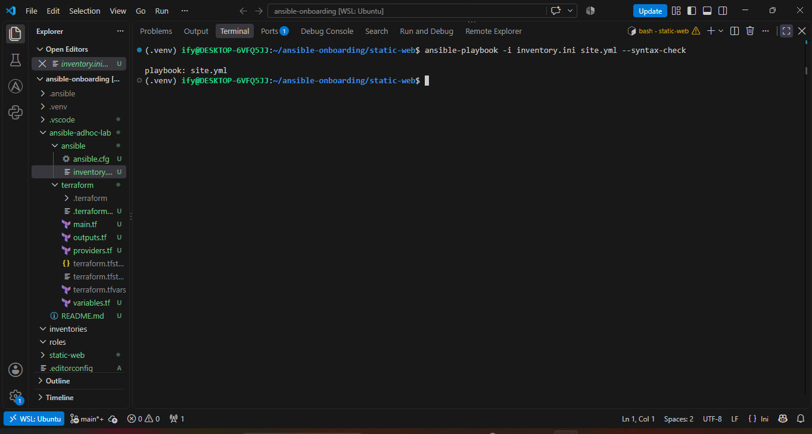

---

# Task 7 — Run the Multi-Play Playbook

## Goal

Install Nginx, deploy the website, and verify both servers in one playbook run.

## Evidence

### Screenshot 6 — Play 3 verification showing HTTP `200` for both servers

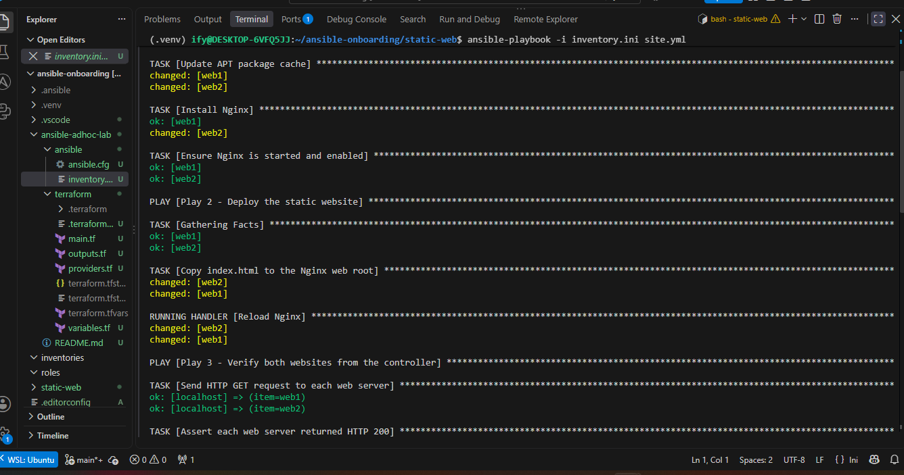

---

### Screenshot 7 — Final play recap showing `unreachable=0` and `failed=0` for `web1`, `web2`, and `localhost`

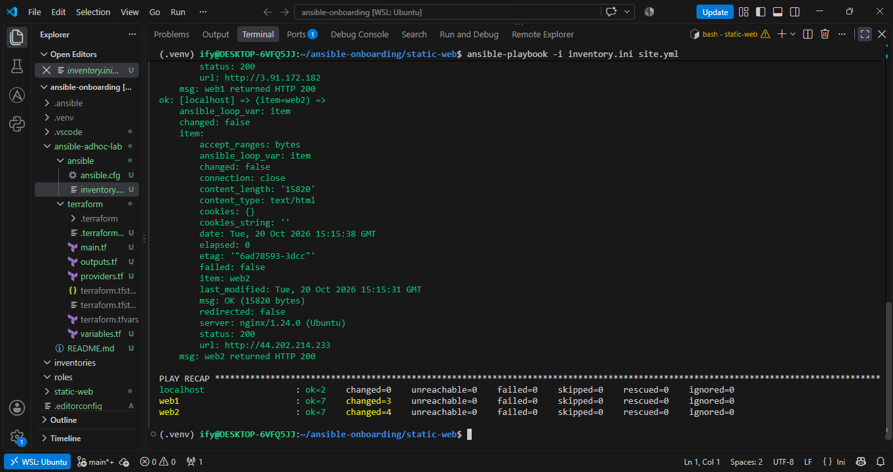

---

# Task 8 — Verify Idempotency

## Goal

Run the playbook again and confirm that it does not make unnecessary changes.

## Evidence

### Screenshot 8 — Second playbook run showing the play recap with `changed=0`, `unreachable=0`, and `failed=0` for both web servers

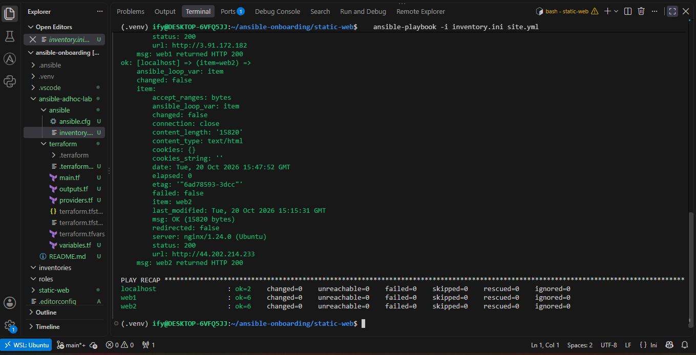

---

# Task 9 — Test Both Websites Manually

## Goal

Confirm that the static website is accessible from both public IP addresses.

## Evidence

### Screenshot 9 — `curl -I` output showing HTTP `200 OK` from both servers

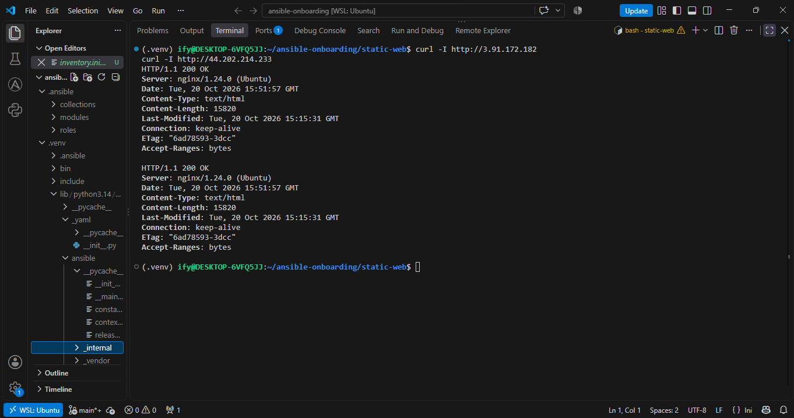

---

### Screenshot 10 — Browser showing the website from Server 1 with the public IP and your full name visible

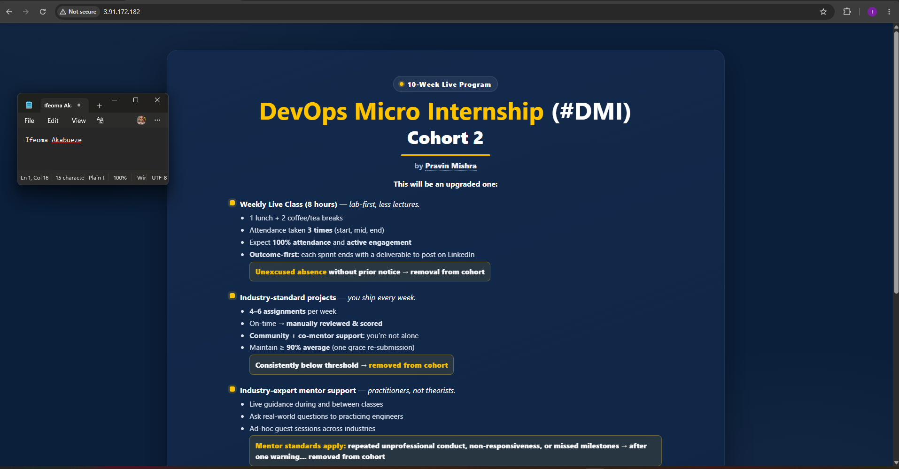

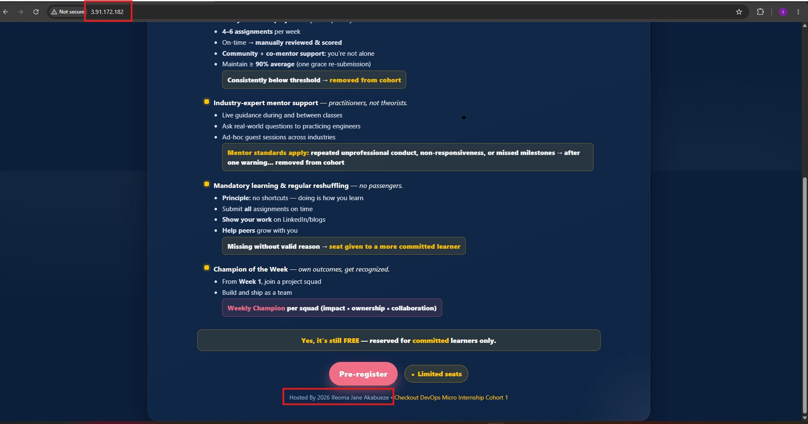
---

### Screenshot 11 — Browser showing the website from Server 2 with the public IP and your full name visible

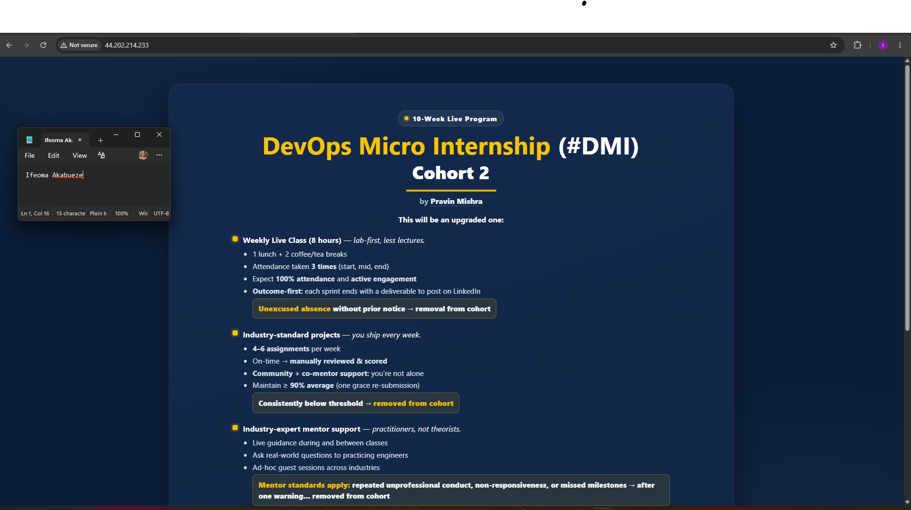

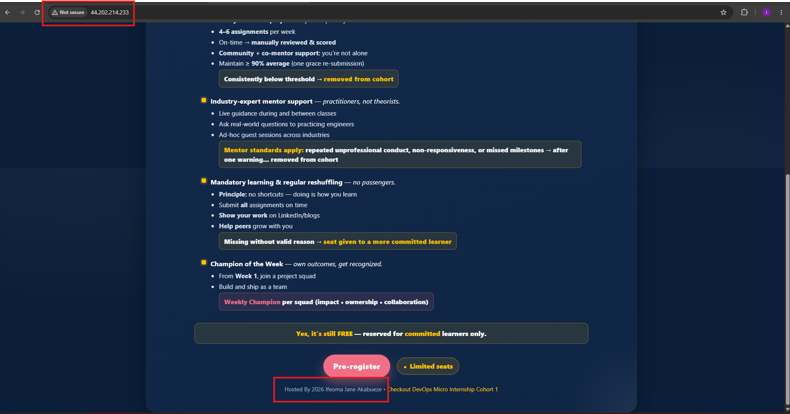
---

## Website URLs

Add both deployed website URLs below:

```text
Server 1: http://3.91.172.182
Server 2: http://44.202.214.233
```

---

# Task 10 — Complete the Project README

## Goal

Document how the project works and record what you learned.

## README Content

Copy and paste the complete contents of your `README.md` file below:

```markdown
# Multi-Play Ansible Static Website Deployment

## Project Overview

I deployed a static website to two Ubuntu web servers on AWS using a single Ansible playbook with three separate plays. The first play installs and configures Nginx, the second copies the personalized `index.html` from my Ansible controller to both servers and reloads Nginx only when the file changes, and the third runs from the controller to verify that both websites return HTTP status 200. The playbook is idempotent: a second run made no changes on either server.

## Environment

- Cloud platform: AWS (us-east-1), EC2 instances provisioned with Terraform
- Operating system: Ubuntu 24.04 LTS on the managed servers; Ubuntu on WSL2 as the Ansible controller
- Number of managed servers: 2 (`web1` and `web2`)
- Web server: Nginx

## How to Run the Playbook

From the `static-web` directory, with the Python virtual environment active:

```bash
source ~/ansible-onboarding/.venv/bin/activate
export ANSIBLE_CONFIG=~/ansible-onboarding/ansible.cfg
ansible-playbook -i inventory.ini site.yml --syntax-check
ansible-playbook -i inventory.ini site.yml
```

## Issue Faced and Solution

When I returned to the project the next day, I prepared to add `web2` with Terraform. Before applying, I refreshed my controller's public IP in `terraform.tfvars`, and the apply showed `1 changed` on the SSH security group. My home internet IP had changed overnight, so without this update SSH and Ansible connections to both servers would have timed out, because the security group only allows SSH from my controller's `/32` address. Updating the IP and re-applying fixed it, and both servers responded to `ansible web -m ping`.

A second issue was that the new `static-web` folder has no `ansible.cfg`, and Ansible only reads the config file in the current directory. Without it, host key checking was enabled again. I fixed this by exporting `ANSIBLE_CONFIG` to point at my main project configuration.

## What I Learned

I learned how to structure a playbook into multiple plays, each with its own target and responsibility, including a play that runs on `localhost` with a local connection. I learned how handlers work: the reload only runs when a task that notifies it actually changes something, and the handler name must match the `notify` value exactly. I also learned the difference between `status_code`, the expected value inside the `uri` module, and `status`, the value returned and checked with `assert`. Finally, I saw idempotency in practice: adding `cache_valid_time` to the APT task was necessary for the second run to show `changed=0`.

## Why Installation and Deployment Are Separate

Installing Nginx is infrastructure setup that rarely changes, while the website content changes often. Keeping them in separate plays makes each responsibility clear, easier to read, and easier to troubleshoot, because a failure points directly to either the server setup or the content deployment. It also makes the playbook easier to extend: for example, the deployment play could later be run on its own to publish new content without touching the server configuration.

## Benefit of the Ansible Copy Module

The `copy` module sends the exact same tested file from the controller to every server, so all servers are guaranteed to serve identical content. The managed servers do not need Git installed, repository access, or credentials. The module also compares the file before copying and only transfers it when it has changed, which keeps the playbook idempotent and allows the handler to reload Nginx only when the content actually changes. I confirmed this with `curl -I`: both servers returned the same `ETag` and a `Content-Length` of 15,820 bytes, 6 bytes more than the original download because of my name in the footer.
```

---

# LinkedIn Post Required

## Evidence

### LinkedIn Post URL

Paste your LinkedIn post URL here:

https://lnkd.in/p/eAvzWueE

---

### Screenshot — Published LinkedIn post

week-09-ansible/screenshots/Published-LinkedIn-post-ass3.png

---

# Assignment Questions

Answer the following in your own words:

**1. What issue did you face while completing this assignment, and how did you fix it?**

When I returned to the project the next day, I prepared to add `web2` with Terraform. Before applying, I refreshed my controller's public IP in `terraform.tfvars`, and the apply showed `1 changed` on the SSH security group. My home internet IP had changed overnight, so without this update SSH and Ansible connections to both servers would have timed out, because the security group only allows SSH from my controller's `/32` address. Updating the IP and re-applying fixed it, and both servers responded to `ansible web -m ping`.

A second issue was that the new `static-web` folder has no `ansible.cfg`, and Ansible only reads the config file in the current directory. Without it, host key checking was enabled again. I fixed this by exporting `ANSIBLE_CONFIG` to point at my main project configuration.

---

**2. What did you learn from this assignment?**

I learned how to structure a playbook into multiple plays, each with its own target and responsibility, including a play that runs on `localhost` with a local connection. I learned how handlers work: the reload only runs when a task that notifies it actually changes something, and the handler name must match the `notify` value exactly. I also learned the difference between `status_code`, the expected value inside the `uri` module, and `status`, the value returned and checked with `assert`. Finally, I saw idempotency in practice: adding `cache_valid_time` to the APT task was necessary for the second run to show `changed=0`.

## Why Installation and Deployment Are Separate

Installing Nginx is infrastructure setup that rarely changes, while the website content changes often. Keeping them in separate plays makes each responsibility clear, easier to read, and easier to troubleshoot, because a failure points directly to either the server setup or the content deployment. It also makes the playbook easier to extend: for example, the deployment play could later be run on its own to publish new content without touching the server configuration.

---

**3. Why is it useful to split installation, deployment, and verification into separate plays?**

Splitting installation, deployment, and verification into separate plays gives each play one clear responsibility, which makes the playbook easier to read, troubleshoot, and maintain. In my playbook, Play 1 prepares the servers by installing and starting Nginx, Play 2 deploys the website content, and Play 3 checks the result from the controller.

Different targets and settings. Each play can have its own hosts and options. Plays 1 and 2 target the web group with become: true, while Play 3 runs on localhost with a local connection, no fact gathering, and no privilege escalation. That kind of difference is only possible with separate plays.

Easier troubleshooting. When something fails, the play name shows immediately whether the problem is in the server setup, the content deployment, or the website’s reachability.

Different rates of change. Installing Nginx rarely changes, while website content changes often. Keeping them separate makes it easier to update or rerun the deployment logic without mixing it with server configuration.

Independent verification. Verifying from the controller tests the real path a visitor takes, through the internet and the security group’s port 80 rule, to Nginx. This confirms the earlier plays actually worked rather than assuming they did.

---

**4. What is one benefit of using the Ansible `copy` module instead of cloning the website directly from Git on every managed server?**

The `copy` module sends the exact same tested file from the controller to every server, so all servers are guaranteed to serve identical content. The managed servers do not need Git installed, repository access, or credentials. The module also compares the file before copying and only transfers it when it has changed, which keeps the playbook idempotent and allows the handler to reload Nginx only when the content actually changes. I confirmed this with `curl -I`: both servers returned the same `ETag` and a `Content-Length` of 15,820 bytes, 6 bytes more than the original download because of my name in the footer.

---

**5. What does idempotency mean in this assignment?**

In this assignment, idempotency means that running the same playbook multiple times produces the same result without making unnecessary changes. Ansible checks the current state of each server and only acts when it differs from the desired state described in the playbook.

On the first run, Ansible did real work: it updated the package cache, installed Nginx on web2 (web1 already had it), copied index.html to both servers, and the handler reloaded Nginx because the file changed. On the second run, with no changes to site.yml or index.html, every task reported ok, the Nginx reload handler did not run, and the play recap showed changed=0 for both web1 and web2, while both websites still returned HTTP 200.

I also learned that idempotency has to be designed. Without cache_valid_time: 3600 on the APT cache task, that task would report changed on every run. Adding it meant the cache is only updated when it is older than one hour, which allowed the second run to reach changed=0.

---

**6. What does the Ansible `uri` module verify in Play 3?**

In Play 3, the uri module verifies that each web server is actually serving the website over HTTP, as a visitor would see it. Running from the Ansible controller (localhost), it loops through every host in the web group, builds the URL from each server’s ansible_host value (http://<public IP>), and sends an HTTP GET request.

The status_code: 200 parameter sets the expected response. If a server returns anything other than 200, or doesn’t respond at all, the task fails. The results are saved with register: website_checks, and a separate assert task then checks each returned status value equals 200, printing web1 returned HTTP 200 and web2 returned HTTP 200.

Because the request is sent from outside the servers, a successful check proves the whole path works: the server is reachable over the internet, the security group allows port 80, Nginx is running, and it returns the deployed page successfully.

---

# Required Files

Confirm that the following files are included in your assignment folder:

- [ ] `inventory.ini`
- [ ] `site.yml`
- [ ] `files/index.html`
- [ ] `README.md`

---

# Submission Instructions

- Add all required screenshots in the correct order.
- Full Name must be visible in required screenshots.
- Include both deployed website URLs.
- Paste `inventory.ini`, `site.yml`, and `README.md` as editable text.
- Answer all assignment questions clearly in your own words.
- Add your LinkedIn post URL.
- Do not expose SSH private keys, passwords, cloud account IDs, or other sensitive information.

---

# Completion Checklist

- [ ] Task 1: `static-web` folder structure is complete
- [ ] Task 2: Both servers are listed under the `[web]` group in `inventory.ini`
- [ ] Task 2: Inventory graph shows `web1` and `web2`
- [ ] Task 3: Ansible ping returns `SUCCESS` and `pong` for both servers
- [ ] Task 4: `files/index.html` contains your full name
- [ ] Task 5: `site.yml` contains three separate plays
- [ ] Task 5: Play 1 installs, starts, and enables Nginx
- [ ] Task 5: Play 2 deploys `index.html` using the `copy` module
- [ ] Task 5: Nginx reload handler is included
- [ ] Task 5: Play 3 verifies both web servers from the controller
- [ ] Task 6: Playbook syntax check passes
- [ ] Task 7: First playbook run completes with `unreachable=0` and `failed=0`
- [ ] Task 7: URI verification returns HTTP `200` for both servers
- [ ] Task 8: Second playbook run demonstrates idempotency
- [ ] Task 8: Second run shows `changed=0` for both web servers
- [ ] Task 9: Both `curl -I` commands return HTTP `200 OK`
- [ ] Task 9: Website loads from Server 1
- [ ] Task 9: Website loads from Server 2
- [ ] Task 9: Full name is visible on both deployed websites
- [ ] Task 10: `README.md` contains all required explanations
- [ ] Screenshots 1–11 are included
- [ ] `inventory.ini`, `site.yml`, and `README.md` are pasted as editable text
- [ ] Both website URLs are included
- [ ] Assignment questions are answered
- [ ] LinkedIn post published
- [ ] LinkedIn post URL added
- [ ] No sensitive information is exposed

---

## About DMI & CloudAdvisory

DevOps Micro Internship (DMI) is a project-based DevOps program run by Pravin Mishra and The CloudAdvisory, focused on real-world execution, systems thinking, and career readiness.

It helps learners build strong DevOps foundations with hands-on experience.

---

## Resources

- DMI Official Website: [https://dmi.pravinmishra.com?utm_source=github&utm_medium=readme](https://dmi.pravinmishra.com?utm_source=github&utm_medium=readme)
- University: [https://university.pravinmishra.com?utm_source=github&utm_medium=readme](https://university.pravinmishra.com?utm_source=github&utm_medium=readme)
- Discord Community: [https://discord.pravinmishra.com?utm_source=github&utm_medium=readme](https://discord.pravinmishra.com?utm_source=github&utm_medium=readme)
- Blog: [https://dmi.pravinmishra.com/blog?utm_source=github&utm_medium=readme](https://dmi.pravinmishra.com/blog?utm_source=github&utm_medium=readme)
- YouTube Playlist: [https://www.youtube.com/playlist?list=PLFeSNDtI4Cho](https://www.youtube.com/playlist?list=PLFeSNDtI4Cho)
- Pravin Mishra LinkedIn: [https://www.linkedin.com/in/pravin-mishra-aws-trainer/](https://www.linkedin.com/in/pravin-mishra-aws-trainer/)
- CloudAdvisory LinkedIn: [https://www.linkedin.com/company/thecloudadvisory/](https://www.linkedin.com/company/thecloudadvisory/)

---

*This submission is part of DevOps Micro Internship (DMI) — Agentic AI Track.*