# Assignment 04 — Deploy Mini Finance on Azure Using Terraform and Ansible

Part of the DevOps Micro Internship (DMI) with Agentic AI

---

## Purpose

In this assignment, you will provision Azure infrastructure using Terraform and deploy the Mini Finance website using an Ansible multi-play playbook.

Terraform will create the Azure Virtual Machine and networking resources. Ansible will install Nginx, clone the Mini Finance repository, deploy the website, and verify the deployment.

---

# Task 1 — Create the Project Structure

## Goal

Create separate directories and files for the Terraform infrastructure and Ansible configuration.

### Evidence

#### Screenshot 1 — Terminal or VS Code showing the complete `mini-finance` project structure

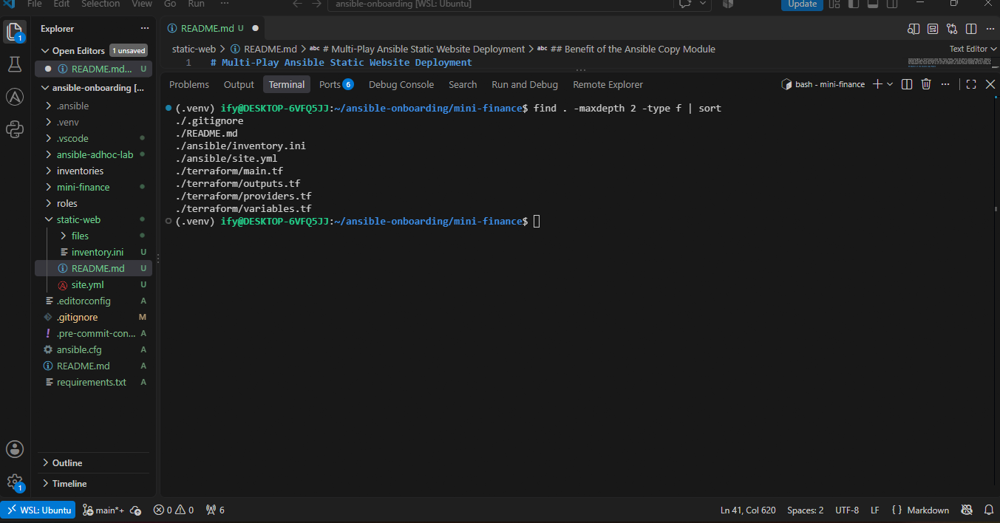

---

### Notes

My Ansible controller (Ubuntu on WSL2) already had Terraform, Ansible in the Python virtual environment, the Azure CLI (2.90.0), the ansible.posix collection (2.2.2), and rsync, so no new tools were needed.

Signing in to the Azure CLI was the main challenge. az login --use-device-code was blocked with AADSTS530035, because my Azure directory has Security Defaults enabled, which block device-code sign-in. The interactive browser login also failed inside WSL with a Status_NoNetwork broker error. Instead of weakening my directory’s security settings, I authenticated with a service principal. In Azure Cloud Shell, I created one with az ad sp create-for-rbac, limited to the Contributor role on my subscription only. On the controller, I provided its credentials to Terraform through the ARM_CLIENT_ID, ARM_TENANT_ID, ARM_SUBSCRIPTION_ID, and ARM_CLIENT_SECRET environment variables, entering the secret with read -s so it was never displayed or saved in my shell history. No credentials are stored in any Terraform file. I then signed the Azure CLI in with az login --service-principal and confirmed that my subscription showed Enabled. I will delete the service principal after destroying the infrastructure.

Task 1 — Create the Project Structure

I created the mini-finance project inside my existing ansible-onboarding workspace, with separate terraform/ and ansible/ directories so infrastructure code and configuration code stay clearly separated. I created the four Terraform files (providers.tf, main.tf, variables.tf, outputs.tf), the Ansible inventory.ini and site.yml, a README.md, and a .gitignore. The .gitignore excludes Terraform’s working directory, state files, saved plans, crash logs, and private key files. I also added *.tfvars, because my terraform.tfvars file contains my controller’s public IP.

---

# Task 2 — Create the Azure Infrastructure Using Terraform

## Goal

Use Terraform to provision an Ubuntu Virtual Machine with the required Azure networking and security resources.

### Evidence

#### Screenshot 2 — Terraform code showing the `Allow-SSH` rule for port `22` and the `Allow-HTTP` rule for port `80`

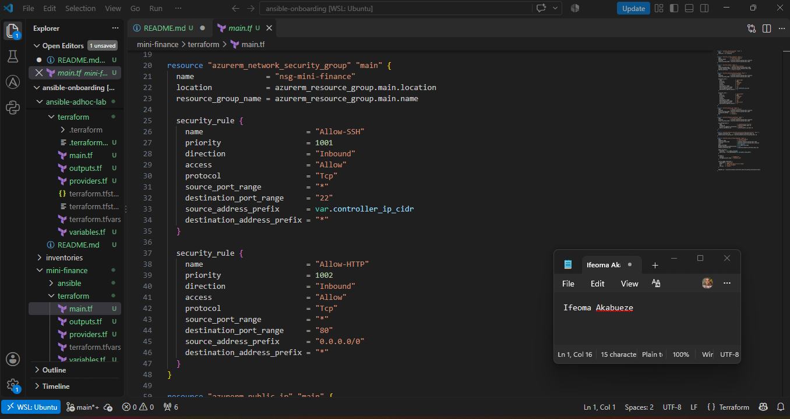

---

#### Screenshot 3 — Terraform code showing the association between `nsg-mini-finance` and `nic-mini-finance`

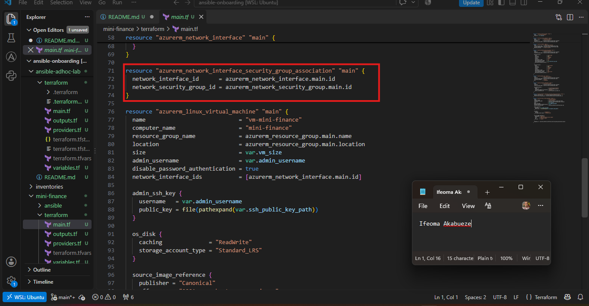

---

### Notes

Task 2 — Create the Azure Infrastructure Using Terraform

I configured the AzureRM provider (version 4.x) with the required features {} block, relying on environment variables for authentication. In main.tf, I defined all resources with the required fixed names: the resource group rg-mini-finance, the virtual network vnet-mini-finance (10.0.0.0/16), and the subnet subnet-mini-finance (10.0.1.0/24). The network security group nsg-mini-finance has two inbound rules with different priorities: Allow-SSH on port 22, restricted to my controller’s public IP in /32 format, and Allow-HTTP on port 80 from 0.0.0.0/0. A validation rule on the controller_ip_cidr variable rejects anything other than a single /32 address, so SSH can never be opened to the whole internet.

I created a Standard, Static public IP (pip-mini-finance) and a network interface (nic-mini-finance) with the IP configuration ipconfig-mini-finance and dynamic private IP allocation. The NSG is attached to the NIC through an azurerm_network_interface_security_group_association resource; without this association, the rules would not protect the VM. The Ubuntu 22.04 LTS VM (vm-mini-finance, computer name mini-finance) uses the admin user azureuser, has password authentication disabled, and receives only my SSH public key. A depends_on ensures the NSG is attached before the VM is created. Finally, the public_ip output exposes the VM’s public IP for SSH, the Ansible inventory, and browser testing.

---

# Task 3 — Initialize and Apply the Terraform Configuration

## Goal

Format and validate the Terraform configuration, review the execution plan, and provision the Azure infrastructure.

### Evidence

#### Screenshot 4 — End of the `terraform apply` output showing `Apply complete!` with no errors

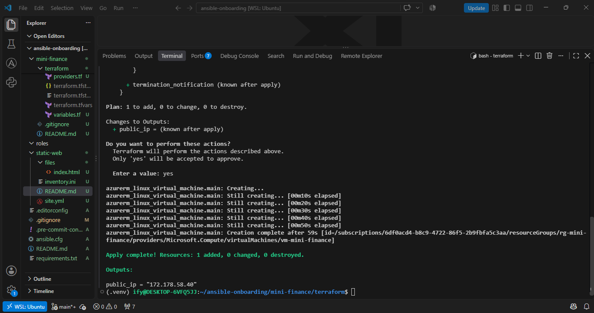

---

#### Screenshot 5 — Output of `terraform output public_ip` showing the VM’s public IP address

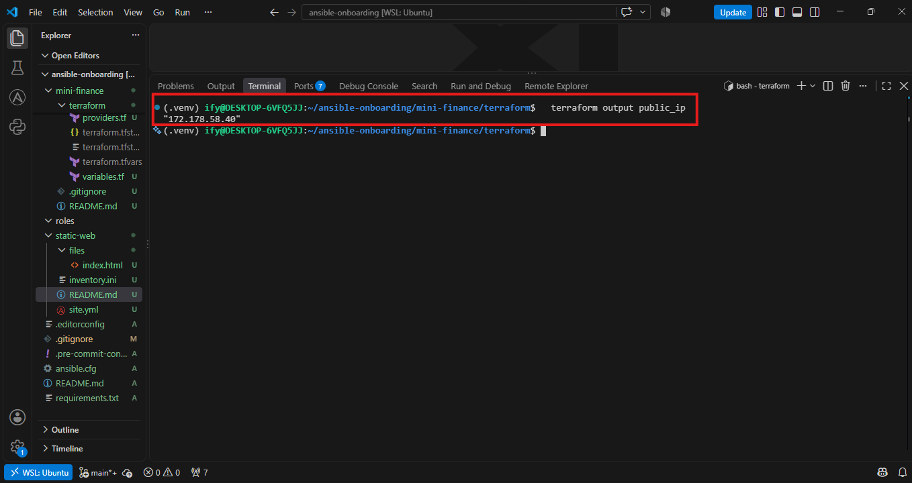

---

### Notes

From the terraform directory, I ran terraform fmt, terraform init (which installed the AzureRM provider), and terraform validate, which confirmed the configuration was valid. Before every apply, I reviewed the terraform plan output to confirm the expected resources, SSH restricted to my controller’s /32 IP, HTTP open on port 80, and no unexpected deletions.

Provisioning the VM required significant troubleshooting. The first terraform plan failed because ARM_SUBSCRIPTION_ID contained my tenant ID by mistake, and then because the subscription ID captured from the Azure CLI included a hidden Windows carriage return (\r). I fixed this by fetching the ID with az account show --query id -o tsv | tr -d '\r'.

The network resources deployed successfully, but the VM was repeatedly refused. Standard_B1s and Standard_B1ms failed with SkuNotAvailable due to capacity restrictions in East US, and Standard_B2ats_v2 failed because my subscription has a quota of 0 for the Basv2 family. Using az vm list-usage and az vm list-skus, I confirmed which VM families had quota and which sizes were restricted for my subscription. I also tried West US 2 and Central US, and learned that the A-series v2 sizes only support Gen 1 images, so they cannot boot the Gen 2 Ubuntu image. Because changing the region forces Azure resources to be recreated, I used terraform destroy before each region change to avoid an inconsistent partial replacement.

To find a size my subscription could actually use, I ran a validation-only test in the Azure portal’s VM creation wizard, without creating anything. It passed for Standard_D2als_v7 in East US. I set location and vm_size in terraform.tfvars, switched the image to the Gen 2 Ubuntu 22.04 LTS SKU (22_04-lts-gen2), and added disk_controller_type = "NVMe", which these newer sizes require.

During the final deployment, Azure’s eventual consistency caused two Terraform state issues: the NSG–NIC association reported “Provider produced inconsistent result after apply”, and the public IP was briefly reported as deleted during refresh. In both cases the resource actually existed in Azure, so I brought it back under Terraform management with terraform import, then ran terraform apply -refresh=false to create the VM without re-reading the unreliable state. The apply completed successfully, and terraform output public_ip displayed the VM’s public IP address.

---

# Task 4 — Verify Passwordless SSH Access

## Goal

Confirm that the Ansible controller can connect to the Terraform-provisioned Azure VM using SSH key authentication.

### Evidence

#### Screenshot 6 — Passwordless SSH command and the returned `mini-finance` hostname

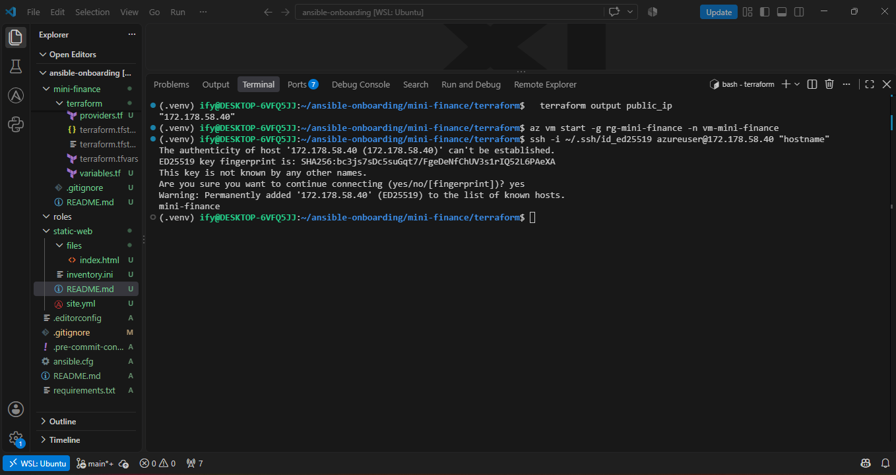

---

### Notes

From my Ansible controller, I retrieved the VM’s public IP with terraform output public_ip and tested SSH access using the private key that matches the public key Terraform added to the VM: ssh -i ~/.ssh/id_ed25519 azureuser@<PUBLIC_IP> "hostname". Because the VM had been deallocated overnight to save costs, I first started it with az vm start. Its public IP stayed the same, because pip-mini-finance uses a Static allocation.

On the first connection, SSH displayed the VM’s ED25519 host fingerprint and asked me to confirm it. This was host verification, not a password prompt. After I typed yes, the fingerprint was saved to ~/.ssh/known_hosts. The command returned mini-finance, the computer name configured in Terraform, without asking for a password for azureuser. This confirms that key-based authentication works, password authentication is disabled as configured, and the NSG’s Allow-SSH rule permits port 22 from my controller’s IP.

---

# Task 5 — Create the Ansible Inventory and Verify Connectivity

## Goal

Add the Terraform-provisioned Azure VM to the Ansible inventory and confirm that Ansible can connect to it.

### Evidence

#### Screenshot 7 — Ansible ping output showing `SUCCESS` and `pong` from the Azure VM

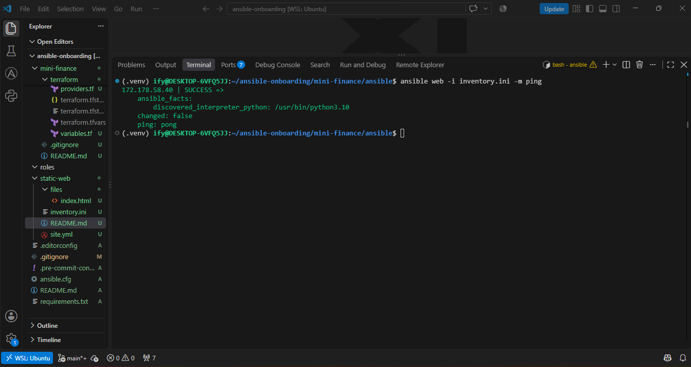

---

### Configuration File

Copy and paste the complete contents of your `ansible/inventory.ini` file below:

```ini
[web]
172.178.58.40

[web:vars]
ansible_user=azureuser
ansible_ssh_private_key_file=~/.ssh/id_ed25519

```

---

# Task 6 — Create the Multi-Play Ansible Playbook

## Goal

Create one Ansible playbook containing separate plays to install Nginx, deploy the Mini Finance website, and verify the deployment.

### Evidence

#### Screenshot 8 — `site.yml` showing Play 1 and the beginning of Play 2

Screenshot must show:

- Play 1 targeting the `web` group
- Installation of `nginx`, `git`, and `rsync`
- Nginx service configured as started and enabled
- Beginning of Play 2 with the Git repository URL and synchronization task

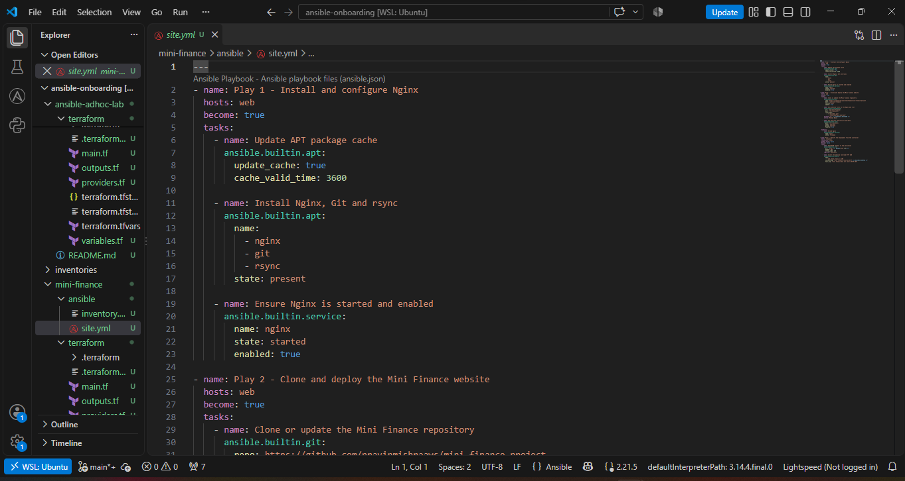
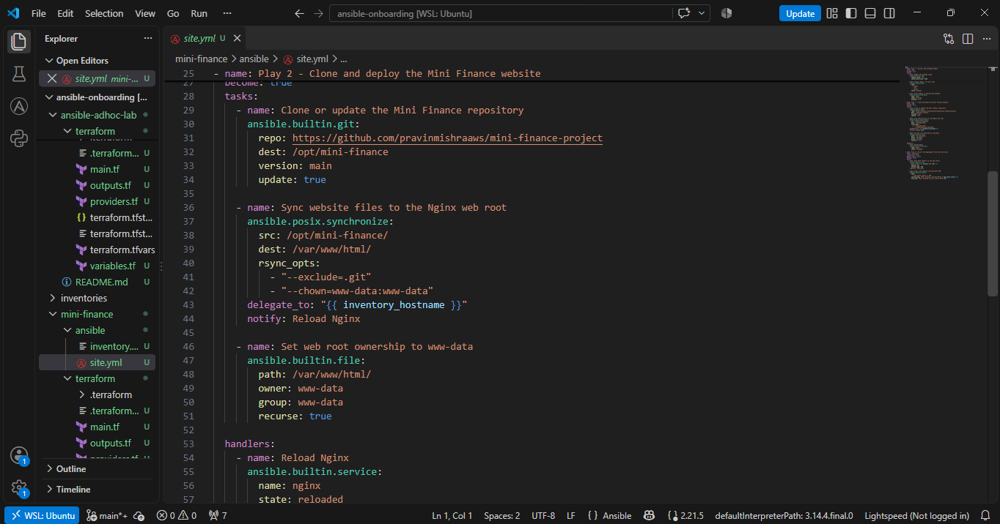


---

#### Screenshot 9 — `site.yml` showing the deployment destination, handler, and Play 3 verification

Screenshot must show:

- Website destination `/var/www/html/`
- Ownership set to `www-data:www-data`
- Nginx reload handler
- Play 3 targeting `localhost`
- The `uri` verification and `assert` condition

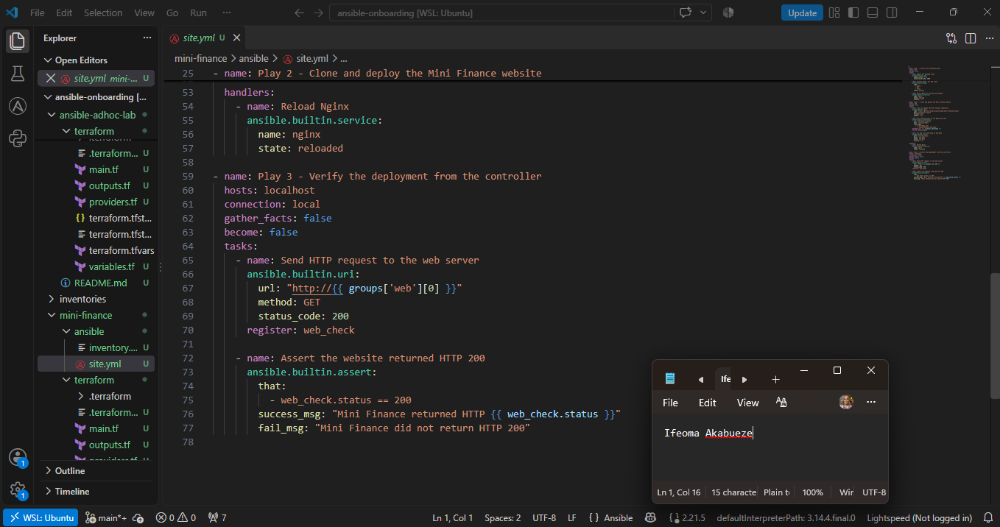

---

### Configuration File

Copy and paste the complete contents of your `ansible/site.yml` file below:

```yaml
---
- name: Play 1 - Install and configure Nginx
  hosts: web
  become: true
  tasks:
    - name: Update APT package cache
      ansible.builtin.apt:
        update_cache: true
        cache_valid_time: 3600

    - name: Install Nginx, Git and rsync
      ansible.builtin.apt:
        name:
          - nginx
          - git
          - rsync
        state: present

    - name: Ensure Nginx is started and enabled
      ansible.builtin.service:
        name: nginx
        state: started
        enabled: true

- name: Play 2 - Clone and deploy the Mini Finance website
  hosts: web
  become: true
  tasks:
    - name: Clone or update the Mini Finance repository
      ansible.builtin.git:
        repo: https://github.com/pravinmishraaws/mini-finance-project
        dest: /opt/mini-finance
        version: main
        update: true

    - name: Sync website files to the Nginx web root
      ansible.posix.synchronize:
        src: /opt/mini-finance/
        dest: /var/www/html/
        rsync_opts:
          - "--exclude=.git"
          - "--chown=www-data:www-data"
      delegate_to: "{{ inventory_hostname }}"
      notify: Reload Nginx

    - name: Set web root ownership to www-data
      ansible.builtin.file:
        path: /var/www/html/
        owner: www-data
        group: www-data
        recurse: true

  handlers:
    - name: Reload Nginx
      ansible.builtin.service:
        name: nginx
        state: reloaded

- name: Play 3 - Verify the deployment from the controller
  hosts: localhost
  connection: local
  gather_facts: false
  become: false
  tasks:
    - name: Send HTTP request to the web server
      ansible.builtin.uri:
        url: "http://{{ groups['web'][0] }}"
        method: GET
        status_code: 200
      register: web_check

    - name: Assert the website returned HTTP 200
      ansible.builtin.assert:
        that:
          - web_check.status == 200
        success_msg: "Mini Finance returned HTTP {{ web_check.status }}"
        fail_msg: "Mini Finance did not return HTTP 200"

```

---

# Task 7 — Validate and Run the Ansible Playbook

## Goal

Validate the syntax of the multi-play Ansible playbook and run it to install Nginx, deploy the Mini Finance website, and verify the deployment.

### Evidence

#### Screenshot 10 — Successful playbook syntax check showing `playbook: site.yml`

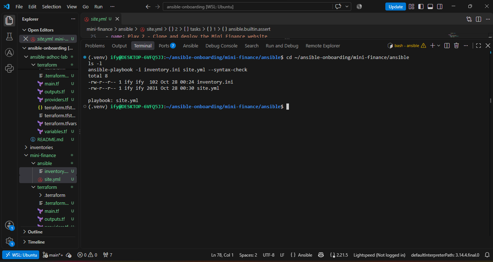

---

#### Screenshot 11 — Play 3 output showing the successful HTTP verification and assertion

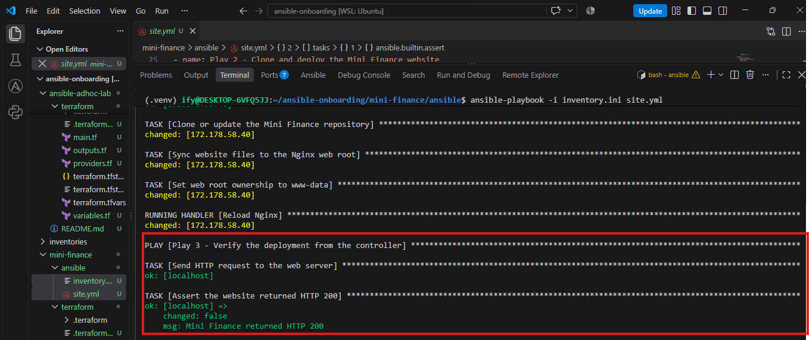

---

#### Screenshot 12 — Final `PLAY RECAP` showing `failed=0` and `unreachable=0`

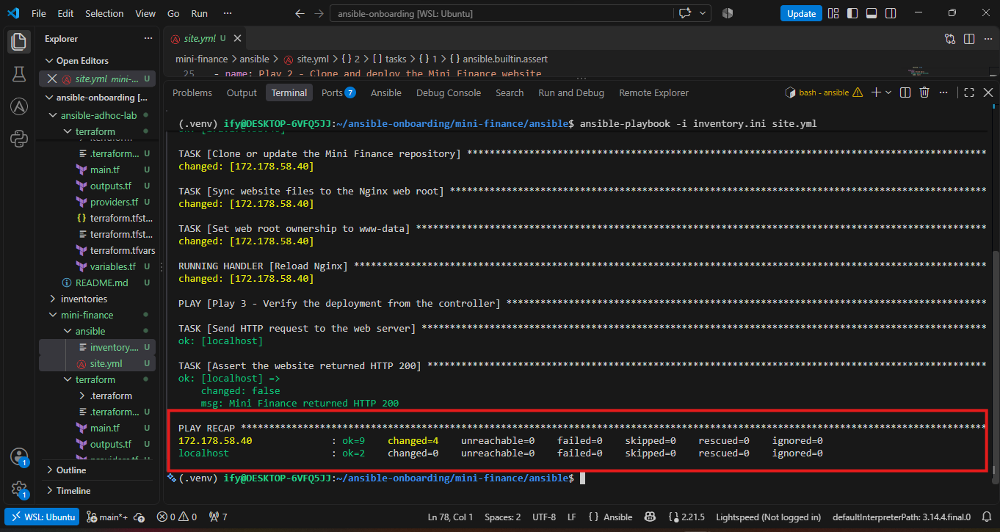

---

### Notes

From the ansible directory, I confirmed that inventory.ini and site.yml were present and ran ansible-playbook -i inventory.ini site.yml --syntax-check, which returned playbook: site.yml. I also checked the playbook with yamllint and ansible-lint; ansible-lint reported 0 failures and 0 warnings and met the production profile.

On the first run, Play 1 completed successfully: it updated the APT cache, installed nginx, git, and rsync, and confirmed Nginx was started and enabled. Play 2 then failed at the Git clone with could not read Username for 'https://github.com'. Running git ls-remote against the repository URL in the brief returned “Repository not found”, which explained the error: GitHub treats a missing or private repository as one that requires login. I searched my earlier Week 6 Mini Finance assignment and found the working repository, https://github.com/pravinmishraaws/mini_finance.git. I confirmed it was public and used the main branch with git ls-remote, updated the repo value in site.yml, and ran the playbook again.

On the second run, Play 2 cloned the repository into /opt/mini-finance and used ansible.posix.synchronize, delegated to the managed host, to copy the website files into /var/www/html/, excluding the .git directory and setting www-data:www-data ownership. Because the synchronization changed files, the Reload Nginx handler ran. Play 3 ran on the controller, sent an HTTP request to the VM’s public IP with the uri module, and the assert task confirmed the returned status was 200. The final play recap showed failed=0 and unreachable=0 for both the VM and localhost.

---

# Task 8 — Test the Mini Finance Website in a Browser

## Goal

Confirm that the Mini Finance website is publicly accessible through the Azure VM’s public IP address.

### Evidence

#### Screenshot 13 — Mini Finance website successfully loading in the browser, with the Azure VM’s public IP address visible in the address bar

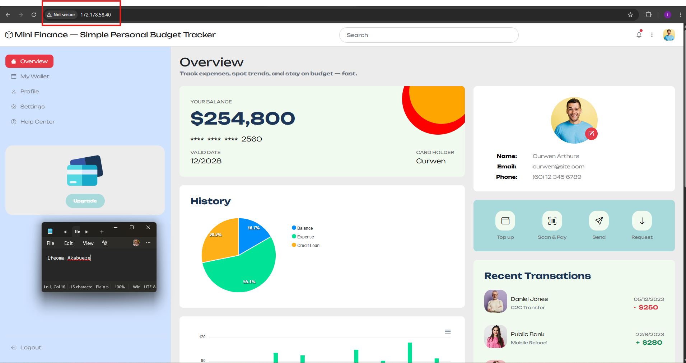

---

### Website URL

Add your deployed website URL below:

```text
http://172.178.58.40
```

---

# Task 9 — Create the Project README

## Goal

Create a `README.md` file to document the Mini Finance infrastructure and deployment project.

### Evidence

#### Screenshot 14 — Completed `README.md` displayed in the VS Code Markdown preview or terminal

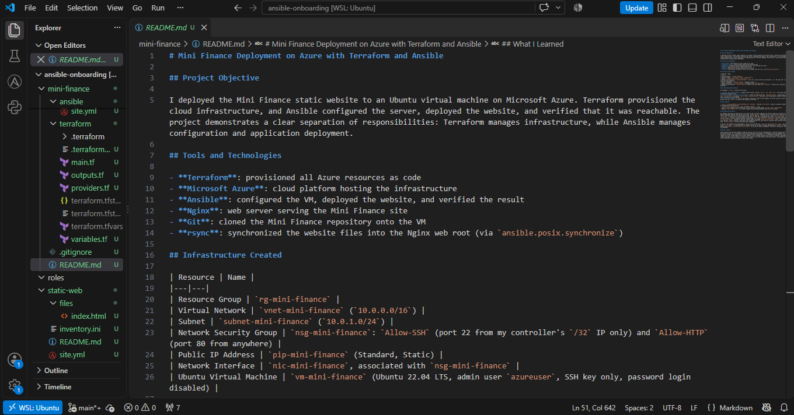

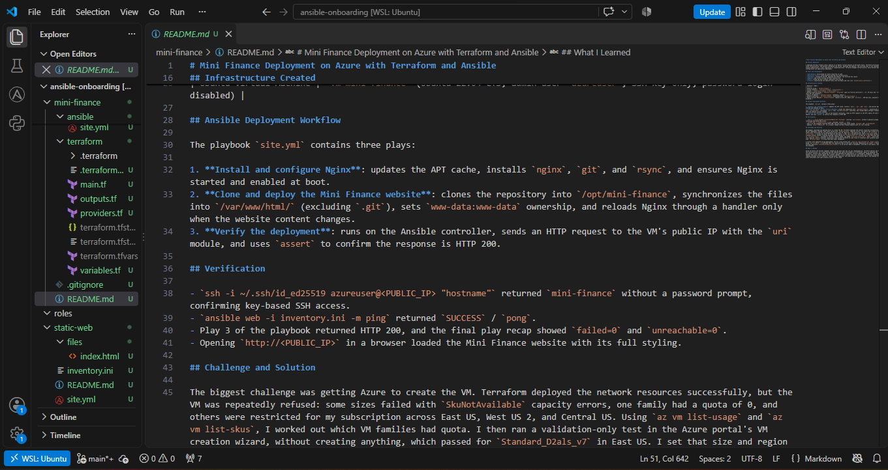

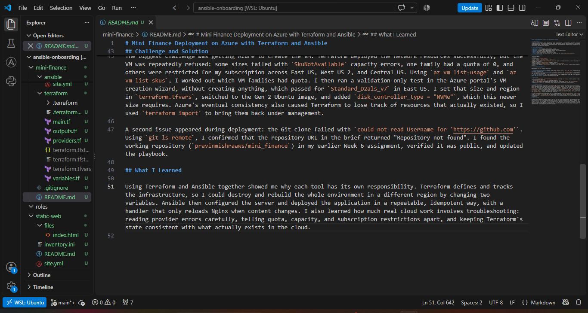

---

### README Content

Copy and paste the complete contents of your `README.md` file below:

```markdown
# Mini Finance Deployment on Azure with Terraform and Ansible

## Project Objective

I deployed the Mini Finance static website to an Ubuntu virtual machine on Microsoft Azure. Terraform provisioned the cloud infrastructure, and Ansible configured the server, deployed the website, and verified that it was reachable. The project demonstrates a clear separation of responsibilities: Terraform manages infrastructure, while Ansible manages configuration and application deployment.

## Tools and Technologies

- **Terraform**: provisioned all Azure resources as code
- **Microsoft Azure**: cloud platform hosting the infrastructure
- **Ansible**: configured the VM, deployed the website, and verified the result
- **Nginx**: web server serving the Mini Finance site
- **Git**: cloned the Mini Finance repository onto the VM
- **rsync**: synchronized the website files into the Nginx web root (via `ansible.posix.synchronize`)

## Infrastructure Created

| Resource | Name |
|---|---|
| Resource Group | `rg-mini-finance` |
| Virtual Network | `vnet-mini-finance` (`10.0.0.0/16`) |
| Subnet | `subnet-mini-finance` (`10.0.1.0/24`) |
| Network Security Group | `nsg-mini-finance`: `Allow-SSH` (port 22 from my controller's `/32` IP only) and `Allow-HTTP` (port 80 from anywhere) |
| Public IP Address | `pip-mini-finance` (Standard, Static) |
| Network Interface | `nic-mini-finance`, associated with `nsg-mini-finance` |
| Ubuntu Virtual Machine | `vm-mini-finance` (Ubuntu 22.04 LTS, admin user `azureuser`, SSH key only, password login disabled) |

## Ansible Deployment Workflow

The playbook `site.yml` contains three plays:

1. **Install and configure Nginx**: updates the APT cache, installs `nginx`, `git`, and `rsync`, and ensures Nginx is started and enabled at boot.
2. **Clone and deploy the Mini Finance website**: clones the repository into `/opt/mini-finance`, synchronizes the files into `/var/www/html/` (excluding `.git`), sets `www-data:www-data` ownership, and reloads Nginx through a handler only when the website content changes.
3. **Verify the deployment**: runs on the Ansible controller, sends an HTTP request to the VM's public IP with the `uri` module, and uses `assert` to confirm the response is HTTP 200.

## Verification

- `ssh -i ~/.ssh/id_ed25519 azureuser@<PUBLIC_IP> "hostname"` returned `mini-finance` without a password prompt, confirming key-based SSH access.
- `ansible web -i inventory.ini -m ping` returned `SUCCESS` / `pong`.
- Play 3 of the playbook returned HTTP 200, and the final play recap showed `failed=0` and `unreachable=0`.
- Opening `http://<PUBLIC_IP>` in a browser loaded the Mini Finance website with its full styling.

## Challenge and Solution

The biggest challenge was getting Azure to create the VM. Terraform deployed the network resources successfully, but the VM was repeatedly refused: some sizes failed with `SkuNotAvailable` capacity errors, one family had a quota of 0, and others were restricted for my subscription across East US, West US 2, and Central US. Using `az vm list-usage` and `az vm list-skus`, I worked out which VM families had quota. I then ran a validation-only test in the Azure portal's VM creation wizard, without creating anything, which passed for `Standard_D2als_v7` in East US. I set that size and region in `terraform.tfvars`, switched to the Gen 2 Ubuntu image, and added `disk_controller_type = "NVMe"`, which this newer size requires. Azure's eventual consistency also caused Terraform to lose track of resources that actually existed, so I used `terraform import` to bring them back under management.

A second issue appeared during deployment: the Git clone failed with `could not read Username for 'https://github.com'`. Using `git ls-remote`, I confirmed that the repository URL in the brief returned "Repository not found". I found the working repository (`pravinmishraaws/mini_finance`) in my earlier Week 6 assignment, verified it was public, and updated the playbook.

## What I Learned

Using Terraform and Ansible together showed me why each tool has its own responsibility. Terraform defines and tracks the infrastructure, so I could destroy and rebuild the whole environment in a different region by changing two variables. Ansible then configured the server and deployed the application in a repeatable, idempotent way, with a handler that only reloads Nginx when content changes. I also learned how much real cloud work involves troubleshooting: reading provider errors carefully, telling quota, capacity, and subscription restrictions apart, and keeping Terraform's state consistent with what actually exists in the cloud.

```

---

# LinkedIn Post Required

## Evidence

#### Screenshot 15 — Published LinkedIn post showing the text and at least one deployment screenshot

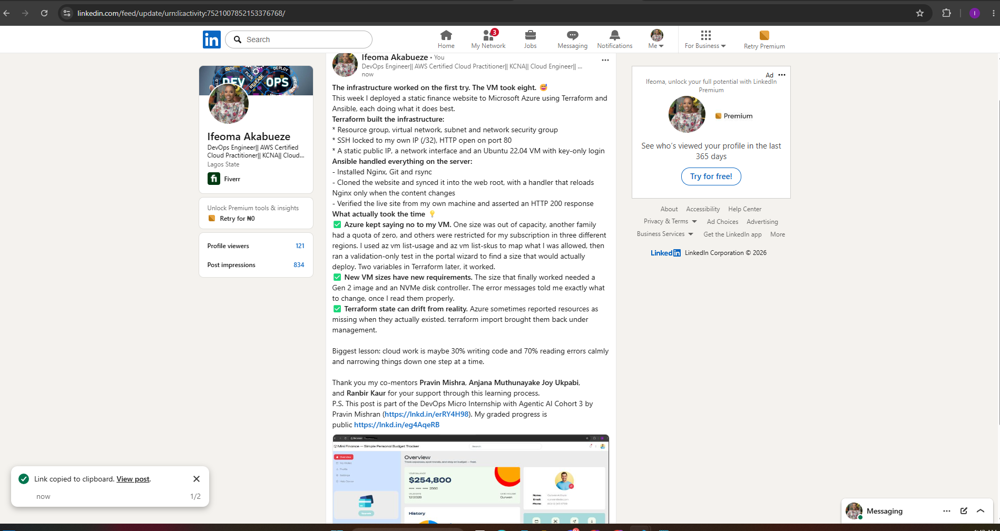

---

#### LinkedIn Post URL

Paste your LinkedIn post URL here:

https://lnkd.in/p/e7A9Sy2E

---

### LinkedIn Submission Notes

**One challenge you faced and how you fixed it:**

Azure repeatedly refused to create my VM even though Terraform deployed all the network resources successfully. Some sizes failed with `SkuNotAvailable` capacity errors, the Basv2 family had a quota of 0, and several sizes were restricted for my subscription in East US, West US 2, and Central US. I used `az vm list-usage` to check which VM families had quota and `az vm list-skus` to see which sizes were restricted. I then ran a validation-only test in the Azure portal's VM creation wizard, without creating anything, which passed for `Standard_D2als_v7` in East US. I set that size and region in `terraform.tfvars`, switched to the Gen 2 Ubuntu 22.04 image, and added `disk_controller_type = "NVMe"`, which this newer size requires. After that, `terraform apply` completed successfully.

---

**One real-world example where you can use this learning:**

As a freelance DevOps engineer, I could use this exact workflow to launch a demo or staging environment for a client. Terraform would create the network, firewall rules, and VM in the client's cloud account in a few minutes, and Ansible would install the web server and deploy their website the same way every time. When the demo is finished, `terraform destroy` removes everything, so the client only pays for what they used, and the environment can be recreated on demand.


---

# Assignment Questions

Answer the following in your own words:

**1. What did you provision using Terraform in this assignment?**

I used Terraform to provision the Azure infrastructure: the resource group `rg-mini-finance`, the virtual network `vnet-mini-finance`, the subnet `subnet-mini-finance`, the network security group `nsg-mini-finance` with the `Allow-SSH` and `Allow-HTTP` rules, the Standard static public IP `pip-mini-finance`, the network interface `nic-mini-finance`, the association between the NSG and the NIC, and the Ubuntu 22.04 VM `vm-mini-finance` with SSH key authentication. I also created a `public_ip` output for the VM's address.

---

**2. What did Ansible configure and deploy in this assignment?**

Ansible configured the VM and deployed the website. It updated the APT cache, installed `nginx`, `git`, and `rsync`, and made sure Nginx was started and enabled at boot. It then cloned the Mini Finance repository into `/opt/mini-finance`, synchronized the website files into `/var/www/html/` while excluding the `.git` folder, set the ownership to `www-data:www-data`, and reloaded Nginx through a handler when the content changed. Finally, it verified the deployment from the controller by checking that the website returned HTTP 200.

---

**3. Why is SSH access on port `22` restricted to your public IP address?**

SSH gives administrative access to the server, so it should only be reachable by the people who manage it. Restricting port 22 to my controller's IP with `/32` means only my machine can attempt to connect, which blocks the automated scans and brute-force attempts that constantly target open SSH ports on the internet. This follows the principle of least privilege and reduces the attack surface of the VM.


---

**4. Why is HTTP port `80` open to the internet?**

Port 80 is the standard port for HTTP traffic, and the Mini Finance website is meant to be publicly accessible. Opening it to `0.0.0.0/0` lets anyone on the internet load the site in a browser. It also allowed my Ansible controller to verify the website with the `uri` module from outside the VM. Only port 80 is open publicly; administrative access stays restricted.

---


---

**5. What is the purpose of the Ansible inventory file?**

The inventory file tells Ansible which servers to manage and how to connect to them. In this assignment, `inventory.ini` placed the VM's public IP in the `web` group and set `ansible_user=azureuser` and the private key path under `[web:vars]`. The playbook could then target the `web` group by name instead of hard-coding IP addresses or connection details.


---

**6. Why does the playbook use separate plays for install, deploy, and verify?**

Each play has one clear responsibility, which makes the playbook easier to read, troubleshoot, and maintain. If something fails, the play name shows whether the problem is in the server setup, the website deployment, or the verification. Separate plays also allow different settings: the install and deploy plays target the `web` group with `become: true`, while the verify play runs on `localhost` with a local connection and no privilege escalation.


---

**7. Why is `rsync` useful when deploying website files?**

`rsync` copies a whole directory efficiently by transferring only files that are new or have changed, instead of copying everything every time. This makes deployments faster and keeps the playbook idempotent: if nothing changed, nothing is copied, and the Nginx reload handler does not run. It also supports options such as excluding the `.git` directory and setting file ownership during the copy with `--chown=www-data:www-data`.


---

**8. What does the Ansible `uri` module verify in this assignment?**

The `uri` module sends an HTTP request from the Ansible controller to the VM's public IP and checks the response. With `status_code: 200`, it expects the website to return a successful response, and the `assert` task then confirms that the returned `status` equals 200. Because the check runs from outside the VM, a successful result proves the whole path works: the public IP is reachable, the NSG allows port 80, Nginx is running, and the deployed website is being served.


---

**9. What issue did you face during this assignment, and how did you fix it?**

The Git clone in Play 2 failed with `could not read Username for 'https://github.com'`. GitHub responds this way when a repository does not exist or is private, so Git tried to ask for login details on a server with no interactive terminal. I ran `git ls-remote` on the repository URL from the brief, and it returned "Repository not found". I searched my earlier Week 6 Mini Finance assignment and found the working repository, `https://github.com/pravinmishraaws/mini_finance.git`. I confirmed it was public and used the `main` branch with `git ls-remote`, updated the `repo` value in `site.yml`, and the playbook then completed successfully.

---

**10. What did you learn from using Terraform and Ansible together?**

I learned that Terraform and Ansible work best when each has its own responsibility. Terraform defines and tracks the infrastructure, which let me destroy and rebuild the entire environment in a different region just by changing two variables. Ansible then configures the server and deploys the application in a repeatable way, with handlers and idempotent tasks so it only changes what is needed. Connecting them was simple: Terraform's `public_ip` output fed directly into the Ansible inventory. I also learned that real cloud work involves careful troubleshooting, such as telling quota, capacity, and subscription restrictions apart, and using `terraform import` to keep Terraform's state consistent with what actually exists in the cloud.

---

# Required Files

Confirm that the following files are included in your assignment folder:

- [ ] `.gitignore`
- [ ] `README.md`
- [ ] `terraform/providers.tf`
- [ ] `terraform/main.tf`
- [ ] `terraform/variables.tf`
- [ ] `terraform/outputs.tf`
- [ ] `ansible/inventory.ini`
- [ ] `ansible/site.yml`

---

# Submission Instructions

- Add all required screenshots in the correct order.
- Full Name must be visible in required screenshots.
- Add the Azure VM public IP address.
- Add the final Mini Finance website URL.
- Paste `inventory.ini`, `site.yml`, and `README.md` as editable text.
- Answer all assignment questions clearly in your own words.
- Add your LinkedIn post URL.
- Do not expose SSH private keys, passwords, Azure credentials, subscription IDs, Terraform state contents, or other sensitive information.

---

# Completion Checklist

- [ ] Task 1: `mini-finance` project structure created
- [ ] Task 1: `.gitignore` created
- [ ] Task 2: Terraform Azure infrastructure code created
- [ ] Task 2: `Allow-SSH` rule configured for port `22`
- [ ] Task 2: `Allow-HTTP` rule configured for port `80`
- [ ] Task 2: NSG associated with the Network Interface
- [ ] Task 3: `terraform fmt` completed
- [ ] Task 3: `terraform init` completed
- [ ] Task 3: `terraform validate` completed successfully
- [ ] Task 3: `terraform apply` completed successfully
- [ ] Task 3: `terraform output public_ip` displayed the VM public IP
- [ ] Task 4: Passwordless SSH works from the Ansible controller
- [ ] Task 5: `inventory.ini` created
- [ ] Task 5: Ansible ping returns `SUCCESS` and `pong`
- [ ] Task 6: `site.yml` contains three separate plays
- [ ] Task 6: Play 1 installs Nginx, Git, and rsync
- [ ] Task 6: Play 2 clones and deploys the Mini Finance website
- [ ] Task 6: Play 3 verifies HTTP status code `200`
- [ ] Task 7: Playbook syntax check passes
- [ ] Task 7: Ansible playbook completes successfully
- [ ] Task 7: Final recap shows `failed=0` and `unreachable=0`
- [ ] Task 8: Mini Finance website loads in the browser
- [ ] Task 8: Azure VM public IP is visible in the browser screenshot
- [ ] Task 9: `README.md` completed
- [ ] Screenshots 1–15 are included
- [ ] `inventory.ini`, `site.yml`, and `README.md` are pasted as editable text
- [ ] Assignment questions are answered
- [ ] LinkedIn post published with Anyone visibility
- [ ] LinkedIn post URL added
- [ ] No sensitive information is exposed

---

## About DMI & CloudAdvisory

DevOps Micro Internship (DMI) is a project-based DevOps program run by Pravin Mishra and The CloudAdvisory, focused on real-world execution, systems thinking, and career readiness.

It helps learners build strong DevOps foundations with hands-on experience.

---

## Resources

- DMI Official Website: [https://dmi.pravinmishra.com?utm_source=github&utm_medium=readme](https://dmi.pravinmishra.com?utm_source=github&utm_medium=readme)
- University: [https://university.pravinmishra.com?utm_source=github&utm_medium=readme](https://university.pravinmishra.com?utm_source=github&utm_medium=readme)
- Discord Community: [https://discord.pravinmishra.com?utm_source=github&utm_medium=readme](https://discord.pravinmishra.com?utm_source=github&utm_medium=readme)
- Blog: [https://dmi.pravinmishra.com/blog?utm_source=github&utm_medium=readme](https://dmi.pravinmishra.com/blog?utm_source=github&utm_medium=readme)
- YouTube Playlist: [https://www.youtube.com/playlist?list=PLFeSNDtI4Cho](https://www.youtube.com/playlist?list=PLFeSNDtI4Cho)
- Pravin Mishra LinkedIn: [https://www.linkedin.com/in/pravin-mishra-aws-trainer/](https://www.linkedin.com/in/pravin-mishra-aws-trainer/)
- CloudAdvisory LinkedIn: [https://www.linkedin.com/company/thecloudadvisory/](https://www.linkedin.com/company/thecloudadvisory/)

---

*This submission is part of DevOps Micro Internship (DMI) — Agentic AI Track.*