# Assignment — Deploy EpicBook with Terraform and Ansible Roles

Part of the DevOps Micro Internship (DMI) with Agentic AI

---

## Purpose

In this assignment, you will deploy the EpicBook web application using Terraform and Ansible roles.

Terraform provisions the cloud infrastructure, including one Ubuntu VM and one managed MySQL database. Ansible roles configure the VM, install required software, deploy the EpicBook application, configure Nginx, connect the app to the managed MySQL database, and verify the deployment.

---

# Task 1 — Set Up the Project Folder Layout

## Goal

Create the project folder structure for Terraform and Ansible roles.

Terraform will be used to provision the cloud infrastructure. Ansible roles will be used to configure the VM and deploy the EpicBook application.

### Evidence

#### Screenshot 1 — Terminal showing the completed `epicbook-prod` project structure

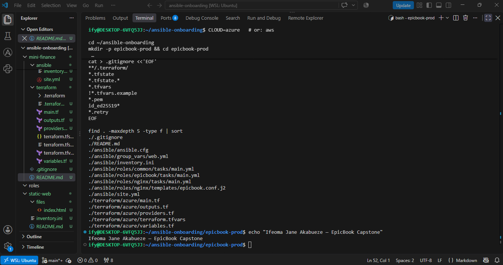

---

### Notes

Answer the following in your own words:

**1. Which cloud provider did you choose for this assignment?**

AWS

---

**2. Why is it useful to keep Terraform files and Ansible files in separate folders?**

Terraform and Ansible handle two different jobs. Terraform provisions the infrastructure (VM, network, managed MySQL), and Ansible configures what runs on that infrastructure (packages, Nginx, the EpicBook app). Separate folders keep that boundary clear, so each tool's files, state, and commands stay in their own space. I can change server configuration without touching infrastructure code, and the reverse, which lowers the risk of an accidental change. The separation also makes the project easier to read and review, and either part can be reused or replaced on its own. For example, the same Ansible roles could configure a VM created on a different cloud.


---

**3. What is the purpose of the `roles` directory in Ansible?**

The `roles` directory breaks the configuration into reusable, self-contained units, each responsible for one job. In this project, `common` prepares the base system, `nginx` sets up the reverse proxy, and `epicbook` deploys the application. Each role has a standard structure (`tasks`, `templates`, `handlers`, and so on), so Ansible knows where to find everything without extra wiring. This keeps `site.yml` short, since it only lists the roles to run, and it makes the code easier to maintain, test, and reuse across other projects or hosts.

---

# Task 2 — Provision the Infrastructure with Terraform

## Goal

Run Terraform to provision the cloud infrastructure for the EpicBook deployment.

Terraform will create the VM, managed MySQL database, networking, security rules, and required outputs.

### Evidence

#### Screenshot 2 — `terraform apply` completed successfully

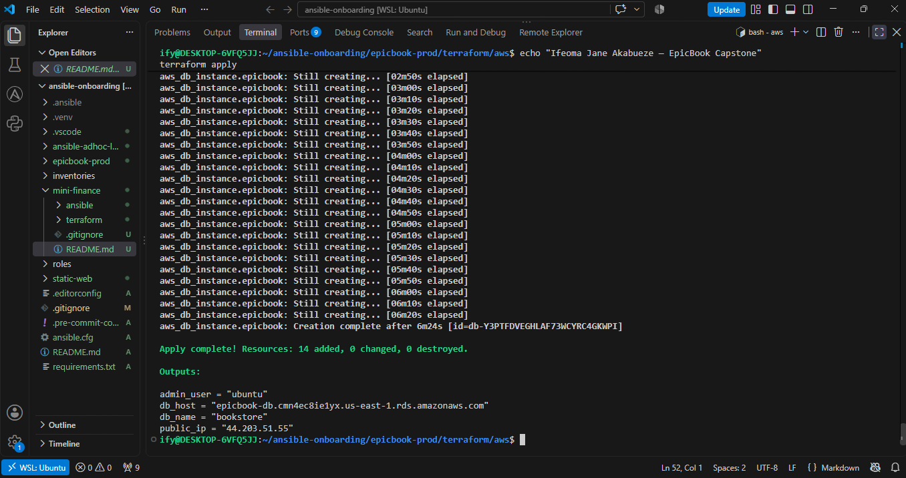

---

#### Screenshot 3 — Output of `terraform output`

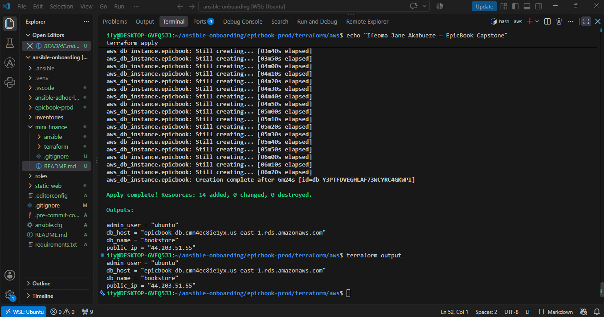

---

#### Screenshot 4 — Azure Portal or AWS Console showing the VM running

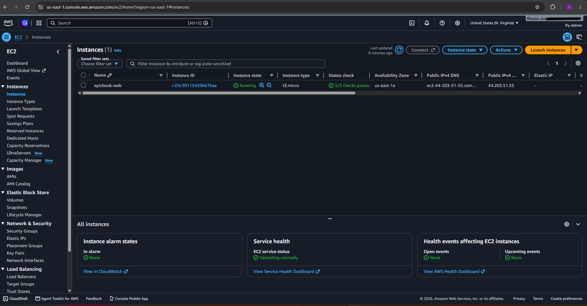

---

#### Screenshot 5 — Azure Portal or AWS Console showing the managed MySQL database created

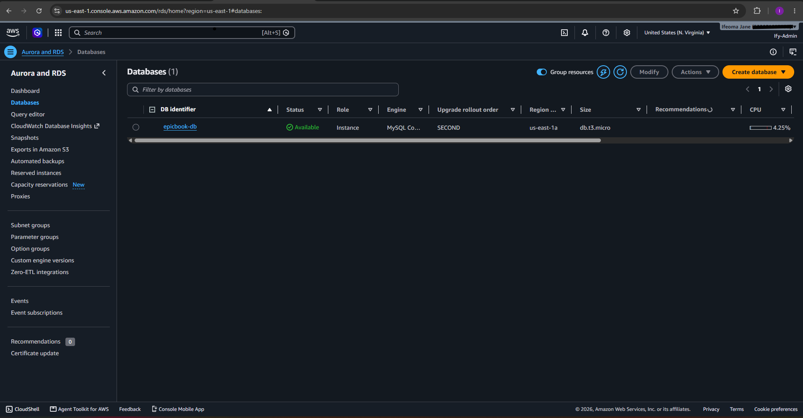

---

### Notes

Answer the following in your own words:

**1. What resources did Terraform create for this assignment?**

Terraform provisioned 14 resources on AWS in the `us-east-1` region:

**Networking**
- A VPC (`10.0.0.0/16`) with DNS support enabled
- An internet gateway to give the public subnet internet access
- One public subnet for the EC2 instance
- Two private subnets in different Availability Zones for the database (RDS requires a subnet group spanning at least two AZs)
- A public route table with a default route to the internet gateway, plus its association with the public subnet

**Security**
- A web security group allowing SSH (port 22) only from my controller's public IP (`/32`) and HTTP (port 80) from anywhere
- A database security group allowing MySQL (port 3306) only from the web security group, so the database is never publicly reachable

**Compute**
- An SSH key pair created from my controller's public key (`~/.ssh/id_ed25519.pub`)
- One Ubuntu 24.04 EC2 instance (`t3.micro`) in the public subnet

**Database**
- A DB subnet group containing the two private subnets
- A DB parameter group for MySQL 8.4
- One Amazon RDS for MySQL 8.4 instance (`db.t3.micro`) with the `bookstore` database, set to not publicly accessible

Terraform also exposed four outputs for the Ansible stage: `public_ip`, `admin_user`, `db_host`, and `db_name`. The database password is passed in as a sensitive variable and is not shown in the outputs.

---

**2. Why should you review `terraform plan` before running `terraform apply`?**

`terraform plan` is a preview. It shows exactly what Terraform will create, change, or destroy before anything happens in the cloud account. Reviewing it is the last chance to catch a mistake while it is still free and harmless.

Reviewing the plan helps me:

- **Avoid accidental destruction.** A small code change can make Terraform replace a resource (shown as `-/+` or "must be replaced"). For a database, that can mean losing all of its data.
- **Confirm the scope is what I expect.** The summary line (e.g. `Plan: 14 to add, 0 to change, 0 to destroy`) should match what the code is meant to build. In this assignment, I checked that the plan only added resources and destroyed nothing before applying.
- **Catch configuration errors early.** Wrong values, such as a placeholder IP left in `terraform.tfvars`, a security rule that is too open, or the wrong region, show up in the plan before they become real resources.
- **Control cost.** The plan reveals unexpected billable resources (for example, a larger instance size or an extra database) before they start costing money.
- **Detect drift.** If someone changed resources manually in the console, the plan shows the differences Terraform intends to correct.

In team and production environments, the plan is often saved with `terraform plan -out=tfplan` and reviewed by others. Then `terraform apply tfplan` executes exactly what was approved and nothing else.

---

**3. Why should database passwords not be shown in Terraform output?**

Terraform output is printed to the terminal and is easy to expose by accident. It can end up in screenshots, terminal history, shared logs, CI/CD pipeline logs, or messages pasted to teammates when troubleshooting. Anyone who sees the password can connect to the database and read, change, or delete application data.

Outputs are meant for non-secret values that other tools need, such as the VM's public IP or the database hostname. Secrets should be handled separately: marked as `sensitive` in Terraform, kept out of version control (for example, `terraform.tfvars` is in `.gitignore`), and ideally stored in a secrets manager such as AWS Secrets Manager or Ansible Vault.

Hiding the password from output does not fully protect it, though. Terraform still stores the value in plain text in the state file (`terraform.tfstate`). That is why the state file must also be kept private and never committed to GitHub. In production, it should live in an encrypted remote backend with restricted access.

---

# Task 3 — Verify SSH Key-Based Access

## Goal

Verify that the cloud VM can be accessed from the Ansible controller using SSH key-based authentication.

### Evidence

#### Screenshot 6 — Successful SSH hostname check from the Ansible controller

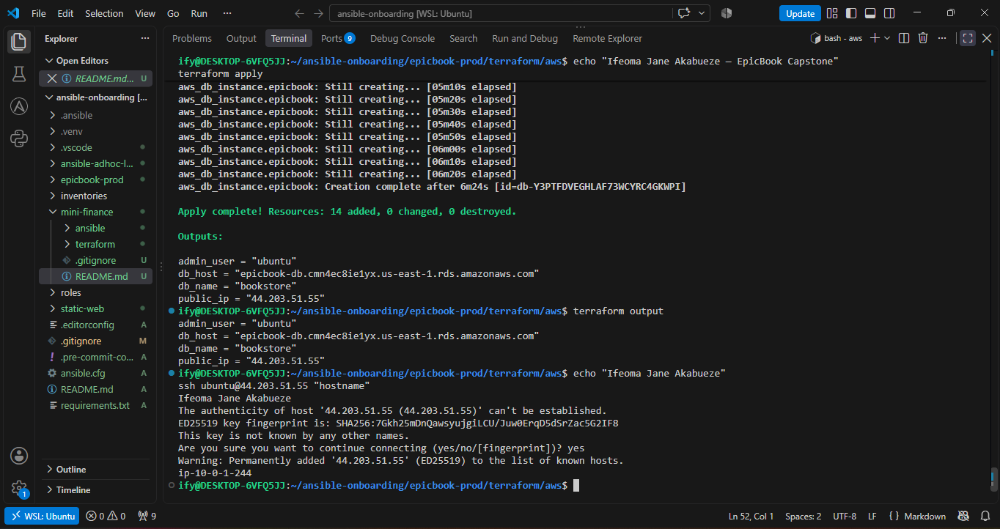

---

### Notes

Answer the following in your own words:

**1. What command did you use to verify SSH access?**

From the Ansible controller, I ran:

```bash
ssh ubuntu@44.203.51.55 "hostname"
```

`ubuntu` is the admin user and `44.203.51.55` is the EC2 public IP, both taken from `terraform output`. The command opens an SSH session, runs `hostname` on the remote VM, prints the result, and exits.


---

**2. What proves that SSH key-based access worked successfully?**

The command returned the VM's hostname (in the form `ip-10-0-1-xx`, based on its private IP in the public subnet) without asking for a password. This proves that:

- The controller could reach the VM over port 22, so the security group rule allowing my `/32` IP works.
- The VM accepted my private key (`~/.ssh/id_ed25519`), which matches the public key Terraform installed through the AWS key pair.
- The `ubuntu` username is correct for the Ubuntu AMI.
- A command executed on the remote VM, which is exactly what Ansible needs to manage it.

Apart from the one-time host fingerprint confirmation on the first connection, no prompt appeared. Ubuntu cloud images disable password login by default, so a successful connection without a password can only mean key-based authentication worked.

---

**3. What would you check if SSH returned `Permission denied (publickey)`?**

This error means the VM was reached but rejected the key, so I would check the authentication side:

- **Username:** Ubuntu AMIs use `ubuntu`, not `ec2-user`, `root`, or `admin`.
- **Private key:** Confirm the right key is being offered by specifying it explicitly with `ssh -i ~/.ssh/id_ed25519 ubuntu@<public_ip>`, and check that it exists.
- **Key pair match:** Confirm that the public key Terraform uploaded (`public_key_path` in `variables.tf`) is the pair of the private key I'm using. Comparing `ssh-keygen -lf ~/.ssh/id_ed25519.pub` with the key fingerprint shown in the EC2 console verifies this.
- **Key permissions:** The private key should be `chmod 600`. SSH ignores keys with permissions that are too open.
- **Verbose output:** Run `ssh -v ubuntu@<public_ip>` to see which keys were offered and why they were rejected.

If SSH instead timed out with no response, the problem would be network access rather than authentication. In that case I would check the security group (port 22 allowed from my current public IP `/32`), the public IP address, and whether my own IP had changed since `terraform apply`.

---

# Task 4 — Create the Ansible Inventory and Configuration

## Goal

Create the Ansible inventory file and local Ansible configuration for the EpicBook VM.

The inventory tells Ansible which VM to manage and which SSH user to use.

### Evidence

#### Screenshot 7 — `inventory.ini` showing the VM under the `web` group

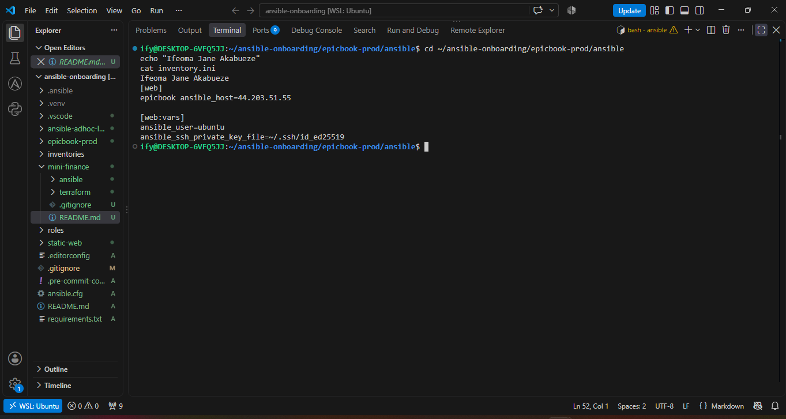

---

#### Screenshot 8 — Output of `ansible-inventory -i inventory.ini --graph`

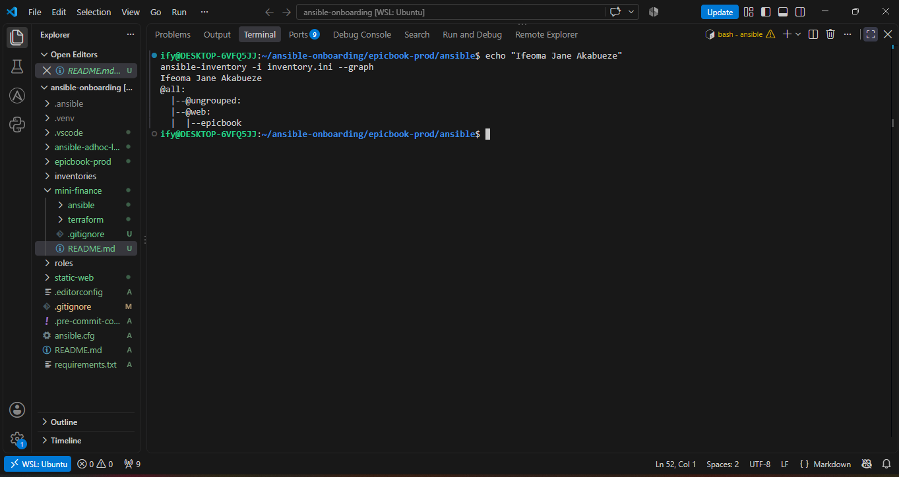

---

#### Screenshot 9 — Output of `ansible web -i inventory.ini -m ping`

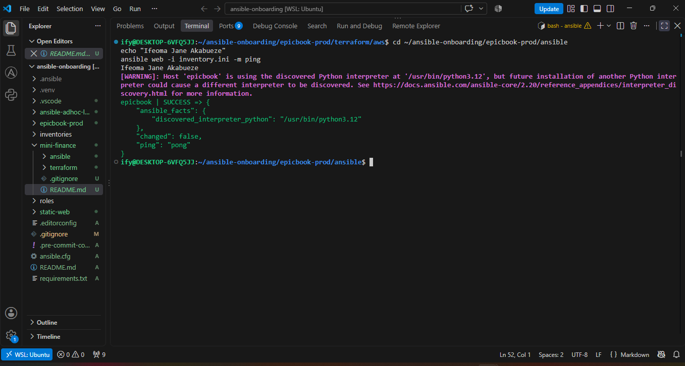

---

### Notes

Answer the following in your own words:

**1. What is the purpose of `inventory.ini`?**

The inventory file tells Ansible which servers to manage and how to connect to them. It lists the hosts, organises them into groups, and holds connection variables such as the SSH user and key. In this project, it defines one host, `epicbook`, under the `web` group. Because `site.yml` targets `hosts: web`, Ansible looks up the `web` group in the inventory to know which VM to configure. If more web servers were added later, I would only need to list them under `[web]`, and the same playbook would configure all of them.

---

**2. What does `ansible_host` store?**

`ansible_host` stores the actual network address Ansible connects to. In this project, that's the EC2 public IP `44.203.51.55` from `terraform output`. It lets me give the host a readable name (`epicbook`) in the inventory and in Ansible output, while the real IP is kept in one place. If the VM were recreated with a new IP, only this value would need to change.

---

**3. What does `ansible_ssh_private_key_file` tell Ansible?**

It tells Ansible which private key to use when authenticating over SSH. Here it points to `~/.ssh/id_ed25519` on my controller, the private half of the key pair whose public key Terraform installed on the EC2 instance. Setting it explicitly means Ansible uses the correct key even when several keys exist on the controller. The key path stays outside the project folder, so the private key is never committed to GitHub.


---

**4. Why is `host_key_checking = False` used only for this temporary lab?**

Host key checking is an SSH security feature. On the first connection, SSH records the server's fingerprint in `known_hosts`, and on every later connection it verifies that the server still presents the same fingerprint. That protects against man-in-the-middle attacks, where an attacker impersonates the server.

In this lab, the VM is short-lived and gets a fresh fingerprint whenever it's recreated, so disabling the check avoids interactive "Are you sure you want to continue connecting?" prompts that would stall an automated Ansible run. The trade-off is that Ansible would connect to any machine answering on that IP without verifying its identity.

In production, I would keep host key checking enabled and manage fingerprints properly, for example by pre-populating `known_hosts` with `ssh-keyscan` from a trusted source, distributing approved host keys through automation, or using SSH certificates.

---

# Task 5 — Create the Main Ansible Playbook

## Goal

Create the main Ansible playbook that runs the required roles in the correct order.

The `site.yml` file will call the `common`, `nginx`, and `epicbook` roles.

### Evidence

#### Screenshot 10 — `site.yml` showing the roles in the correct order

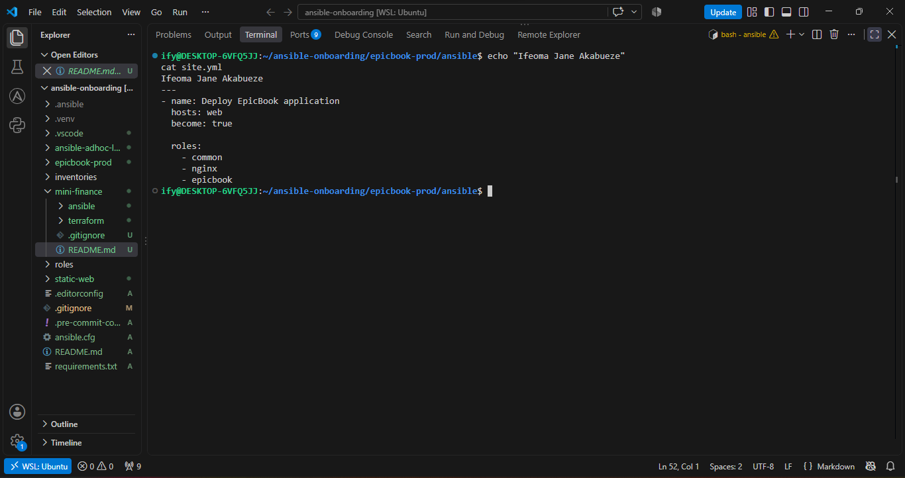

---

#### Screenshot 11 — Output of `ansible-playbook -i inventory.ini site.yml --syntax-check`

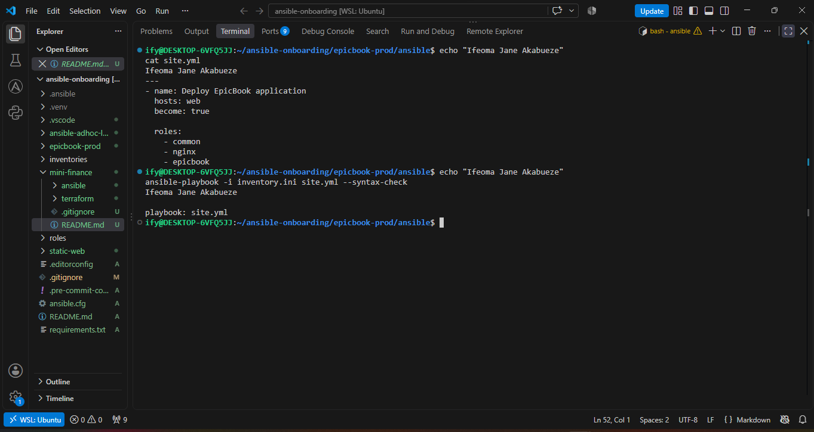

---

### Notes

Answer the following in your own words:

**1. What is the purpose of `site.yml`?**

`site.yml` is the main playbook and the single entry point for the whole deployment. It defines which hosts to target (`web`), whether to use elevated privileges, and which roles to run in which order. It doesn't contain the actual configuration tasks itself. Those live inside the roles. Keeping the playbook this short makes it easy to see the whole deployment at a glance, and running `ansible-playbook -i inventory.ini site.yml` is all it takes to configure the server from start to finish.

---

**2. Why should the roles run in the order `common`, `nginx`, and `epicbook`?**

Each role depends on what the previous one set up:

- **`common`** prepares the base system: it updates the package cache and installs shared tools such as Git, Node.js, and the MySQL client. Nothing else can be installed or deployed reliably until this foundation exists.
- **`nginx`** installs Nginx and configures it as a reverse proxy that forwards web traffic on port 80 to the Node.js application. It needs the system prepared by `common`, and it must be in place before the app goes live so users can reach it.
- **`epicbook`** comes last because it relies on everything before it: Git to clone the repository, Node.js and npm to install dependencies and run the app, the MySQL client to load the database schema, and Nginx to route traffic to the running app.

Running the roles in a different order would cause failures. For example, the `epicbook` role would fail if Git or Node.js weren't installed yet.

---

**3. What does `become: true` allow Ansible to do?**

`become: true` tells Ansible to escalate privileges, by default using `sudo` to run tasks as `root`. Ansible connects as the normal `ubuntu` user, but most of this deployment needs administrator rights: installing packages with `apt`, writing Nginx configuration files under `/etc/nginx`, and managing system services with `systemd`. Without `become: true`, these tasks would fail with permission errors. On the Ubuntu EC2 instance, the `ubuntu` user has passwordless sudo, so Ansible can escalate without prompting for a password.

---

# Task 6 — Create the `common` Role

## Goal

Create the `common` role to prepare the Ubuntu VM with the basic packages required for the EpicBook deployment.

This role handles the common server setup before Nginx and the application are configured.

### Evidence

#### Screenshot 12 — `roles/common/tasks/main.yml` showing the common setup tasks

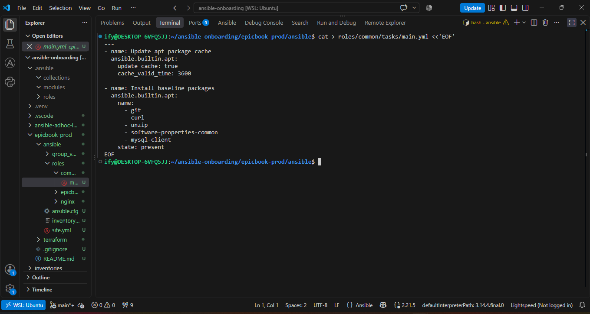

---

### Notes

Answer the following in your own words:

**1. What is the responsibility of the `common` role?**

The `common` role prepares the base Ubuntu server before anything application-specific is installed. It refreshes the apt package cache so the latest package lists are available, then makes sure the shared baseline tools are present: `git`, `curl`, `unzip`, `software-properties-common`, and `mysql-client`. These are general-purpose utilities that later roles depend on. The `epicbook` role uses Git to clone the repository, curl and `software-properties-common` support adding package sources, and the MySQL client loads the database. Keeping this setup in one role gives every later step a consistent, predictable starting point.

---

**2. Why should Nginx installation not be placed inside the `common` role?**

Each role should have one clear responsibility. `common` is meant for baseline setup that almost any server would need, while Nginx is a specific component with its own job: serving web traffic as a reverse proxy. Putting Nginx in its own role keeps everything related to it (installation, site template, enabling the site, validation, and the reload handler) together in one place. That makes it easier to:

- **Reuse** `common` on servers that don't need Nginx, such as a worker or database host.
- **Maintain and troubleshoot**, since any web server issue points straight to the `nginx` role.
- **Swap or change** the web server later without touching the base setup.

Mixing them would make `common` bloated and harder to reuse.

---

**3. Why is `mysql-client` useful in this deployment?**

The database runs on Amazon RDS, a managed service, so there is no MySQL server on the VM and no direct shell access to the database host. The `mysql-client` package gives the VM the `mysql` command-line tool needed to talk to RDS remotely. In this deployment it is used to:

- **Check whether the schema already exists** before importing, which keeps the playbook idempotent on reruns.
- **Import the schema and seed data** from the repository's `db/` folder (`BuyTheBook_Schema.sql`, `author_seed.sql`, `books_seed.sql`) into the `bookstore` database.
- **Test and troubleshoot connectivity** from the VM to the RDS endpoint, for example to confirm the security group allows port 3306 from the web server and that the credentials are correct.

Because RDS sits in private subnets and isn't publicly accessible, the VM is the only place these commands can run from.

---

# Task 7 — Create the `nginx` Role

## Goal

Create the `nginx` role to install Nginx and configure it as a reverse proxy for the EpicBook application.

Nginx will receive browser traffic on port `80` and forward it to the EpicBook Node.js application running on the VM.

### Evidence

#### Screenshot 13 — `roles/nginx/tasks/main.yml` showing Nginx installation and site configuration tasks

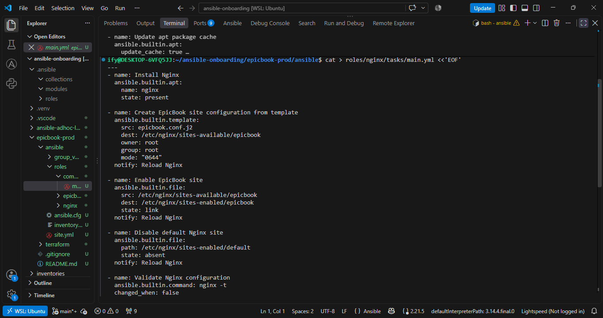

---

#### Screenshot 14 — `roles/nginx/templates/epicbook.conf.j2` showing the reverse proxy configuration

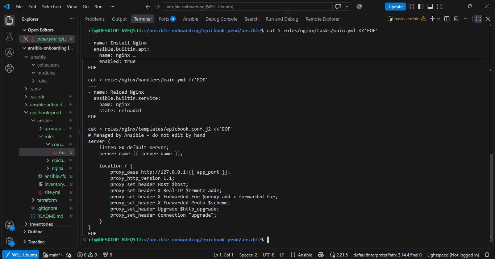

---

### Notes

Answer the following in your own words:

**1. What is the responsibility of the `nginx` role?**

The `nginx` role installs Nginx and configures it as the public entry point for the EpicBook application. It:

- Installs the `nginx` package.
- Generates the site configuration from the `epicbook.conf.j2` template and places it at `/etc/nginx/sites-available/epicbook`.
- Enables the site with a symbolic link in `/etc/nginx/sites-enabled/` and removes the default Nginx site so it doesn't take priority.
- Validates the configuration with `nginx -t` before anything goes live.
- Uses a handler to reload Nginx only when the configuration actually changes.
- Makes sure Nginx is running and enabled to start on boot.

It doesn't deploy or run the application. That stays in the `epicbook` role.

---

**2. Why is Nginx configured as a reverse proxy in this deployment?**


The Node.js application listens on internal port `8080`, while browsers expect a website on the standard HTTP port `80`. Nginx listens on port 80 and forwards each request to the app at `http://127.0.0.1:8080`, so users never need to know or type the app's port.

Using a reverse proxy also brings other benefits:

- **Security:** Only port 80 is open publicly. Port 8080 is never exposed in the security group, so the app is reachable only through Nginx.
- **No root needed for the app:** Ports below 1024 need elevated privileges. Nginx handles port 80, so the Node.js app can run as the unprivileged `ubuntu` user under PM2.
- **Better handling of web traffic:** Nginx is built to manage many client connections efficiently and passes headers such as `X-Real-IP` and `X-Forwarded-For`, so the app still sees the original client details.
- **Room to grow:** HTTPS/TLS, caching, compression, or load balancing across several app instances can be added in Nginx later without changing the application.

---

**3. Why should the application port come from `group_vars/web.yml` instead of being hard-coded?**

The port is used in more than one place: the Nginx template needs it for `proxy_pass`, and the `epicbook` role passes it to PM2 as the `PORT` environment variable. Defining it once as `app_port` in `group_vars/web.yml` keeps both sides in sync. If the port were hard-coded separately in each role, changing it in one place and forgetting the other would make Nginx forward traffic to a port where nothing is listening, resulting in a `502 Bad Gateway` error.

Keeping it as a variable also makes the roles reusable. The same `nginx` role could proxy a different app on a different port, or the port could be overridden for another environment (for example, staging versus production), just by changing the variable, without editing the role's code. This follows the principle of separating configuration data from logic.

---

# Task 8 — Create the `epicbook` Role

## Goal

Create the `epicbook` role to deploy the EpicBook application, connect it to the managed MySQL database, and run the application on port `8080` using PM2.

### Evidence

#### Screenshot 15 — `roles/epicbook/tasks/main.yml` showing application deployment tasks

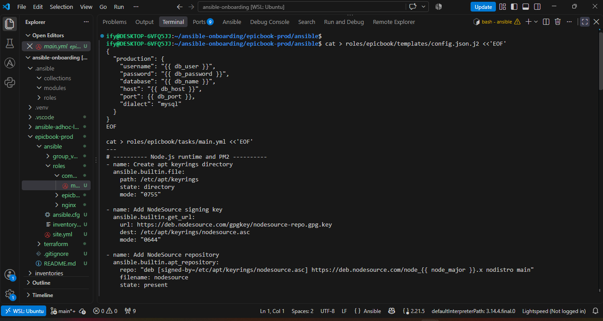

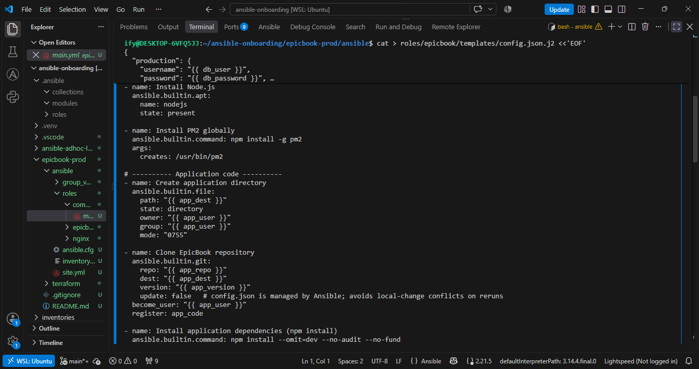

---

#### Screenshot 16 — Task or file showing how the database connection is configured, with secrets hidden

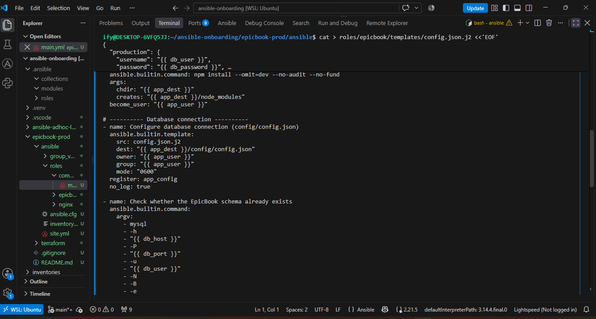

---

#### Screenshot 17 — Task or output showing the EpicBook application managed by PM2

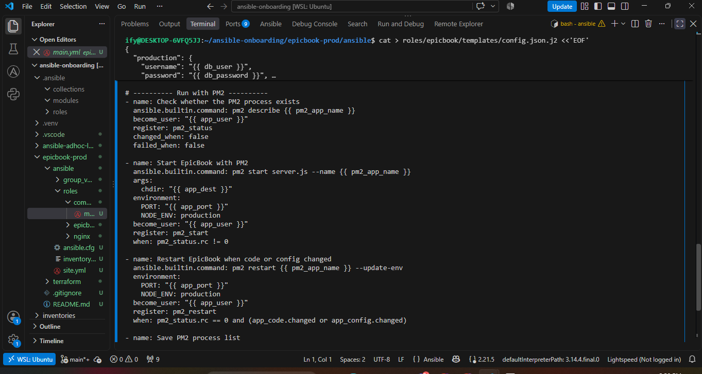

---

### Notes

Answer the following in your own words:

**1. What is the responsibility of the `epicbook` role?**

The `epicbook` role deploys and runs the application itself. It:

- Installs the application runtime, Node.js 22 from the NodeSource repository, plus PM2 as a global npm package.
- Creates the application directory (`/opt/epicbook`) owned by the `ubuntu` user and clones the EpicBook repository into it.
- Installs the app's dependencies with `npm install`.
- Generates `config/config.json` from a template, so the app connects to the RDS endpoint using the database name, user, and password from Ansible variables.
- Checks whether the database schema already exists and, only if it doesn't, imports the schema and seed data from the repository's `db/` folder. This keeps reruns idempotent.
- Starts the app with PM2 under the name `epicbook` on port 8080, restarts it only when the code or configuration changes, saves the process list, and enables PM2 to start on boot.
- Waits until the app is listening on port 8080, so the run fails clearly if the app can't start.

Everything app-specific lives here, separate from the base setup (`common`) and the web server (`nginx`).

---

**2. Why is PM2 used for the EpicBook Node.js application?**

Running `node server.js` directly ties the app to a terminal session: it stops when the SSH session closes or the server reboots, and nothing restarts it if it crashes. PM2 is a process manager built for Node.js that solves these problems:

- **Runs in the background** independently of any terminal session.
- **Restarts the app automatically** if it crashes.
- **Starts on boot** through the systemd service created by `pm2 startup`, combined with `pm2 save`.
- **Makes management easy** with commands such as `pm2 list`, `pm2 logs`, and `pm2 restart`, and with a consistent process name (`epicbook`) that Ansible can check and control.

This makes the deployment reliable without anyone having to start the app by hand.

---

**3. Why should database passwords not be hard-coded in public files?**

Anything committed to a public repository can be read by anyone, and it stays in the Git history even after it is deleted from the latest version. Automated bots constantly scan GitHub for leaked credentials. A hard-coded password would give an attacker direct access to read, change, or delete the application's data, and would force a password rotation across every place it is used.

In this deployment:

- The password lives in `terraform.tfvars`, which is excluded by `.gitignore`.
- In `group_vars/web.yml`, it is stored only as an **Ansible Vault** encrypted value, and decrypted at runtime with `--ask-vault-pass`.
- The `config.json.j2` template contains only the placeholder `{{ db_password }}`. The real value is written only to the VM, with `0600` permissions, and the template task uses `no_log` so the password doesn't appear in Ansible output.

Separating secrets from code also makes the same files reusable across environments, each with its own credentials.

---

**4. What does it mean for the application to run on port `8080` while Nginx listens on port `80`?**

There are two layers. Nginx is the public-facing web server listening on port **80**, the standard HTTP port that browsers use by default. The EpicBook Node.js app listens on port **8080** on the VM itself (`127.0.0.1`), and the security group doesn't open 8080 to the internet.

When a user visits `http://<public_ip>`, the request reaches Nginx on port 80. Nginx forwards it internally to `http://127.0.0.1:8080`, the app processes it, and the response travels back through Nginx to the user. The user never sees port 8080.

This setup keeps the application hidden behind Nginx. It also means the app doesn't need root privileges to bind to a low port, and the web layer (TLS, caching, load balancing) can be changed without touching the app. Both sides read the port from the same `app_port` variable, so they always agree.

---

# Task 9 — Create Group Variables

## Goal

Create reusable variables for the EpicBook deployment.

The `group_vars/web.yml` file stores values that can be reused across the Ansible roles.

### Evidence

#### Screenshot 18 — `group_vars/web.yml` showing the application, PM2, and database variables, with passwords hidden or masked

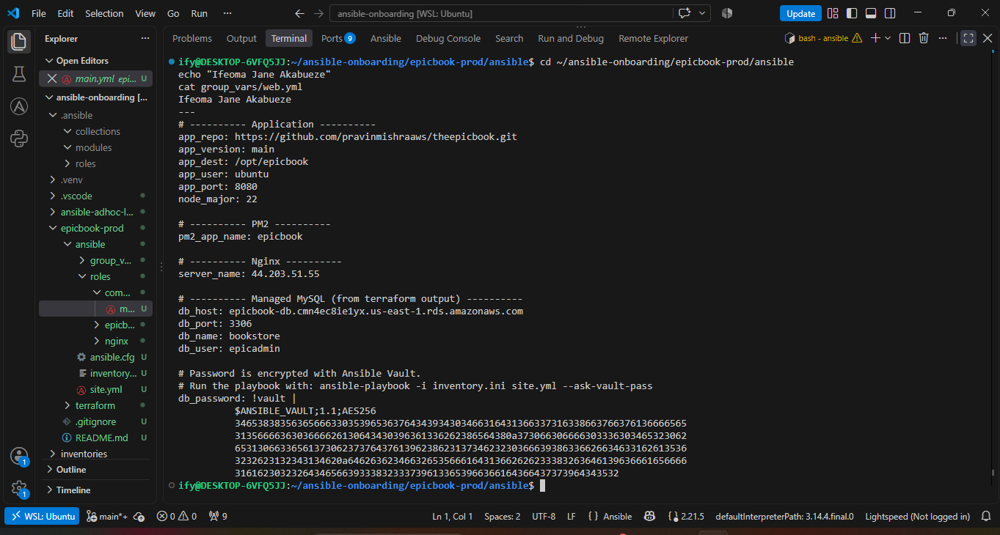

---

### Notes

Answer the following in your own words:

**1. What is the purpose of `group_vars/web.yml`?**

`group_vars/web.yml` holds variables that apply to every host in the `web` inventory group. Ansible loads it automatically for any play that targets `web`, so the roles can use these values without anyone passing them in.

It keeps the configuration *data* separate from the role *logic*. The roles describe how to install and configure things, while this file says what values to use: which repository to clone, which port the app runs on, which database to connect to, and so on. As a result:

- Each value is defined **once** and shared across roles (for example, `app_port` is used by both the Nginx template and PM2).
- The roles stay **reusable**. Deploying to another environment only means changing these values, not editing the role code.
- Changes are **easy and safe**. If the VM IP or RDS endpoint changes after a new `terraform apply`, I update one file.

---

**2. Which values did you store in `group_vars/web.yml`?**

| Category | Variable | Value |
|---|---|---|
| Application | `app_repo` | `https://github.com/pravinmishraaws/theepicbook.git` |
| | `app_version` | `main` |
| | `app_dest` | `/opt/epicbook` |
| | `app_user` | `ubuntu` |
| | `app_port` | `8080` |
| | `node_major` | `22` (Node.js major version) |
| PM2 | `pm2_app_name` | `epicbook` |
| Nginx | `server_name` | the EC2 public IP from `terraform output` |
| Database | `db_host` | the RDS endpoint from `terraform output` |
| | `db_port` | `3306` |
| | `db_name` | `bookstore` (matches the database created by Terraform) |
| | `db_user` | `epicadmin` (the RDS master user defined in Terraform) |
| | `db_password` | encrypted with Ansible Vault |


---

**3. How did you handle the database password securely?**

I used **Ansible Vault** to encrypt the password inline in `group_vars/web.yml` with `ansible-vault encrypt_string`. I didn't type the password on screen: I read it directly from `terraform.tfvars` and piped it into the command, which added a `db_password: !vault |` block containing only AES256-encrypted text. Without the vault password, the value can't be read, so the file is safe to commit to GitHub and to show in screenshots.

The password is decrypted only at runtime, when I run the playbook with:

```bash
ansible-playbook -i inventory.ini site.yml --ask-vault-pass
```

Other measures protect it along the rest of its path:

- `terraform.tfvars`, which holds the original password, is excluded from Git by `.gitignore`. Terraform marks the variable as `sensitive`, and it is not included in the Terraform outputs.
- The `config.json.j2` template contains only the placeholder `{{ db_password }}`. The real value is written only to the VM, in `config/config.json` with `0600` permissions (readable only by the app user).
- The template task uses `no_log: true`, so the password doesn't appear in Ansible's output.
- The `mysql` commands pass the password through the `MYSQL_PWD` environment variable rather than on the command line, so it doesn't show up in process listings or task output.

---

# Task 10 — Run the Ansible Playbook

## Goal

Run the Ansible playbook to configure the VM and deploy the EpicBook application.

The playbook should run the roles in this order:

1. `common`
2. `nginx`
3. `epicbook`

### Evidence

#### Screenshot 19 — Ansible playbook output showing the roles running

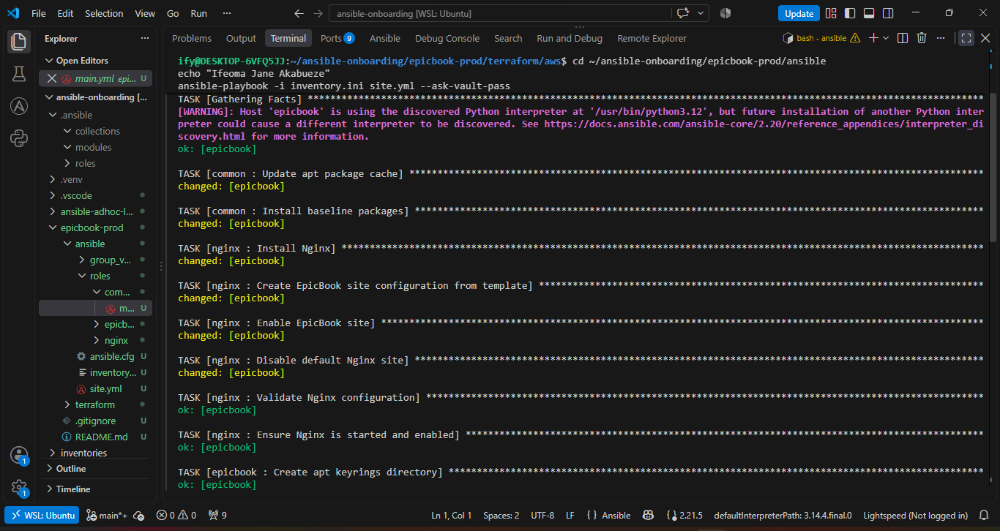

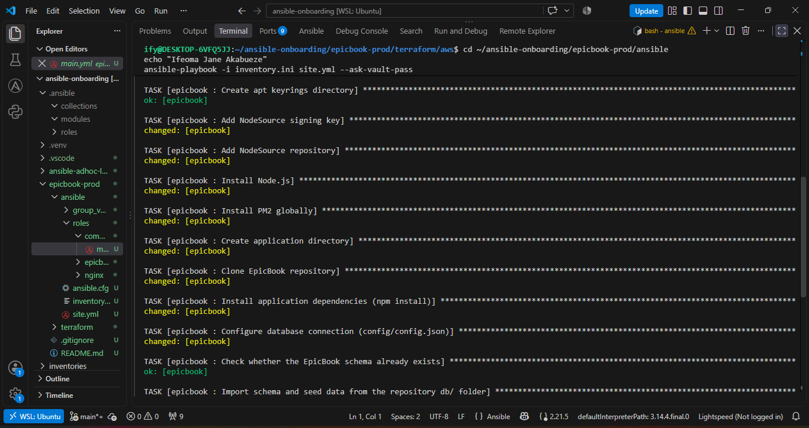

---

#### Screenshot 20 — Final Ansible recap showing `failed=0`

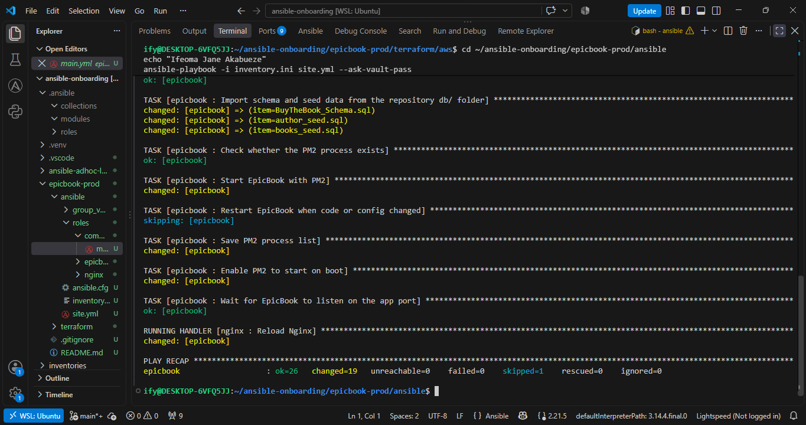

---

#### Screenshot 21 — Output of `ansible web -i inventory.ini -m command -a "systemctl is-active nginx" --become`

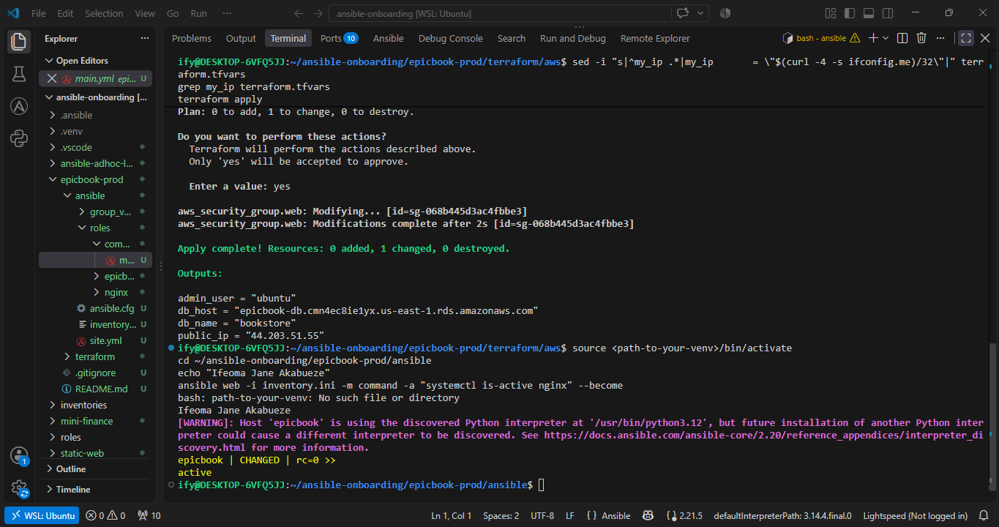

---

#### Screenshot 22 — Output of `ansible web -i inventory.ini -m command -a "pm2 status"`

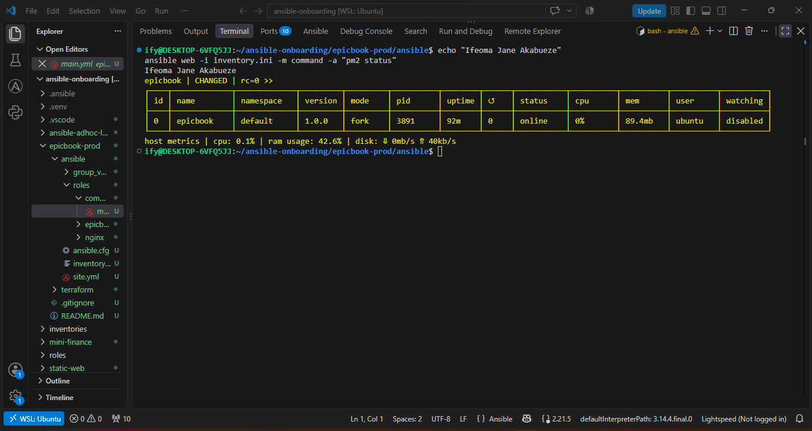

---

#### Screenshot 23 — Output of `ansible web -i inventory.ini -m command -a "curl -I http://localhost:8080"`

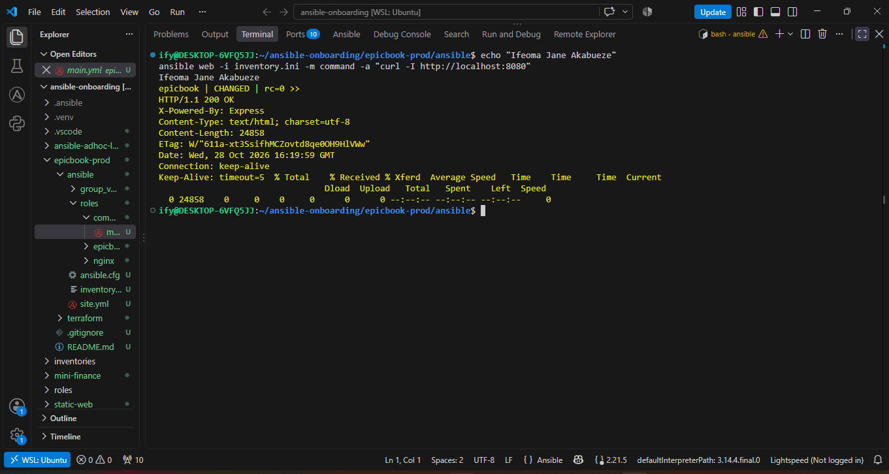

---

### Notes

Answer the following in your own words:

**1. What command did you run to execute the Ansible playbook?**

From the `ansible` directory on my controller, I ran:

```bash
ansible-playbook -i inventory.ini site.yml --ask-vault-pass
```

`-i inventory.ini` tells Ansible to target the `epicbook` host in the `web` group. `site.yml` is the main playbook that runs the `common`, `nginx`, and `epicbook` roles in order. `--ask-vault-pass` prompts for the vault password so Ansible can decrypt the `db_password` stored with Ansible Vault in `group_vars/web.yml`.

---

**2. How do you know all roles completed successfully?**

The playbook output showed tasks from all three roles running in order, each prefixed with its role name: `TASK [common : ...]`, then `TASK [nginx : ...]`, then `TASK [epicbook : ...]`, including the handler `RUNNING HANDLER [nginx : Reload Nginx]`. Each task finished as `ok` or `changed`, with no red `fatal` errors.

The final `PLAY RECAP` for the `epicbook` host showed `failed=0` and `unreachable=0`. Ansible stops a host at the first failed task, so reaching the recap with zero failures means every task in every role completed. The last task in the `epicbook` role, `Wait for EpicBook to listen on the app port`, also passed, which confirms the app was actually up at the end of the run, not just installed.

---

**3. What proves that Nginx is active?**

I ran:

```bash
ansible web -i inventory.ini -m command -a "systemctl is-active nginx" --become
```

It returned `rc=0` and printed `active`, meaning systemd reports the Nginx service is running on the VM. The `nginx` role also ensures Nginx is enabled at boot, and the playbook validated the configuration with `nginx -t` before reloading. The public check in Task 11 (`curl -I http://<public_ip>`) confirms it further by returning a response with the `Server: nginx` header.

---

**4. What proves that PM2 is managing the EpicBook application?**

I ran:

```bash
ansible web -i inventory.ini -m command -a "pm2 status"
```

The PM2 process table listed a process named **`epicbook`** with:

- **status: `online`**, so the app is running.
- **uptime: `92m`**, so it had been running continuously in the background since the playbook started it, including while my own machine lost power, which shows it doesn't depend on my terminal session.
- **restarts (`↺`): `0`**, so it hadn't crashed once, which also suggests the database connection was healthy from the start.
- **user: `ubuntu`**, so it runs as the unprivileged app user, not root.

The playbook also ran `pm2 save` and `pm2 startup systemd`, so PM2 will bring the app back automatically if the VM reboots.


---

**5. What proves that the EpicBook application responds on port `8080`?**

I ran:

```bash
ansible web -i inventory.ini -m command -a "curl -I http://localhost:8080"
```

The VM itself sent the request directly to port 8080, bypassing Nginx, and the app returned `HTTP/1.1 200 OK` with the header `X-Powered-By: Express`. That proves the Node.js/Express application is listening and serving requests on port 8080. Since Nginx's `proxy_pass` points to `http://127.0.0.1:8080`, this is also the port that public traffic on port 80 is forwarded to.

---

# Task 11 — Verify the EpicBook Deployment

## Goal

Verify that the EpicBook application is running, accessible in the browser, and connected to the managed MySQL database.

### Evidence

#### Screenshot 24 — Output of `curl -I http://<public_ip>`

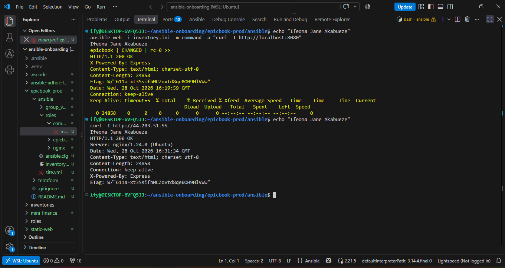

---

#### Screenshot 25 — Output of the cart API test command

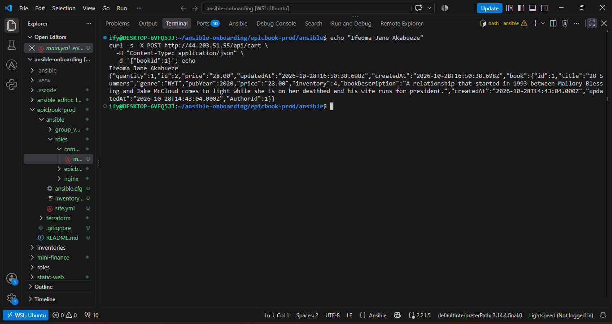

---

#### Screenshot 26 — Output of the `/cart` HTTP status check

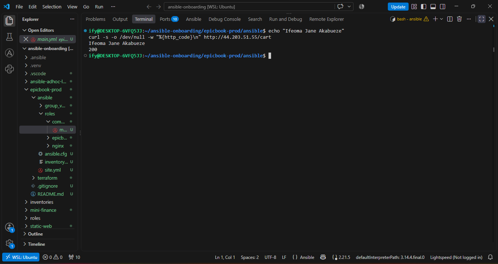

---

#### Screenshot 27 — Browser showing the EpicBook application loaded from `http://<public_ip>`

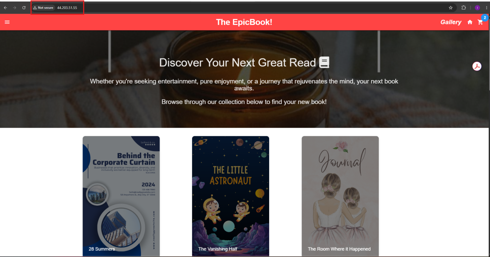

---

### Notes

Answer the following in your own words:

**1. What HTTP response did you receive from the public application URL?**

What HTTP response did you receive from the public application URL?**

Running `curl -I http://44.203.51.55` from my controller returned `HTTP/1.1 200 OK`. The response headers included `Server: nginx`, which shows the request was received by Nginx on port 80 and successfully proxied to the EpicBook app on port 8080. This confirms that the security group allows public HTTP traffic, that Nginx is serving the site, and that the application behind it responds.

---

**2. What did the cart API test prove?**

The `POST /api/cart` request with `{"bookId":1}` returned a JSON response containing a new cart record (`id`, `quantity`, `price`) and a nested `book` object with the details of book ID 1.

This proves the complete request path works end to end:

1. **Controller → Nginx:** the request reached the VM over the public internet on port 80.
2. **Nginx → Node.js:** Nginx forwarded it to the Express app on port 8080.
3. **Node.js → RDS MySQL:** the app looked up book ID 1 and inserted a new row into the `Cart` table in the managed database.
4. **Back to the client:** the app returned the result as JSON.

It also confirms that the database credentials from Ansible Vault were applied correctly, that the RDS security group allows MySQL traffic from the web server, and that the schema and seed data were imported, since book ID 1 only exists because `books_seed.sql` was loaded.

---

**3. What did the `/cart` status check return?**

```bash
curl -s -o /dev/null -w "%{http_code}\n" http://44.203.51.55/cart
```

It returned **`200`**, meaning the cart page loaded successfully through Nginx without server errors. In the browser, the home page, book listings, add-to-cart action, and cart page all worked without visible errors.

---


---

**4. What issue did you face during verification, and how did you fix it?**


**Issue:** My controller's public IP kept changing during the session (from `.193` to `.144`, then to `.212`), because my internet provider rotates IP addresses. Since the SSH rule in the security group is restricted to my controller's IP with `/32`, every change locked me out: `ansible web -m ping` failed with `UNREACHABLE` and `ssh: connect to host ... port 22: Connection timed out`.

**Diagnosis:** A timeout, rather than `Permission denied (publickey)`, pointed to a network block rather than an authentication problem. I compared my current IP (`curl -4 ifconfig.me`) with the `my_ip` value in `terraform.tfvars` and found they no longer matched.

**Fix:** I updated `my_ip` in `terraform.tfvars` to the new address and ran `terraform apply`. The plan showed only `1 to change`, an in-place update to the web security group's SSH rule, with nothing added or destroyed. After applying, SSH and Ansible connected again. Making the change through Terraform rather than editing the rule in the AWS console kept the code and the real infrastructure in sync.

**Lesson:** In production, I would avoid depending on a changing home IP for SSH by using a bastion host, a VPN, or AWS Systems Manager Session Manager, which needs no open SSH port at all. For this lab, I kept the required `/32` rule and updated it whenever the IP changed.

---

# LinkedIn Post Required

## Evidence

#### LinkedIn Post URL

Paste your LinkedIn post URL here:

https://lnkd.in/p/ePbZVVsc

---

#### Screenshot — Published LinkedIn post


---

# Assignment Questions

Answer the following in your own words:

**1. Why is Terraform used for infrastructure provisioning?**

Terraform lets me define infrastructure as code: the VPC, subnets, security groups, EC2 instance, and RDS database are all described in `.tf` files instead of being clicked together in the AWS console. That makes the infrastructure:

- **Repeatable:** the same code creates the same environment every time.
- **Reviewable:** `terraform plan` shows exactly what will change before anything happens.
- **Version-controlled:** changes are tracked in Git like application code.
- **Easy to change and clean up:** when my IP changed, I updated one variable and Terraform changed only the affected security group rule. `terraform destroy` removes everything when I'm done, so no forgotten resources keep costing money.

Terraform also tracks what it created in its state file, so it knows the difference between what exists and what the code describes.


---

**2. Why are Ansible roles useful for production-style deployments?**

Roles split a deployment into focused, reusable units with a standard structure (`tasks`, `templates`, `handlers`). In this project, `common` prepares the server, `nginx` handles the reverse proxy, and `epicbook` deploys the app. This makes the code:

- **Organised and readable:** `site.yml` is just a short list of roles, and each concern lives in its own place.
- **Reusable:** the `nginx` role could proxy another app just by changing variables.
- **Easier to troubleshoot:** a web server problem points straight to the `nginx` role.
- **Easier for teams:** different people can maintain different roles, and roles can be shared across projects.

---

**3. What is the purpose of `group_vars/web.yml`?**

It stores the variables for every host in the `web` group, and Ansible loads it automatically. It separates configuration *values* (repository URL, app path, port, PM2 name, Nginx server name, RDS host, database name and user) from role *logic*. Each value is defined once and shared across roles. For example, `app_port` is used by both the Nginx template and PM2, so they always agree. It also connects the two tools, holding the Terraform outputs (`public_ip`, `db_host`, `db_name`) that Ansible needs. The database password is stored there only as an Ansible Vault encrypted value.


---

**4. Why should database passwords not be committed to GitHub?**

Anything pushed to GitHub can be copied, forked, or scanned by bots that search specifically for leaked credentials, and it stays in the Git history even after deletion. A leaked password could let an attacker read, change, or delete application data, and would force a password rotation everywhere it is used. In this project, the password stays in `terraform.tfvars` (excluded by `.gitignore`), is encrypted with Ansible Vault in `group_vars/web.yml`, appears only as a placeholder in the `config.json.j2` template, and is hidden from Ansible output with `no_log`.

---

**5. What is the purpose of Nginx in this deployment?**

Nginx is the public entry point. It listens on port 80 and reverse-proxies requests to the Node.js app on `127.0.0.1:8080`. This means:

- Only port 80 is publicly open; the app port is never exposed.
- The app runs as the unprivileged `ubuntu` user, without root.
- Nginx handles client connections efficiently and passes headers such as `X-Forwarded-For`, so the app sees the real client details.
- HTTPS, caching, or load balancing can be added later in Nginx without changing the app.

---

**6. Why should the managed MySQL database not be publicly accessible?**

The database holds the application's data and should only ever be reached by the application. If it were public, anyone on the internet could attempt brute-force logins or exploit vulnerabilities directly. In this setup, RDS sits in **private subnets** with `publicly_accessible = false`, and its security group allows port 3306 **only from the web server's security group**. Even a leaked password couldn't be used from outside, because there is no network path to the database. This is defence in depth: credentials and network controls protect it independently.

---

**7. Why is PM2 used for the EpicBook Node.js application?**

Running `node server.js` directly ties the app to a terminal session: it stops when the session ends and doesn't come back after a crash or reboot. PM2 runs the app as a managed background process named `epicbook`, restarts it automatically if it crashes, and, through `pm2 save` and `pm2 startup systemd`, starts it again after a server reboot. It also offers simple management commands (`pm2 status`, `pm2 logs`, `pm2 restart`). The app stayed online through my local power cut with 0 restarts, which shows it doesn't depend on my machine at all.

---

**8. What does idempotency mean in Ansible?**

Idempotency means running the same playbook multiple times produces the same end state, and only changes what is actually out of line with the desired state. On a second run, a well-written playbook should report mostly `ok` and very few or no `changed` tasks.

In this project I made the playbook idempotent by:

- Using state-based modules such as `apt` (`state: present`), `template`, `file`, and `service`, which only act when something differs.
- Adding `creates:` to commands, so `npm install` and the PM2 install run only if their result doesn't exist yet.
- Checking whether the `Author` table exists before importing the SQL files. They use plain `CREATE TABLE` and `INSERT`, so running them twice would fail or duplicate data.
- Restarting PM2 only when the code or configuration changed, and reloading Nginx through a handler only when its configuration changed.
- Marking read-only checks such as `nginx -t` with `changed_when: false`.

Idempotency makes reruns safe, which matters for fixing drift, recovering from failures, and repeatable deployments.

---

**9. What issue did you face during the deployment, and how did you fix it?**

My controller's public IP kept changing during the session because my ISP rotates addresses. The SSH rule only allowed my original IP (`/32`), so Ansible suddenly failed with `UNREACHABLE` and `Connection timed out`. Because it was a timeout rather than `Permission denied (publickey)`, I knew the problem was network access, not my SSH key. I compared `curl -4 ifconfig.me` with `my_ip` in `terraform.tfvars`, confirmed they differed, updated the variable, and ran `terraform apply`. The plan showed a single in-place change to the web security group, and access was restored. Fixing it through Terraform instead of the console kept the code and the real infrastructure in sync.

A smaller issue came early on: Task 1 created a `terraform/azure` folder by mistake. I renamed it to `terraform/aws` before provisioning anything, so the project kept only one cloud folder.

---

**10. What security improvement would you make before using this setup in production?**

The most important improvement would be **HTTPS with TLS everywhere**:

- **Browser to Nginx:** add a domain name and a TLS certificate (Let's Encrypt via Certbot, or an AWS Application Load Balancer with an ACM certificate), and redirect HTTP to HTTPS. Right now, traffic, including anything users submit, travels unencrypted over port 80.
- **App to database:** turn `require_secure_transport` back on in the RDS parameter group and configure the app to connect over TLS using the AWS RDS certificate bundle. I disabled it only because the app doesn't support TLS connections out of the box.

Other improvements I would make:

- **Remove public SSH:** use AWS Systems Manager Session Manager or a bastion host instead of opening port 22 to a home IP.
- **Least-privilege database user:** create a dedicated `epicbook_app` user with access only to the `bookstore` database, instead of the RDS master user.
- **Secrets management:** store the DB password in AWS Secrets Manager with automatic rotation, rather than in `terraform.tfvars`. Also keep Terraform state in an encrypted S3 backend with locking, since the state file contains the password in plain text.
- **Resilience:** enable RDS automated backups, Multi-AZ, and deletion protection, and keep host key checking on in Ansible.

---

# Required Files

Confirm that the following files are included in your GitHub repository or assignment folder:

- [ ] `README.md`
- [ ] Terraform files under either `terraform/azure/` or `terraform/aws/`
- [ ] `ansible/ansible.cfg`
- [ ] `ansible/inventory.ini`
- [ ] `ansible/site.yml`
- [ ] `ansible/group_vars/web.yml`
- [ ] `ansible/roles/common/tasks/main.yml`
- [ ] `ansible/roles/nginx/tasks/main.yml`
- [ ] `ansible/roles/nginx/templates/epicbook.conf.j2`
- [ ] `ansible/roles/epicbook/tasks/main.yml`

---

# Submission Instructions

- Add all required screenshots in your submission.
- Full Name must be visible in required screenshots.
- Mention the cloud provider used: Azure or AWS.
- Add the VM public IP address.
- Add the final application URL.
- Add Terraform output proof.
- Add Ansible role tree proof.
- Add all required notes and assignment question answers.
- Add your LinkedIn post URL.
- Do not expose SSH private keys, passwords, cloud credentials, database credentials, Terraform state files, subscription IDs, or account IDs.

---

# Completion Checklist

- [ ] Task 1: Project folder layout created
- [ ] Task 2: Terraform infrastructure provisioned
- [ ] Task 3: SSH key-based access verified
- [ ] Task 4: Ansible inventory and configuration created
- [ ] Task 5: Main Ansible playbook created
- [ ] Task 6: `common` role created
- [ ] Task 7: `nginx` role created
- [ ] Task 8: `epicbook` role created
- [ ] Task 9: Group variables created
- [ ] Task 10: Ansible playbook run completed
- [ ] Task 11: EpicBook deployment verified
- [ ] Terraform files created under only one cloud provider folder
- [ ] One Ubuntu VM was created
- [ ] One managed MySQL database was created
- [ ] SSH port `22` is restricted to the controller public IP
- [ ] HTTP port `80` is accessible
- [ ] MySQL port `3306` is not publicly open
- [ ] `ansible web -i inventory.ini -m ping` returns `SUCCESS`
- [ ] `site.yml` calls the roles in the correct order
- [ ] Database secrets are hidden or handled securely
- [ ] Nginx is active
- [ ] PM2 shows the EpicBook application running
- [ ] EpicBook responds on port `8080`
- [ ] Public URL loads in the browser
- [ ] Cart API verification works
- [ ] Playbook completes with `failed=0`
- [ ] Screenshots 1–27 are included
- [ ] Assignment questions are answered
- [ ] LinkedIn post published
- [ ] LinkedIn post URL added
- [ ] No sensitive information is exposed

---

## About DMI & CloudAdvisory

DevOps Micro Internship (DMI) is a project-based DevOps program run by Pravin Mishra and The CloudAdvisory, focused on real-world execution, systems thinking, and career readiness.

It helps learners build strong DevOps foundations with hands-on experience.

---

## Resources

- DMI Official Website: [https://dmi.pravinmishra.com?utm_source=github&utm_medium=readme](https://dmi.pravinmishra.com?utm_source=github&utm_medium=readme)
- University: [https://university.pravinmishra.com?utm_source=github&utm_medium=readme](https://university.pravinmishra.com?utm_source=github&utm_medium=readme)
- Discord Community: [https://discord.pravinmishra.com?utm_source=github&utm_medium=readme](https://discord.pravinmishra.com?utm_source=github&utm_medium=readme)
- Blog: [https://dmi.pravinmishra.com/blog?utm_source=github&utm_medium=readme](https://dmi.pravinmishra.com/blog?utm_source=github&utm_medium=readme)
- YouTube Playlist: [https://www.youtube.com/playlist?list=PLFeSNDtI4Cho](https://www.youtube.com/playlist?list=PLFeSNDtI4Cho)
- Pravin Mishra LinkedIn: [https://www.linkedin.com/in/pravin-mishra-aws-trainer/](https://www.linkedin.com/in/pravin-mishra-aws-trainer/)
- CloudAdvisory LinkedIn: [https://www.linkedin.com/company/thecloudadvisory/](https://www.linkedin.com/company/thecloudadvisory/)

---

*This submission is part of DevOps Micro Internship (DMI) — Agentic AI Track.*