# Assignment 6 — AI-Assisted Ansible Change Risk Review

Part of the DevOps Micro Internship (DMI) with Agentic AI

---

## Purpose

In this assignment, you will build an AI-assisted Ansible risk-review workflow using `ansible-playbook --check --diff`, Bash scripting, and Claude Code.

You will review possible server changes before applying them, classify risky tasks, and keep the final apply decision under human control.

---

# Task 1 — Confirm EpicBook Connectivity and Create the Workspace

## Goal

Confirm that your previous EpicBook Ansible project is working before creating the risk-review automation.

### Evidence

#### Screenshot 1 — Output of `ansible web -i inventory.ini -m ping`

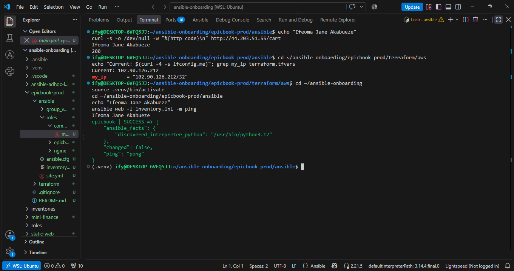

---

#### Screenshot 2 — Output of `ansible-playbook -i inventory.ini site.yml --syntax-check`

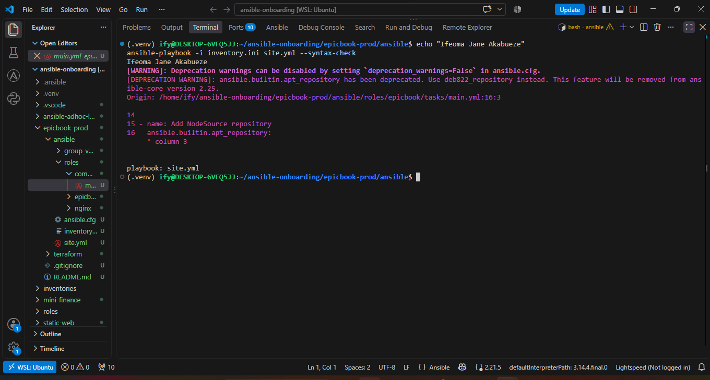

---

#### Screenshot 3 — Output of `pwd` and `find . -maxdepth 4 -type d | sort`

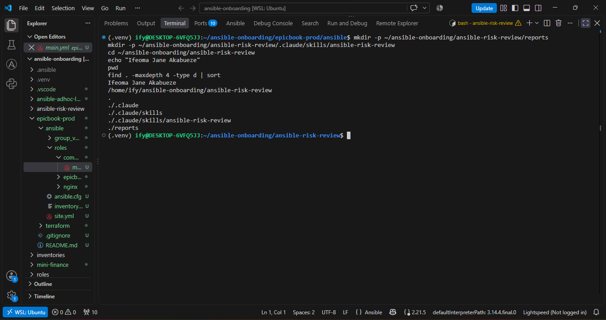

---

### Notes

Answer the following in your own words:

**1. What proves that Ansible can reach your EpicBook VM?**

Running `ansible web -i inventory.ini -m ping` returned `epicbook | SUCCESS` with `"ping": "pong"`. The Ansible `ping` module is not an ICMP ping. It connects to the host over SSH, copies a small Python module to the VM, runs it with the VM's Python interpreter (`/usr/bin/python3.12`), and returns the result. A `pong` therefore proves the full chain works:

- The VM is reachable over the network on port 22, and the security group still allows my current public IP.
- SSH key-based authentication succeeded as the `ubuntu` user with my private key.
- Python is available on the VM, so Ansible modules can execute there.

`"changed": false` also confirms the test was read-only and didn't modify anything on the server.


---

**2. Why should you confirm playbook syntax before building a risk-review script?**

The risk-review script depends on `ansible-playbook --check --diff` running cleanly. If the playbook has a syntax error, such as bad YAML indentation, a missing role, or an invalid module argument, the dry run fails before evaluating any tasks. The script would then report a failure instead of real risk evidence, making it impossible to tell a broken playbook apart from a risky change.

Confirming syntax first gives a trusted baseline: if the risk review later reports problems, they reflect what the playbook would actually change, not a file that never parsed. It also surfaces warnings early. In my case, the syntax check flagged that `ansible.builtin.apt_repository` is deprecated in favour of `deb822_repository`. It still works for now, but it's the kind of issue worth knowing about before automating reviews on top of the playbook.

---

# Task 2 — Create Project Context and Safety Rules in CLAUDE.md

## Goal

Create a `CLAUDE.md` file that tells Claude Code how this project must behave.

### Evidence

#### Screenshot 4 — `CLAUDE.md` open in VS Code or terminal showing the safety rules

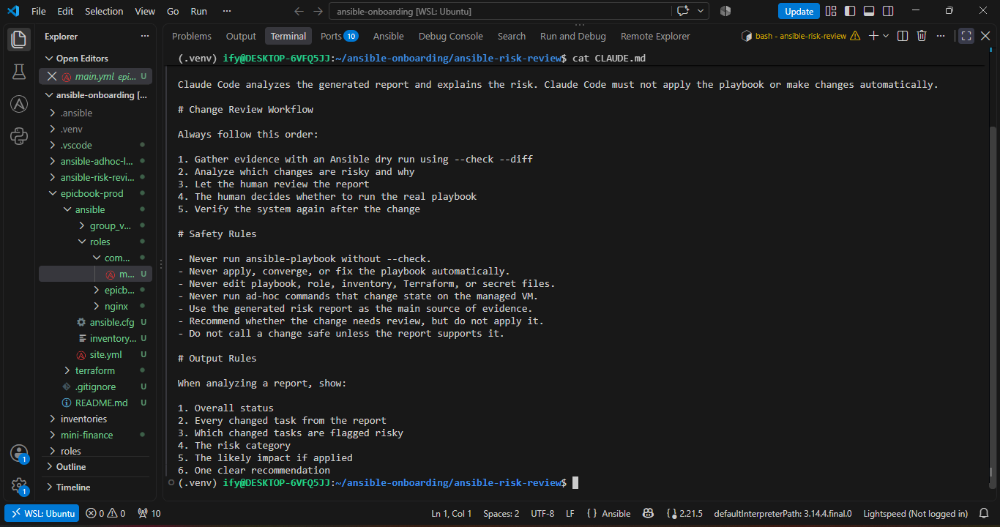

---

### Notes

Answer the following in your own words:

**1. Why should Claude Code have project-specific safety rules?**

Claude Code can run shell commands and edit files, so in a DevOps project it has the ability to change real infrastructure. On its own, it doesn't know that this project is meant to be **read-only** or which files and actions are off-limits. `CLAUDE.md` gives it that context every time it starts in this workspace.

The rules turn the general assistant into one with a clearly defined role: gather and explain evidence, never change anything. They also fit this specific environment. This project touches a live EpicBook VM, a production-style database, Ansible Vault secrets, and Terraform files, where a mistaken command could cause downtime, data loss, or exposed secrets. Writing the boundaries down makes the AI's behaviour predictable, consistent across sessions, and auditable by anyone reviewing the project.

---

**2. Why should the human run the real Ansible playbook manually?**

Applying the playbook changes a live server: it can restart services, overwrite configuration, or modify the database. The person who runs it takes responsibility for the result, so that decision should stay with a human who understands the context: whether now is a good time, whether users will be affected, and whether the risk is acceptable.

An AI can misread a report, miss business context, or be misled by unexpected output. Keeping the real run manual adds a deliberate checkpoint: review the dry-run evidence, decide, then act. It also preserves accountability and an audit trail, since a named person chose to apply a reviewed change. This follows the Agentic Loop in this assignment: **Gather → Analyze → Human Act → Verify**, where the AI helps with gathering and analysis, but acting belongs to the human.

---

**3. Which rule prevents Claude Code from applying changes automatically?**

The main rule is:

> **Never apply, converge, or fix the playbook automatically.**

It's reinforced by **"Never run ansible-playbook without --check."**, which limits Claude Code to dry runs, so the playbook can never execute for real. Together with the related rules, *never edit playbook, role, inventory, Terraform, or secret files*, *never run ad-hoc commands that change state on the managed VM*, and *recommend whether the change needs review, but do not apply it*, they confine Claude Code to an advisory role: it analyzes and recommends, and the human decides and acts.

---

# Task 3 — Ask Claude Code to Plan the Risk Review

## Goal

Use Claude Code to produce a read-only plan before writing the Bash script.

### Evidence

#### Screenshot 5 — Claude Code showing the four-category risk-classification plan

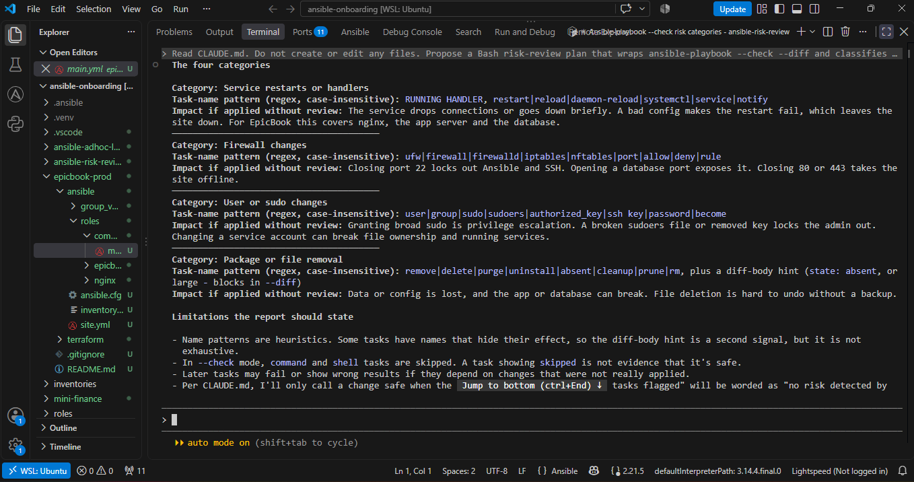

---

### Notes

Answer the following in your own words:

**1. Which part of this task represents the Gather phase?**

In this task, the Gather phase is Claude Code reading `CLAUDE.md` before planning. The file gives it the project context, the required workflow, the safety rules, and the output format, so it plans from the project's actual rules rather than general assumptions.

The plan itself also designs the Gather step for the real workflow: the Bash script will run `ansible-playbook --check --diff` and save the raw output to `reports/ansible-check-raw.txt`. That dry run is the evidence-collection step. It shows what the playbook *would* change on the EpicBook VM without changing anything. No dry run was executed in this task, because Task 3 is only about planning.


---

**2. Which part represents the Analyze phase?**

The Analyze phase is Claude Code proposing how to classify changed tasks into four risk categories. For each category, it described the task-name pattern that would identify it and the real-world impact if the change were applied without review:

- **Service restarts or handlers:** patterns such as `restart`, `reload`, `handler`, `service`. Impact: brief downtime, dropped connections, or a service failing to come back up if the new configuration is broken.
- **Firewall changes:** patterns such as `firewall`, `ufw`, `iptables`, `nftables`, `security group`. Impact: locking out SSH access to the server or accidentally exposing ports to the internet.
- **User or sudo changes:** patterns such as `user`, `group`, `sudo`, `sudoer`, `passwd`, `password`. Impact: losing administrative access, or granting privileges to the wrong account.
- **Package or file removal:** patterns such as `remove`, `absent`, `delete`, `uninstall`, `purge`. Impact: breaking the application by removing something it depends on, or deleting data that can't be recovered.

This is analysis, not action. Claude Code explained risk and proposed logic, but made no decisions about applying changes.


---

**3. How did you verify Claude Code did not create or edit files?**

- **The prompt said so explicitly:** it began with *"Read CLAUDE.md. Do not create or edit any files."*, in line with the `CLAUDE.md` rule to never edit project files.
- **No write or edit permission prompts appeared.** Claude Code asks for approval before creating or modifying files, and it never requested this during the session. It only read `CLAUDE.md` and returned the plan as text.
- **I checked the workspace after exiting.** Running `ls -la` in `~/ansible-onboarding/ansible-risk-review` showed only `CLAUDE.md`, `.claude/`, and `reports/`, the same contents as before the session, with no new script or report files. `CLAUDE.md`'s modification time was also unchanged.

---

# Task 4 — Build the Ansible Risk Review Script

## Goal

Create a Bash script that runs an Ansible dry run and classifies risky changes.

### Evidence

#### Screenshot 6 — Top section of `ansible-check-review.sh` showing `full_name`, `playbook_path`, `inventory_path`, and the `checks` array

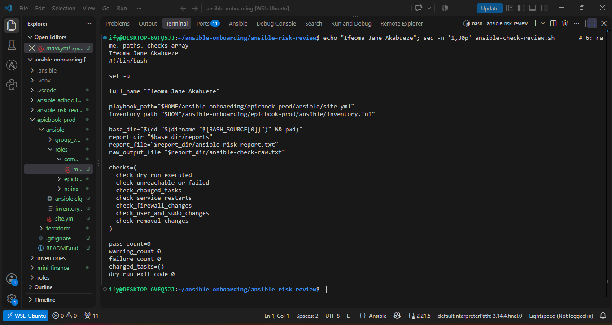

---

#### Screenshot 7 — Middle section showing `extract_changed_tasks` and `check_tasks_matching_pattern`

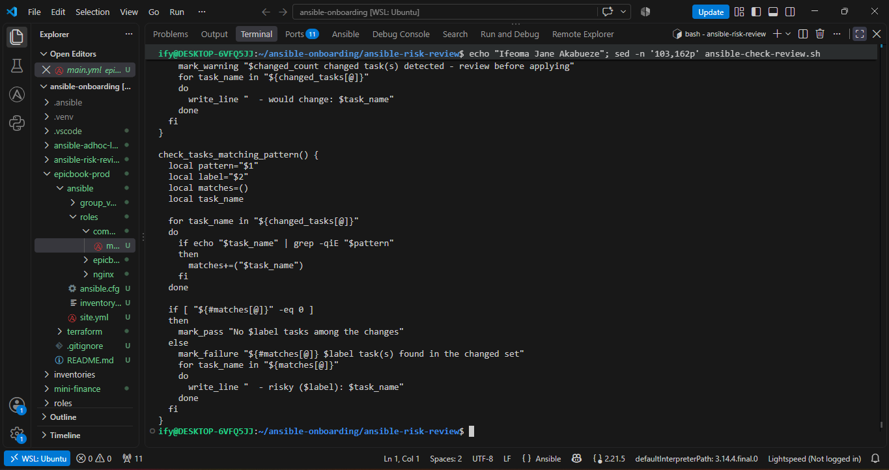

---

#### Screenshot 8 — Bottom section showing the loop, summary, and exit behavior

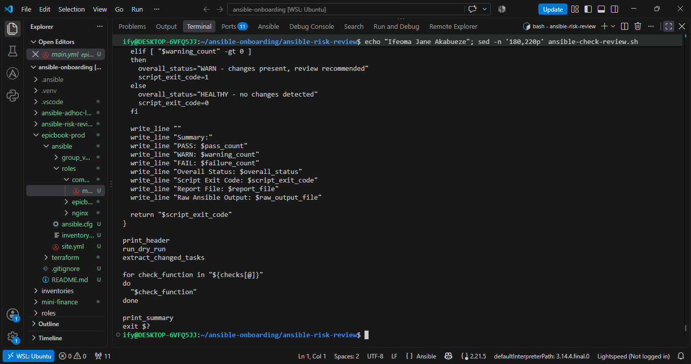

---

#### Screenshot 9 — Output of `bash -n ansible-check-review.sh` and `ls -l ansible-check-review.sh`

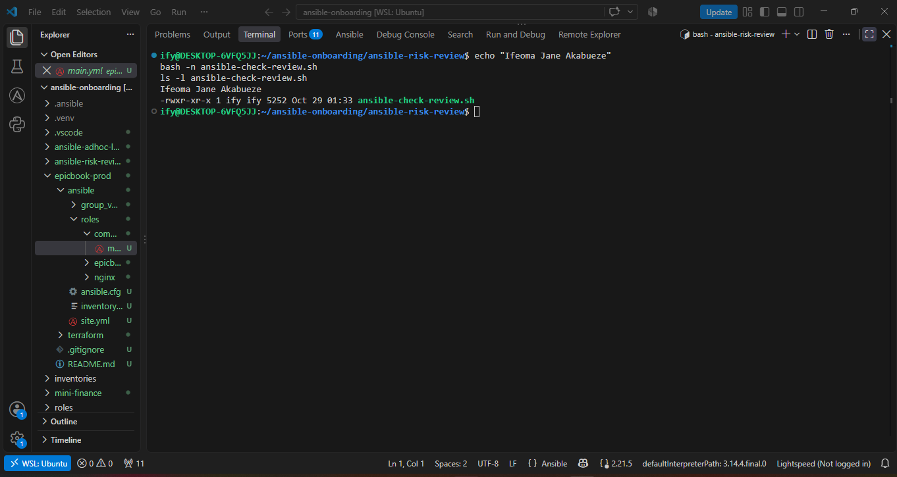

---

### Notes

Answer the following in your own words:

**1. What is stored in the `changed_tasks` array?**

The `changed_tasks` array holds the **names of every task the dry run reported as `changed`**, meaning tasks that would modify the EpicBook VM if the playbook were applied for real. Each entry is a clean task name with the role prefix, for example `nginx : Create EpicBook site configuration from template`. The `TASK [ ... ] *****` wrapper is stripped out.

The array starts empty and is filled once, by `extract_changed_tasks`, after the dry run finishes. The later checks reuse it:

- `check_changed_tasks` counts the entries and lists each one as `would change: ...`.
- The four risk checks (service restarts, firewall, user/sudo, removal) loop through it and match each name against their keyword patterns.

Storing the names in one array means the raw Ansible output is parsed only once, and every check works from the same list of changes.


---

**2. Which function finds changed tasks from the Ansible output?**

The **`extract_changed_tasks`** function. It reads the raw dry-run output saved in `reports/ansible-check-raw.txt` and works in two steps:

1. **`awk` finds the changed tasks.** Every time it sees a line starting with `TASK [`, it remembers that line as the current task. When it then sees a line starting with `changed: [`, it prints the remembered task header. The `printed` flag makes sure each task is printed only once, even if it reports `changed` for several hosts or loop items.
2. **`sed` cleans each name.** Each header, such as `TASK [common : Update apt package cache] ****`, is reduced to just `common : Update apt package cache` and added to the `changed_tasks` array.

Blank lines are skipped, so the array contains only real task names.

---

**3. Why does the script use `--check --diff`?**

The two flags together give a safe, detailed preview of what the playbook would do, similar to `terraform plan`:

- **`--check`** runs the playbook in **dry-run mode**. Ansible connects to the VM and evaluates every task against the current state, then reports which tasks *would* be `ok` or `changed`, without actually making any changes. This is what keeps the review read-only and safe to run against a live server.
- **`--diff`** shows **exactly what would change** for tasks that support it, such as the line-by-line differences in a templated file like the Nginx site config or `config.json`. Without it, the script would only know *that* a task would change, not *what* would change.

The script needs `--check` for safety and `--diff` for evidence: the report flags risky task names, and the diff in the raw output lets a human see the actual change before deciding whether to apply it. Running Ansible only with these flags also follows the `CLAUDE.md` rule *"Never run ansible-playbook without --check."*


---

**4. Why does the script use different exit codes for healthy, warning, and failed results?**

Exit codes let **other programs and automation** understand the result without reading the report text:

| Exit code | Status | Meaning |
|---|---|---|
| `0` | HEALTHY | No changes detected. Safe, and nothing to apply. |
| `1` | WARN | Changes detected, but none match a risky category. Review recommended. |
| `2` | FAIL | Risky changes present, or the dry run failed or hosts were unreachable. Do not apply without review. |

This matters because:

- **Automation can act on the result.** A CI/CD pipeline could continue on `0`, pause for human approval on `1`, and block the deployment on `2`.
- **It follows the standard Unix convention**: `0` means success and any non-zero value means something needs attention. Tools like `if`, `&&`, `||`, and pipeline stages already understand this.
- **Severity stays separate from noise.** Using `1` and `2` instead of a single "not OK" code distinguishes routine changes from changes that could cause an outage, a lockout, or data loss.
- **Claude Code and humans can check it quickly.** After a run, `echo $?` immediately shows the overall outcome.

---

# Task 5 — Run the Baseline Dry-Run Review

## Goal

Run the script against your current EpicBook playbook and confirm the baseline risk status.

### Evidence

#### Screenshot 10 — Output of `./ansible-check-review.sh`

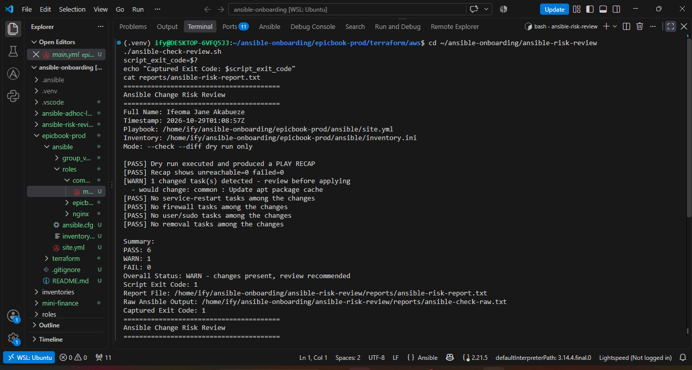

---

#### Screenshot 11 — Output of `echo "Captured Exit Code: $script_exit_code"` and `cat reports/ansible-risk-report.txt`

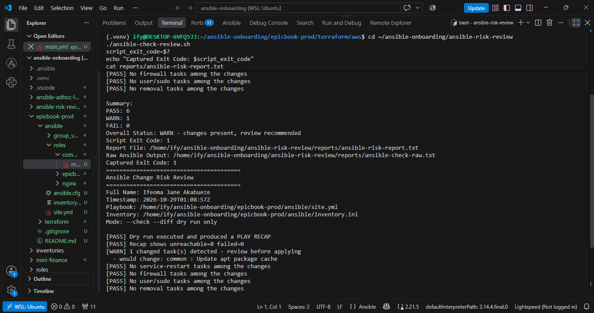

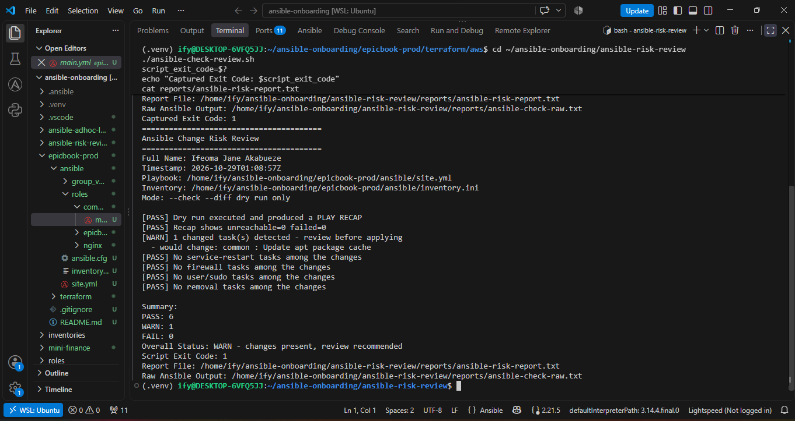

---

### Notes

Answer the following in your own words:

**1. What was the overall status of your baseline run?**

The overall status was **WARN - changes present, review recommended**, with a script exit code of `1`. The summary showed `PASS: 6`, `WARN: 1`, `FAIL: 0`.

The dry run executed successfully against the EpicBook VM and produced a `PLAY RECAP` with `unreachable=0` and `failed=0`, so Ansible evaluated every task in the `common`, `nginx`, and `epicbook` roles. The warning came from one detected change, not from an error or a risky task.

My first attempt returned **FAIL** with exit code `2`, because the recap showed `unreachable=1`. The raw output showed `ssh: connect to host 44.203.51.55 port 22: Connection timed out`: my ISP had rotated my public IP (to `102.90.96.184`), and the SSH security group rule only allowed my previous `/32` address. I updated `my_ip` in `terraform.tfvars`, ran `terraform apply` (1 resource changed in place), and reran the review. The failed attempt showed the script working as intended: it couldn't gather evidence, so it refused to report the server as safe.


---

**2. Did any tasks report `changed`?**

Yes, one task:
This task refreshes the VM's apt package lists. It uses `cache_valid_time: 3600`, so it only runs when the cache is more than one hour old. The last real playbook run was many hours earlier, so the dry run correctly reported that the cache would be refreshed.

Every other task reported `ok` or was skipped. Nginx, the site configuration, Node.js, PM2, the application code, the database configuration, and the schema already matched the desired state. This confirms that the playbook is idempotent: rerunning it would not redeploy or reconfigure anything.

---

**3. Were any changed tasks flagged as risky?**

No. All four risk checks passed:

- `[PASS] No service-restart tasks among the changes`
- `[PASS] No firewall tasks among the changes`
- `[PASS] No user/sudo tasks among the changes`
- `[PASS] No removal tasks among the changes`

The single changed task, `common : Update apt package cache`, does not match any risk pattern, and its real-world impact is low. Refreshing package indexes doesn't install, upgrade, or remove any packages, restart services, or touch the application, so it causes no downtime. The baseline therefore shows a normal, low-risk state: one routine maintenance change and no risky changes.


---

**4. What does the script exit code mean?**

What does the script exit code mean?**

The captured exit code was **`1`**, which means **WARN**: the dry run worked and found changes, but none of them fall into a risky category. A human should still review it before applying.

The script uses three exit codes:

| Exit code | Status | Meaning |
|---|---|---|
| `0` | HEALTHY | No changes detected. The playbook is a no-op against the current server. |
| `1` | WARN | Changes detected, but none are risky. Review recommended. |
| `2` | FAIL | Risky changes found, or the dry run failed or the host was unreachable. Do not apply without review. |

Exit codes let other tools act on the result without reading the report. A CI/CD pipeline could continue on `0`, pause for approval on `1`, and block on `2`. My two runs showed the difference clearly: the unreachable run returned `2`, and the successful baseline returned `1`.

---

# Task 6 — Create and Run the Claude Code Skill

## Goal

Turn the Bash script into a reusable Claude Code skill called `/ansible-risk-review`.

### Evidence

#### Screenshot 12 — `SKILL.md` showing the frontmatter, allowed tools, and safety rules

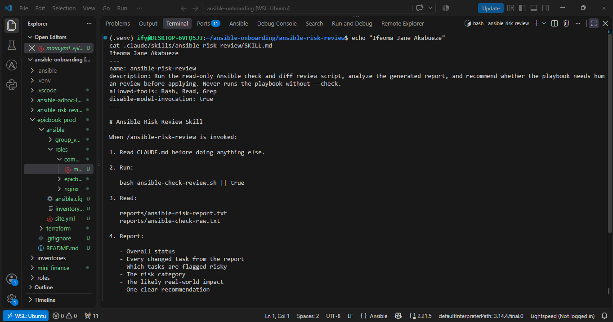

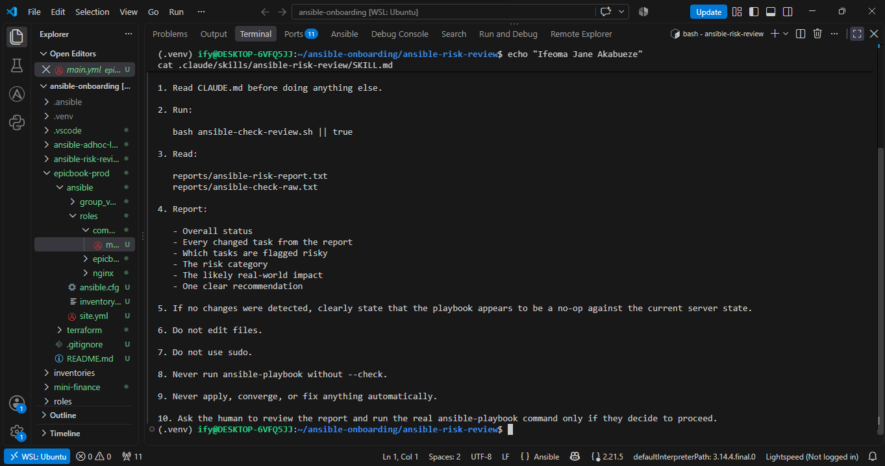

---

#### Screenshot 13 — Claude Code output after running `/ansible-risk-review`

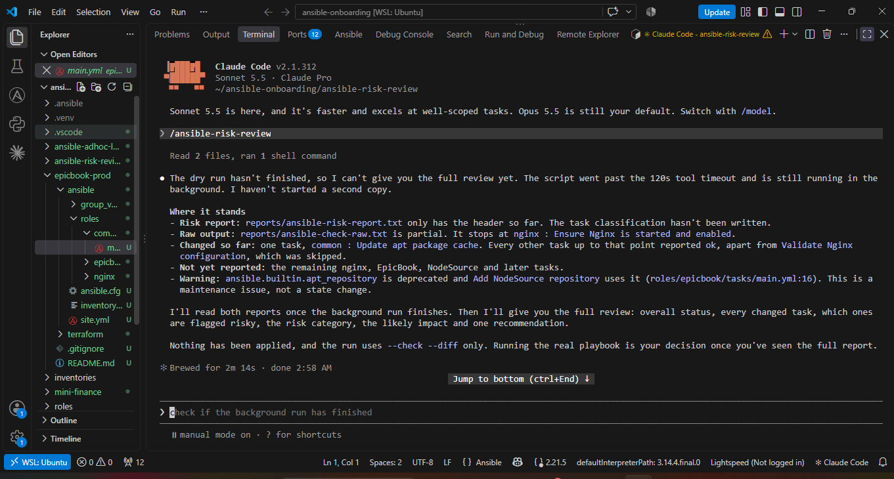

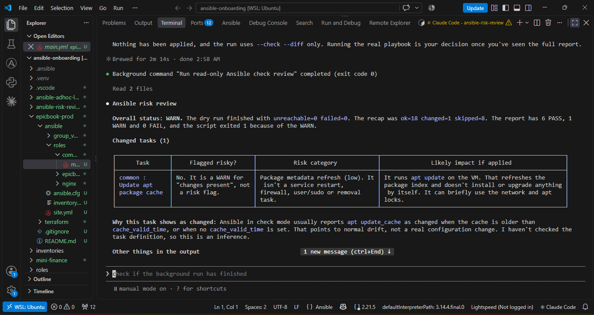

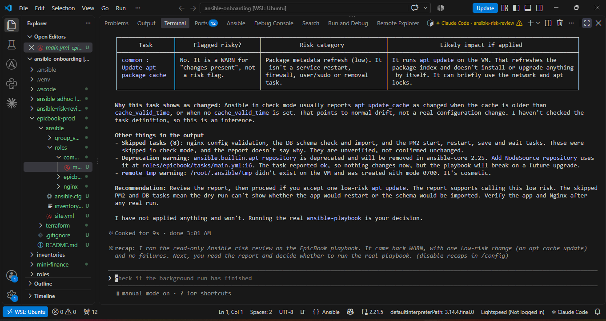

---

### Notes

Answer the following in your own words:

**1. Why does this skill allow `Bash`, `Read`, and `Grep`?**

These are the only three tools the skill needs to gather evidence and analyze it. Each one has a specific job:

- **`Bash`** runs the risk-review script (`bash ansible-check-review.sh || true`), which performs the `--check --diff` dry run and writes the reports. The `|| true` means a non-zero exit code (`1` for WARN or `2` for FAIL) doesn't stop the skill, so Claude Code still goes on to read and explain the report.
- **`Read`** opens `CLAUDE.md` for the safety rules, then the two report files: `reports/ansible-risk-report.txt` (the classified summary) and `reports/ansible-check-raw.txt` (the full Ansible output).
- **`Grep`** searches the raw output for specific evidence, such as `changed:` lines, the `PLAY RECAP`, warnings, or diffs, without reading the whole file.

All three are read-oriented. They let Claude Code collect and inspect evidence, but not change the project. This follows the principle of least privilege: the skill gets only the access its job requires.


---

**2. Why does this skill not allow file editing?**

The skill's purpose is to **review** changes, not make them. If Claude Code could edit files, it could change the playbook, roles, inventory, Terraform files, or secrets, possibly while "fixing" a risk it found. Each of these would change what is deployed to the live EpicBook server without a human deciding to. It could also alter the reports, which would undermine trust in the evidence.

Leaving `Write` and `Edit` out of `allowed-tools` makes this a technical limit rather than just an instruction. Together with the written rules (*"Do not edit files"*, *"Never apply, converge, or fix anything automatically"*) and `CLAUDE.md`, this gives defence in depth: the rules say what not to do, and the tool permissions back them up. Any change to the playbook stays a deliberate human decision.


---

**3. What part is handled by Bash?**

Bash handles the **Gather** step and the **mechanical classification**, all deterministically:

- Runs `ansible-playbook --check --diff` against the EpicBook inventory and saves the raw output.
- Checks that the dry run completed (a `PLAY RECAP` exists) and parses `unreachable` and `failed` counts with `grep` and `sed`.
- Extracts the names of every changed task with `awk` and `sed`, and stores them in the `changed_tasks` array.
- Matches those names against keyword patterns for the four risk categories: service restarts, firewall, user/sudo, and removal.
- Writes a structured report with PASS/WARN/FAIL lines and an overall status, and returns an exit code: `0` HEALTHY, `1` WARN, `2` FAIL.

The script produces the same result every time for the same input, so the evidence is repeatable and doesn't depend on AI judgment.


---

**4. What part is handled by Claude Code?**

Claude Code handles the **Analyze** step, interpreting the evidence the script collected. It:

- Reads `CLAUDE.md` first, so its analysis follows the project's safety and output rules.
- Runs the script, then reads the summary report and the raw Ansible output.
- Explains the results in plain language: the overall status, every changed task, whether each one is flagged risky, its risk category, and its likely real-world impact.
- Adds context the script can't. In my run, it explained that the only changed task, `common : Update apt package cache`, was a low-risk package index refresh. It also pointed out that 8 tasks were skipped in check mode, so their outcome was *"unverified, not confirmed unchanged"*, flagged the deprecated `apt_repository` module, and noted a cosmetic `remote_tmp` warning.
- Gives one clear recommendation and hands the decision to the human, without running the real playbook.

Claude Code also showed good judgment when things went wrong. On an earlier attempt, the script ran from the Windows side, where Ansible isn't installed. Claude Code saw that the dry run never executed and refused to treat "no changed tasks" as safe. When the dry run exceeded its 120-second tool timeout, it let the script finish in the background, didn't start a second copy, and waited for the complete report before giving a final review.


---

**5. Why is this better than asking Claude Code if the playbook is safe without giving it evidence?**

Without evidence, Claude Code could only guess. It would be reasoning about what the playbook *might* do from its code, with no knowledge of the server's **current state**. Whether a task changes anything depends on what's already on the VM: a task that installs Nginx is harmless if Nginx is already installed, but significant if it isn't. A guess could sound confident and still be wrong, which is dangerous on a live server.

With the dry-run evidence:

- **The answer is grounded in reality.** Ansible compared each task against the actual VM state and reported exactly what would change. In my baseline, that was one task out of the whole playbook.
- **Claims can be checked.** Every statement in Claude Code's analysis can be traced back to lines in `ansible-check-raw.txt` or the risk report.
- **It can't overclaim.** The `CLAUDE.md` rule *"Do not call a change safe unless the report supports it"* only works when there is a report to check against. This held up in practice: when the dry run failed, Claude Code said it couldn't call anything safe, and when tasks were skipped, it called them unverified rather than assuming they were fine.
- **It's repeatable and auditable.** The same script produces the same evidence each time, and the saved reports leave a record of what was reviewed before anyone decided to apply.

This follows the Agentic Loop: **Gather** (Bash dry run) → **Analyze** (Claude Code) → **Human Act** → **Verify**. The AI's analysis is only as trustworthy as the evidence behind it.

---

# Task 7 — Introduce a Controlled Risky Change and Let the Skill Catch It

## Goal

Add a small controlled risky change in your lab playbook and confirm the script and Claude Code catch it before applying.

### Evidence

#### Screenshot 14 — The added risky task inside the role file

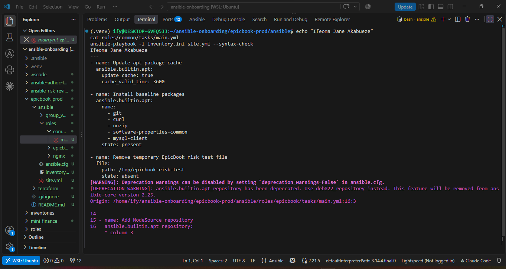

---

#### Screenshot 15 — Output of `./ansible-check-review.sh`

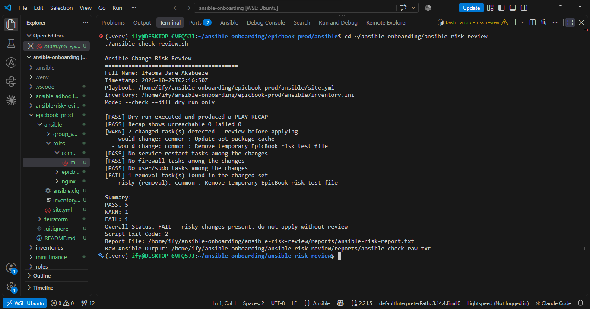

---

#### Screenshot 16 — Claude Code `/ansible-risk-review` output showing the risky finding

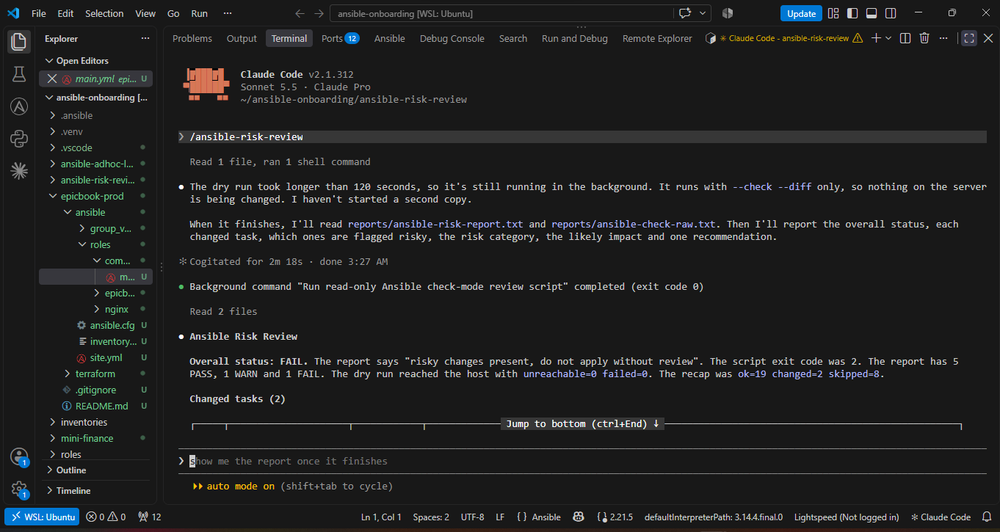

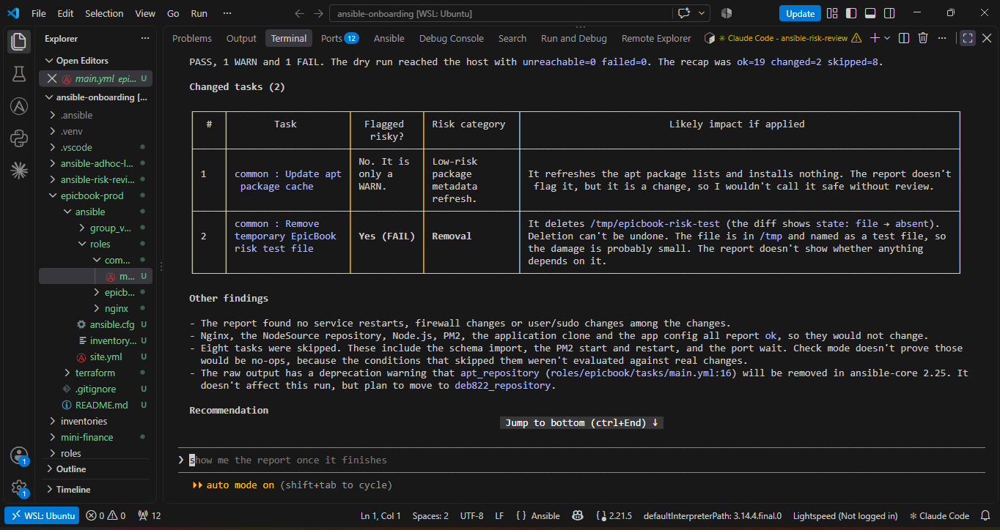

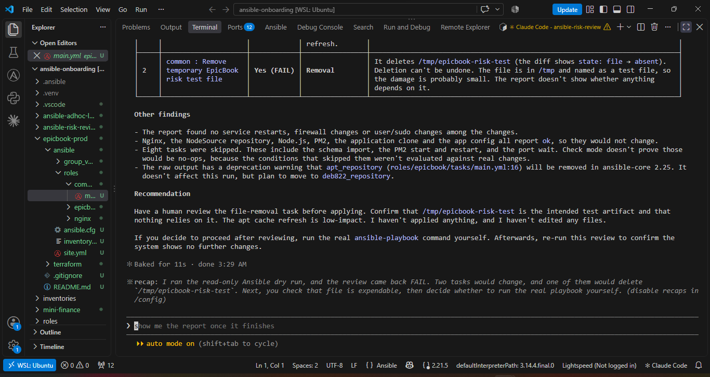

---

#### Screenshot 17 — Output of `cat reports/risky-change-report.txt`

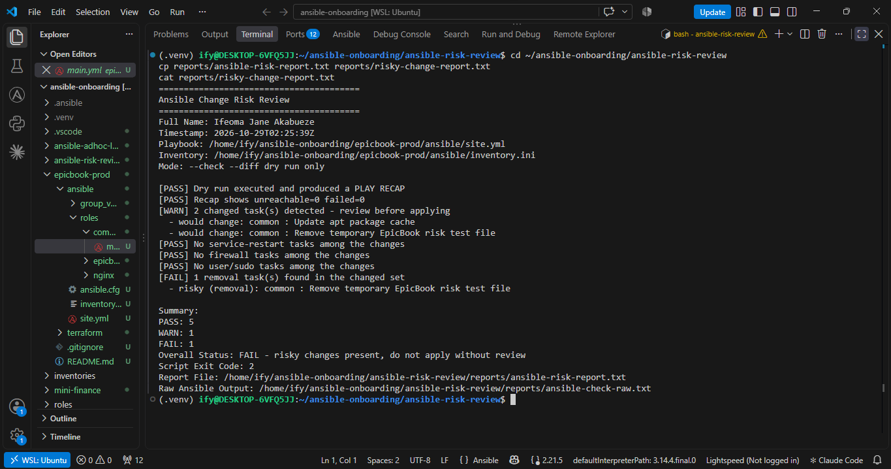

---

### Notes

Answer the following in your own words:

**1. Which risk category did the added task fall into?**


The task `common : Remove temporary EpicBook risk test file` fell into the **package or file removal** category, shown in the report as `removal`.

The script flagged it because the task name contains the word **"Remove"**, which matches the removal pattern `remove|absent|delete|uninstall|purge`. The report showed:

[FAIL] 1 removal task(s) found in the changed set

risky (removal): common : Remove temporary EpicBook risk test file.
It didn't match any of the other three categories (service restarts, firewall, user/sudo). Claude Code's analysis agreed and also classified it as **Removal**, marked **"Yes (FAIL)"**.

Removal is a high-attention category because deletions usually can't be undone. Removing the wrong file or package could break the application or lose data, so it needs human review even when, as here, the target is a harmless test file in `/tmp`.


---

**2. What evidence proves the task would change something?**

Several pieces of evidence from the dry run show the task would change the VM:

- **Ansible reported it as `changed`.** In the raw output (`reports/ansible-check-raw.txt`), the task returned `changed: [epicbook]`. In check mode, this means Ansible compared the task with the VM's current state and found a difference it *would* act on.
- **The diff showed exactly what would change.** Because the script runs with `--diff`, the output showed the file's state going from `file` to `absent`. Claude Code quoted this directly: *"the diff shows state: file → absent"*.
- **The script captured it as a changed task.** The `extract_changed_tasks` function picked it up, so the report listed **2 changed tasks** instead of the baseline's 1, and the overall status moved from **WARN (exit code 1)** to **FAIL (exit code 2)**.
- **The file really exists on the VM.** Before the dry run, I created it with `ansible web -i inventory.ini -m file -a "path=/tmp/epicbook-risk-test state=touch" --become`, which returned `CHANGED` with `"state": "file"`. Since the file is present, `state: absent` would really delete it. If the file didn't exist, the task would report `ok` instead.


---

**3. Did Claude Code apply the playbook?**

No. Claude Code only ran the read-only review script, which uses `ansible-playbook --check --diff`, and then read the generated reports. It did not run the real playbook and did not edit any files. It stated this explicitly: "I haven't applied anything, and I haven't edited any files."* It ended by handing the decision back to me: *"If you decide to proceed after reviewing, run the real ansible-playbook command yourself."

The setup prevented it from applying changes in several ways:

- **`CLAUDE.md`** rules: *"Never run ansible-playbook without --check"* and *"Never apply, converge, or fix the playbook automatically."*
- **`SKILL.md`** rules: *"Never apply, converge, or fix anything automatically"* and *"Do not edit files."*
- **Tool permissions:** the skill only allows `Bash`, `Read`, and `Grep`, with no `Write` or `Edit`.

The test file `/tmp/epicbook-risk-test` still exists on the VM, which confirms nothing was applied.

---

**4. Why is it important that Claude Code only analyzed the risk?**

Analyzing and applying are different responsibilities, and keeping them separate makes the workflow safe:

- **Risky changes stay under human control.** This change would permanently delete a file. Here it's a harmless test file, but in production the same pattern could delete configuration, data, or a dependency the app needs. A human should confirm that before it happens.
- **A person has context the AI doesn't.** Claude Code itself said *"The report doesn't show whether anything depends on it."* Only a human can confirm whether the file is expendable, whether it's a good time to change the server, and whether the risk is acceptable.
- **AI can be wrong.** If Claude Code misread the report, an analysis-only role means the mistake ends up as a wrong recommendation that a human can catch, not a damaging change on a live server.
- **It preserves accountability.** A named person decides and runs the real playbook, which leaves a clear record of who approved what.
- **It builds trust.** When Claude Code doesn't overclaim, as in calling skipped tasks *"not proven no-ops"*, people can rely on its analysis. That makes AI more useful in operations, not less.

In short, the AI adds speed and insight, while the human keeps the authority to act.


---

**5. Which phase of the Agentic Loop is represented by the Bash report?**


The Bash report represents the **Gather** phase.

The script collects evidence by running `ansible-playbook --check --diff` against the real VM, saving the raw output, and turning it into a structured report: the PLAY RECAP checks, the list of changed tasks, the four risk-category matches, and an overall status with an exit code. This step is deterministic: the same server state and playbook always produce the same report, with no AI judgment involved.

The full loop in this assignment:

| Phase | Who | What happened |
|---|---|---|
| **Gather** | Bash script | Ran the dry run and produced `ansible-risk-report.txt` and `ansible-check-raw.txt` |
| **Analyze** | Claude Code | Read the reports, explained the removal risk and its impact, and recommended human review |
| **Human Act** | Me | Review the report and decide whether to run the real playbook |
| **Verify** | Me, with the script | Re-run the review after applying, to confirm the system shows no further changes |

The Bash report is the foundation for the rest of the loop. Claude Code's analysis is only trustworthy because it is based on this evidence.

---

# Task 8 — Apply as the Human, Verify, and Write the Change Summary

## Goal

Review the risky-change report, apply the playbook manually as the human operator, and verify the result.

### Evidence

#### Screenshot 18 — Output of the real playbook run showing the final recap with `failed=0`

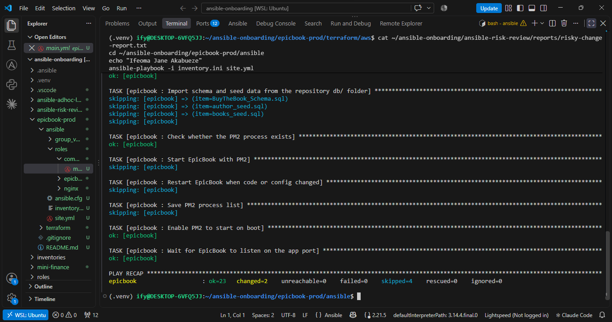

---

#### Screenshot 19 — Output of `ansible web -i inventory.ini -m ping`

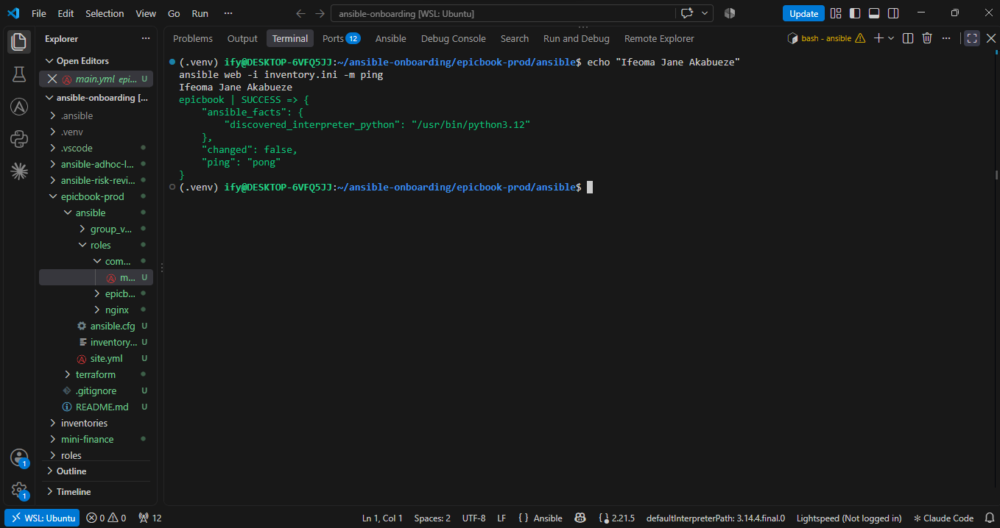

---

#### Screenshot 20 — Second `/ansible-risk-review` output after applying the change

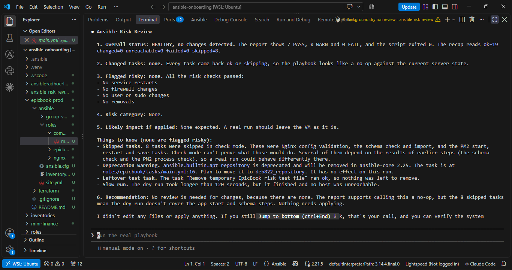

---

#### Screenshot 21 — Output of `ls -lah reports`

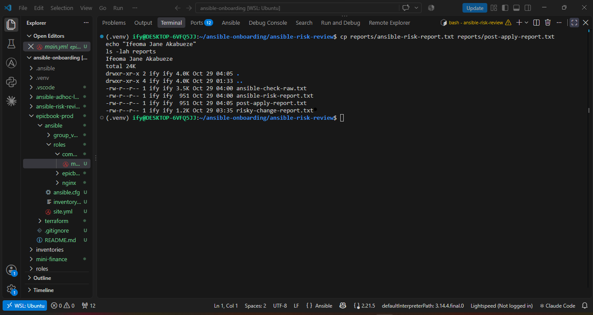

---

#### Screenshot 22 — `change-summary.md` showing all required sections and your Full Name

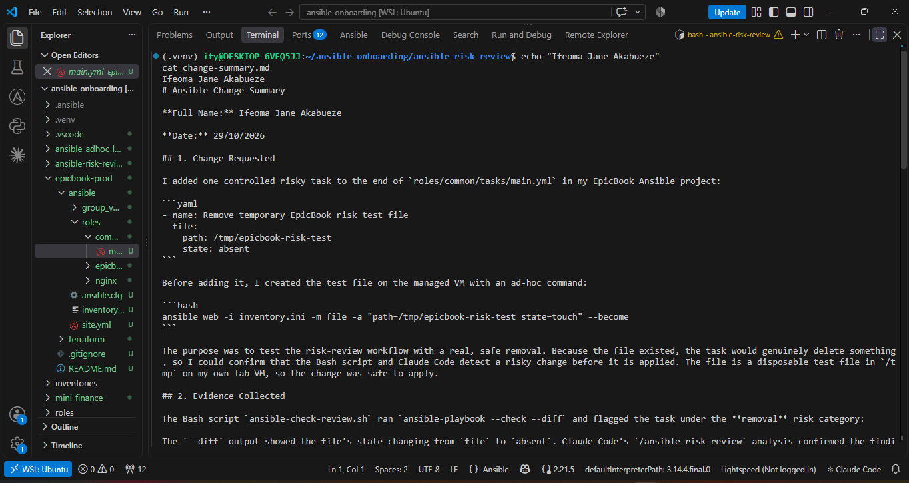

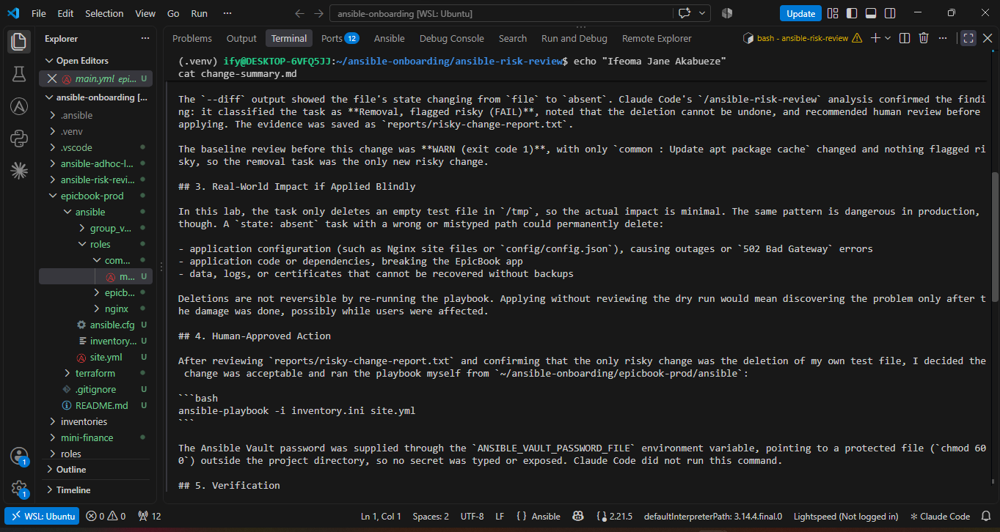

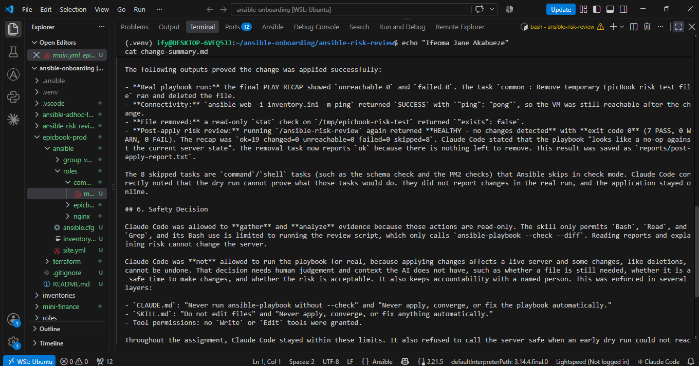

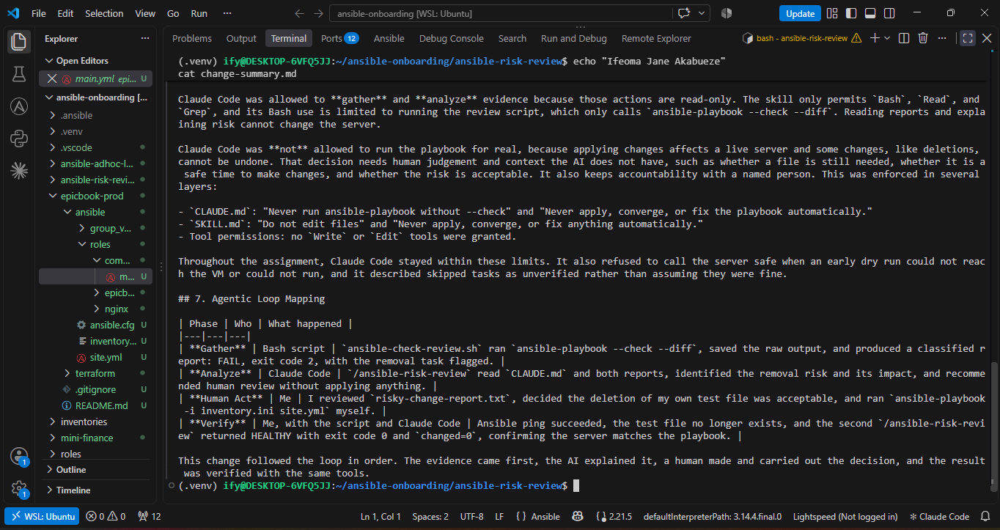

---

### Notes

Answer the following in your own words:

**1. What command did you run to apply the change for real?**

From `~/ansible-onboarding/epicbook-prod/ansible`, I ran:

```bash
ansible-playbook -i inventory.ini site.yml
```

This is the real run, with no `--check` and no `--diff`, so Ansible actually applied the changes to the EpicBook VM. That included the task `common : Remove temporary EpicBook risk test file`, which deleted `/tmp/epicbook-risk-test`. The vaulted database password was decrypted using the `ANSIBLE_VAULT_PASSWORD_FILE` environment variable, which points to a protected file (`chmod 600`) outside the project, so no secret was typed or shown on screen. The final PLAY RECAP showed `unreachable=0` and `failed=0`.

---

**2. Who made the final decision to apply the playbook?**

*I did, as the human operator.** Claude Code analyzed the dry-run evidence and recommended human review, but it didn't decide or act. Before applying, I reviewed `reports/risky-change-report.txt`, confirmed that the only risky change was the deletion of a test file I had created myself in `/tmp` on my own lab VM, and decided it was safe to proceed. I then typed and ran the real `ansible-playbook` command myself.

Claude Code made clear the decision was mine, ending its review with: *"If you decide to proceed after reviewing, run the real ansible-playbook command yourself."*


---

**3. What evidence proves the VM is still reachable?**

After applying the change, I ran:

```bash
ansible web -i inventory.ini -m ping
```

It returned `epicbook | SUCCESS` with `"ping": "pong"`. This proves Ansible could still connect over SSH with my key, run Python on the VM, and return a result, so the change didn't break access to the server.

The post-apply risk review also confirmed this. Its dry run completed with `unreachable=0 failed=0` (`ok=19 changed=0`), which means Ansible reached the VM and evaluated every task again after the change.


---

**4. Why should the risk review be run again after applying?**

4. Why should the risk review be run again after applying?**

Running the review again is the **Verify** step of the Agentic Loop. It confirms that the server now matches the playbook and that the change did what was intended, with no surprises.

In my case, the post-apply review returned **HEALTHY - no changes detected** with **exit code 0**. Before applying, the result had been **FAIL** with exit code 2. The removal task now reported `ok` because the file was already gone, and Claude Code described the playbook as *"a no-op against the current server state."*

Running it again matters because it:

- **Proves the change was applied correctly.** If the review still showed the removal as changed, the real run would have failed to make the change.
- **Confirms idempotency.** Running the same playbook again would change nothing, so the server is in a stable, known state.
- **Catches side effects or drift.** Any unexpected new changes would show up immediately.
- **Creates a clean baseline.** `reports/post-apply-report.txt` documents the healthy state, so the next change can be compared against it.

Without verification, I would only be assuming the change worked.


---

**5. What could go wrong if an AI agent applied Ansible changes automatically?**

If an AI agent could apply changes on its own, the human checkpoint would disappear, and:

- **Irreversible damage could happen before anyone noticed.** A removal task with a wrong path could delete configuration, application code, or data. A re-run can't undo a deletion.
- **The AI could misjudge the risk.** It could misread the report, trust a pattern-matching false negative, or act on incomplete evidence. In this assignment, 8 tasks were skipped in check mode, and Claude Code itself said it couldn't prove what they would do.
- **It lacks business context.** It doesn't know whether a change is needed right now, whether users are active, whether a maintenance window is approved, or whether something else depends on a file.
- **Outages could happen at the wrong time.** Service restarts, firewall changes, or user/sudo changes could take the app down or lock administrators out of the server.
- **Mistakes could spread quickly.** An agent can act faster than a human can react, and on many servers at once if the inventory is large.
- **Security and accountability suffer.** A manipulated prompt or misleading output could trick the agent into harmful actions. And if something goes wrong, there's no clear record of who approved the change.


---

# LinkedIn Post Required

## Evidence

#### LinkedIn Post URL

Paste your LinkedIn post URL here:

https://lnkd.in/p/eb2ZsXup

---

#### Screenshot — Published LinkedIn post

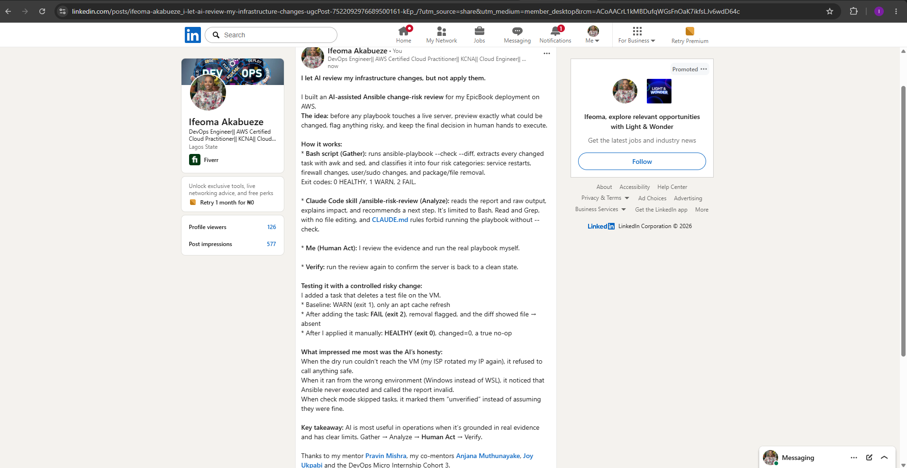

---

# Required Files

Confirm that the following files are included in your GitHub repository or assignment folder:

- [ ] `CLAUDE.md`
- [ ] `ansible-check-review.sh`
- [ ] `.claude/skills/ansible-risk-review/SKILL.md`
- [ ] `reports/risky-change-report.txt`
- [ ] `reports/post-apply-report.txt`
- [ ] `change-summary.md`

---

# Submission Instructions

- Add all required screenshots in your submission.
- Full Name must be visible in required screenshots and reports.
- All required notes must be answered clearly.
- Do not expose SSH private keys, passwords, cloud credentials, database credentials, or secret environment variables.
- Add your GitHub repository or folder URL inside this document.

---

# Completion Checklist

- [ ] Task 1: EpicBook connectivity confirmed and workspace created
- [ ] Task 2: `CLAUDE.md` created with safety rules
- [ ] Task 3: Claude Code produced a read-only risk-review plan
- [ ] Task 4: `ansible-check-review.sh` created and syntax checked
- [ ] Task 5: Baseline dry-run review completed
- [ ] Task 6: Claude Code `/ansible-risk-review` skill created and tested
- [ ] Task 7: Controlled risky change introduced and detected
- [ ] Task 8: Human applied the change and verified the result
- [ ] Risky-change report saved
- [ ] Post-apply report saved
- [ ] Change summary completed
- [ ] All screenshots added
- [ ] All notes answered
- [ ] LinkedIn post published
- [ ] LinkedIn post URL added
- [ ] No sensitive information exposed

---

## About DMI & CloudAdvisory

DevOps Micro Internship (DMI) is a project-based DevOps program run by Pravin Mishra and The CloudAdvisory, focused on real-world execution, systems thinking, and career readiness.

It helps learners build strong DevOps foundations with hands-on experience.

---

## Resources

- DMI Official Website: [https://dmi.pravinmishra.com?utm_source=github&utm_medium=readme](https://dmi.pravinmishra.com?utm_source=github&utm_medium=readme)
- University: [https://university.pravinmishra.com?utm_source=github&utm_medium=readme](https://university.pravinmishra.com?utm_source=github&utm_medium=readme)
- Discord Community: [https://discord.pravinmishra.com?utm_source=github&utm_medium=readme](https://discord.pravinmishra.com?utm_source=github&utm_medium=readme)
- Blog: [https://dmi.pravinmishra.com/blog?utm_source=github&utm_medium=readme](https://dmi.pravinmishra.com/blog?utm_source=github&utm_medium=readme)
- YouTube Playlist: [https://www.youtube.com/playlist?list=PLFeSNDtI4Cho](https://www.youtube.com/playlist?list=PLFeSNDtI4Cho)
- Pravin Mishra LinkedIn: [https://www.linkedin.com/in/pravin-mishra-aws-trainer/](https://www.linkedin.com/in/pravin-mishra-aws-trainer/)
- CloudAdvisory LinkedIn: [https://www.linkedin.com/company/thecloudadvisory/](https://www.linkedin.com/company/thecloudadvisory/)

---

*This submission is part of DevOps Micro Internship (DMI) — Agentic AI Track.*